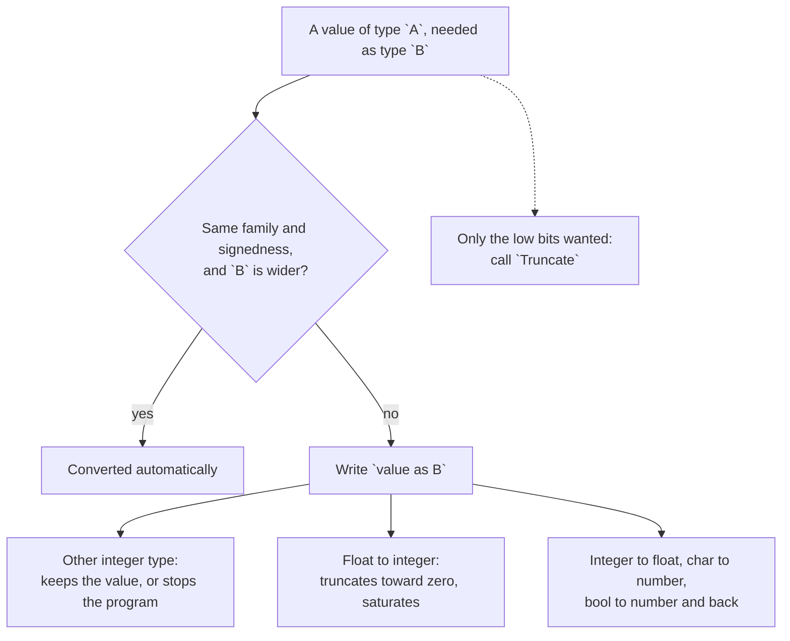

# Convert

::note
<!-- sync:needs:start -->

**You'll need**: [Integer](/docs/learn/integer), [Float](/docs/learn/float), [Boolean](/docs/learn/boolean), [Character](/docs/learn/character)
<!-- sync:needs:end -->

::

Rux converts between types on its own only when nothing can be lost. Every other conversion has to be asked for with `as` — because every other conversion can change the value. Writing `as` is how you tell the compiler, and the next reader, that the change is intended.

## Widening happens on its own

Widening within one family and one signedness — `int8` to `int32`, `float32` to `float64` — can never lose anything, so the compiler does it silently:

```rux
let small: int8 = 100;
let widened: int32 = small;
```

## Everything else needs as



### Narrowing keeps the value — or stops

An integer `as` to a narrower integer type keeps the value when it fits. 100 fits in an `int8`, so nothing changes:

```rux
let fits: int32 = 100;
let small = fits as int8;
```

When the value does not fit, `as` does not quietly invent a different number. `300 as int8` written with a variable stops the program with `Panic: integer cast out of range`; written with a constant, the compiler refuses it before the program ever runs.

### Truncate keeps the low bits on purpose

Sometimes the low bits are exactly what you want. Core's `Truncate` method asks for them by name. 300 needs nine bits; an `int8` has eight, and what survives is 300 − 256 = 44:

```rux
import Core::int32;

let big: int32 = 300;
let narrowed = big.Truncate<int8>();
```

The method comes with the source type, which is why the program imports `Core::int32` — and why its `Rux.toml` lists `Core` beside `Io`.

### Changing signedness re-reads the bits

`Truncate` also crosses between signed and unsigned. −1 has every bit set, and eight set bits read as an unsigned number are 255:

```rux
let negative: int32 = -1;
let reinterpreted = negative.Truncate<uint8>();
```

`-1 as uint8` would stop instead, because 255 is not −1.

### Floats and integers

Integers and floats are different families, so crossing between them always needs `as`. Float to integer drops the fraction — it truncates toward zero rather than rounding:

```rux
let ratio = 3.9;
let negativeRatio = -3.9;
```

`ratio as int32` is `3`, and `negativeRatio as int32` is `-3`. A float too large for the integer type does not stop the program: it **saturates** to the largest (or smallest) value the type holds, so `1e10 as int32` is `2147483647`.

A narrower float keeps fewer digits, so `float64` to `float32` needs `as` as well: `3.141592653589793` becomes `3.1415927`.

### Characters and booleans

A character is a number underneath — its code point — and `as` shows it: `'A' as uint32` is `65`. A boolean becomes `1` or `0`; in the other direction, zero is `false` and anything else is `true`.

## When a value does not fit

A float or boolean `as` always produces a value, and when the original does not fit, that value is simply a different one. An integer `as` that does not fit stops the program instead — a lost value is a bug, and Rux would rather show it than hide it. To find out first whether a value fits, compare it with the target type's limits, or use the checked conversions of [Checked convert](/docs/learn/checked-convert).

| Conversion           | Example                         | Result     |
| -------------------- | ------------------------------- | ---------- |
| Widen                | `int8` 100 → `int32`            | 100        |
| Narrow               | `int32` 100 `as int8`           | 100        |
| Narrow, too big      | `int32` 300 `as int8`           | panic      |
| Keep the low bits    | `int32` 300 `.Truncate<int8>()` | 44         |
| Signedness           | `int32` −1 `.Truncate<uint8>()` | 255        |
| Float → int          | 3.9 `as int32`                  | 3          |
| Float → int, too big | 1e10 `as int32`                 | 2147483647 |
| Int → float          | 7 `as float64`                  | 7.0        |
| Char → int           | 'A' `as uint32`                 | 65         |
| Bool ↔ int           | `true as int`, `5 as bool`      | 1, true    |

## The program

The whole lesson is one package in the [Examples repository](https://github.com/rux-lang/Examples/tree/main/Basics/Convert). Its comments explain every step.

<!-- sync:program:start -->

```rux [Src/Main.rux]
// A conversion happens on its own only when nothing can be lost: widening within one family and
// one signedness, such as `int8` to `int32` or `float32` to `float64`. Every other conversion is
// asked for with `as`, because every other conversion can change the value. Writing `as` is how
// you tell the compiler, and the next reader, that the change is intended.
import Core::int32;
import Io::PrintLine;

func Main() -> int {
    // Widening needs no `as`. Every `int8` is also an `int32`, so the compiler converts silently.
    let small: int8 = 100;
    let widened: int32 = small;
    PrintLine("widen        int8 {} becomes int32 {}", small, widened);

    // Narrowing must be asked for. An integer `as` keeps the value or stops the program with
    // `Panic: integer cast out of range`, so `100 as int8` is fine and `300 as int8` would stop.
    // To keep only the low bits that fit, ask for that with `Truncate`: 300 needs nine bits, an
    // `int8` has eight, and what survives is 300 - 256.
    let fits: int32 = 100;
    PrintLine("narrow       int32 {} becomes int8 {}", fits, fits as int8);
    let big: int32 = 300;
    let narrowed = big.Truncate<int8>();
    PrintLine("narrow       int32 {} becomes int8 {}", big, narrowed);

    // Changing signedness with `Truncate` keeps the bits and reads them differently: -1 has every
    // bit set, and eight set bits read as an unsigned number are 255. `-1 as uint8` would stop,
    // because 255 is not -1.
    let negative: int32 = -1;
    let reinterpreted = negative.Truncate<uint8>();
    PrintLine("sign         int32 {} becomes uint8 {}", negative, reinterpreted);

    // Integers and floats are different families, so crossing between them always needs `as`.
    // Float to integer drops the fraction: it truncates toward zero rather than rounding.
    let ratio = 3.9;
    let negativeRatio = -3.9;
    PrintLine("float->int   {} becomes {}", ratio, ratio as int32);
    PrintLine("float->int   {} becomes {}", negativeRatio, negativeRatio as int32);

    // A float too large for the integer type does not keep low bits the way narrowing does. It
    // saturates: it becomes the largest value the type holds, or the smallest, below the range.
    let huge = 1e10;
    PrintLine("float->int   {} becomes {}", huge, huge as int32);

    let count: int32 = 7;
    PrintLine("int->float   {} becomes {}", count, count as float64);

    // A narrower float keeps fewer digits, so float64 to float32 needs `as` as well.
    let pi = 3.141592653589793;
    PrintLine("narrow float {} becomes {}", pi, pi as float32);

    // A character is a number underneath, its code point, and `as` shows it.
    let letter = 'A';
    PrintLine("char->int    {} becomes {}", letter, letter as uint32);

    // A boolean becomes 1 or 0. In the other direction, zero is false and anything else is true.
    let yes = true;
    let five = 5;
    PrintLine("bool->int    {} becomes {}", yes, yes as int);
    PrintLine("int->bool    {} becomes {}", five, five as bool);

    // None of the conversions above reported a problem. A float or boolean `as` always produces
    // a value, and when the original does not fit, that value is simply a different one; an
    // integer `as` that does not fit stops the program instead. To find out first whether a value
    // fits, compare it with the target type's limits — comparisons are the next part, and choosing
    // what to do with the answer the one after.
    return 0;
}
```

Besides `Io`, its `Rux.toml` lists `Core` under `[Dependencies]`.
<!-- sync:program:end -->

## Run it

```sh
cd Examples/Basics/Convert
rux run
```

<!-- sync:output:start -->

```
widen        int8 100 becomes int32 100
narrow       int32 100 becomes int8 100
narrow       int32 300 becomes int8 44
sign         int32 -1 becomes uint8 255
float->int   3.9 becomes 3
float->int   -3.9 becomes -3
float->int   10000000000.0 becomes 2147483647
int->float   7 becomes 7.0
narrow float 3.141592653589793 becomes 3.1415927
char->int    A becomes 65
bool->int    true becomes 1
int->bool    5 becomes true
```

<!-- sync:output:end -->

## Common mistakes

::mistake
**Expecting rounding.**\
`2.99 as int32` is `2`, not `3`: conversion truncates toward zero. Round first if that is what you mean — the [Math](/docs/learn/math) lesson has `Round`.
::

::mistake
**Expecting `as` to wrap.**\
In some languages `300 as int8` quietly becomes `44`. In Rux a constant that does not fit is refused:

```text
error: constant cast from 'int' to 'int8' is outside the target type's range
note: the value is 300
help: keep the low bits on purpose with '.Truncate<int8>()'
```

With a variable the same cast compiles, and the program stops with `Panic: integer cast out of range`. Write `Truncate` when the low bits are what you want.
::

## Try it yourself

1. Compute `negative.Truncate<uint16>()` and `negative.Truncate<uint32>()`. Predict the results before you run.
2. Print the code points of the letters in `R`, `u`, `x` with `as uint32`.
3. Convert `-1e10` to `int32` and check that it saturates to the smallest value.
4. Change `big.Truncate<int8>()` to `big as int8`, run the program, and read the panic.

## Learn more

- [Type casts](/docs/lang/expressions/casts) and [integer to integer](/docs/lang/expressions/casts#integer-to-integer) in the Rux Reference
- [Checked convert](/docs/learn/checked-convert) — conversions that report whether the value fits
- [Wrapping arithmetic](/docs/learn/wrapping-arithmetic) — what happens when arithmetic overflows
