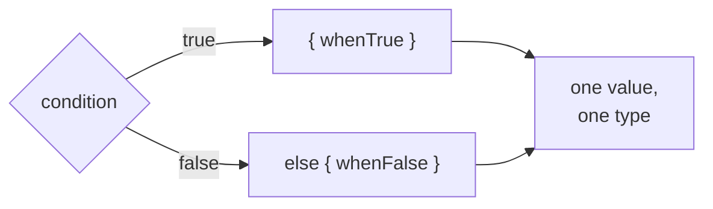

# Ternary

::note
<!-- sync:needs:start -->

**You'll need**: [If](/docs/learn/if)
<!-- sync:needs:end -->

::

`if` chooses which _statements_ run. Sometimes the choice is smaller than that: you only need one of two _values_, right in the middle of an expression — "even" or "odd", the larger of two numbers, an `s` for a plural or nothing. Many languages have a conditional operator for this, `condition ? a : b`, often called the _ternary_ operator because it takes three operands. Rux has no such operator. It makes the same choice with `if` itself, written where a value is expected.

## if as a value

Written after `=`, as an argument or inside arithmetic, `if` is an expression. Each branch is a block that ends with the value it gives, written **without** a `;`:

```rux
let label = if n % 2 == 0 { "even" } else { "odd" };
```

With `n` at 7, `n % 2 == 0` is `false`, so `label` becomes `"odd"`. Only the chosen branch is evaluated; the other is skipped, just as an untaken `if` block is.

If you reach for the operator from another language, the compiler points you at the `if` that replaces it:

```rux
let answer = ready ? "yes" : "no";
```

```text
error: the conditional operator 'c ? a : b' is not supported
help: write 'if c { a } else { b }'
```

## Why not an if statement?

Here is the same choice written as an ordinary `if` statement:

```rux
var labelTheLongWay = "";
if n % 2 == 0 {
    labelTheLongWay = "even";
} else {
    labelTheLongWay = "odd";
}
```

It works, but the binding has to be declared first with a placeholder value and filled in later, in whichever branch runs — so it must be a `var`. The `if` value gives the binding its value where it is declared, so it can be a `let`. That is the real gain, more than the shorter line: a `let` cannot be changed by accident later on.

## A value goes anywhere

Because the whole `if` is a value, it can be passed straight to a call:

```rux
PrintLine("the larger of {} and {} is {}", a, b, if a > b { a } else { b });
```

```rux
PrintLine("{} item{}", count, if count == 1 { "" } else { "s" });
```

or used inside arithmetic:

```rux
let total = price - (if member { 5 } else { 0 });
```

An `if` value runs from `if` to the closing brace of its last branch. Standing alone — as an initializer or an argument — it needs no parentheses. Inside a larger expression, wrap it in parentheses so the reader sees at a glance where it ends.

## One value, one type

The `if` produces one value, so both branches must have the same type, and there must be an `else` — without one there would be no value when the condition is false:



The condition follows the same rule as any `if`: it must be a `bool`, so write `n % 2 != 0` rather than `n % 2`.

## Chains of if values

An `else if` chain is a value too. It reads as a list of cases tested from the top:

```rux
let sign = if n < 0 { "negative" } else if n == 0 { "zero" } else { "positive" };
```

`n < 0` is tested first; if it fails, `n == 0`; if that fails too, the answer is `"positive"`. Two or three cases read well like this. Past that, an [`else if` statement chain](/docs/learn/else-if) — or a [`match` expression](/docs/learn/match-expression) — is clearer.

## The program

The whole lesson is one package in the [Examples repository](https://github.com/rux-lang/Examples/tree/main/ControlFlow/Ternary). Its comments explain every step.

<!-- sync:program:start -->

```rux [Src/Main.rux]
// `if` chooses which statements run. Sometimes the choice is smaller than that: one of two
// *values*, in the middle of an expression. Rux makes that choice with `if` itself: written where
// a value is expected, `if condition { whenTrue } else { whenFalse }` is an expression, and each
// branch ends with the value it gives, written without a `;`. It goes anywhere a value goes.
//
// Many languages spell this `condition ? whenTrue : whenFalse`. Rux has no such operator, and the
// compiler points at the `if` that replaces it:
//
//     let answer = ready ? "yes" : "no";
//         error: the conditional operator 'c ? a : b' is not supported
//         help: write 'if c { a } else { b }'
//
// The whole `if` is one value with one type, so both branches must have the same type, and there
// must be an `else`, or there would be no value when the condition is false:
//
//     let answer = if ready { "yes" } else { 0 };
//         error: 'if' branch type mismatch: expected 'char8[..]', found 'int'
//
//     let answer = if ready { "yes" };
//         error: an 'if' used as a value needs an 'else' branch
//         help: add 'else { ... }' with the value for when the condition is false
//
// Give both branches text, or both numbers.
import Io::PrintLine;

func Main() -> int {
    let n: int32 = 7;

    // Written with `if`, choosing a label needs a `var`: the binding is declared first and given
    // its value later, in whichever branch runs.
    var labelTheLongWay = "";
    if n % 2 == 0 {
        labelTheLongWay = "even";
    } else {
        labelTheLongWay = "odd";
    }

    // Written as an `if` value, the binding gets its value where it is declared, so it can be a
    // `let`. That is the real gain, more than the shorter line.
    let label = if n % 2 == 0 { "even" } else { "odd" };
    PrintLine("{} is {} ({} the long way)", n, label, labelTheLongWay);

    // Being a value, it can be passed straight to a call or used inside arithmetic.
    let a: int32 = 3;
    let b: int32 = 5;
    PrintLine("the larger of {} and {} is {}", a, b, if a > b { a } else { b });

    let count: int32 = 3;
    PrintLine("{} item{}", count, if count == 1 { "" } else { "s" });

    let price: int32 = 40;
    let member = true;
    let total = price - (if member { 5 } else { 0 });
    PrintLine("members pay {}", total);

    // An `else if` chain is a value too, and reads as a list of cases tested from the top. Past
    // two or three cases, a statement chain or a `match` is clearer.
    let sign = if n < 0 { "negative" } else if n == 0 { "zero" } else { "positive" };
    PrintLine("{} is {}", n, sign);
    return 0;
}
```

<!-- sync:program:end -->

## Run it

```sh
cd Examples/ControlFlow/Ternary
rux run
```

<!-- sync:output:start -->

```
7 is odd (odd the long way)
the larger of 3 and 5 is 5
3 items
members pay 35
7 is positive
```

<!-- sync:output:end -->

## Common mistakes

::mistake
**Writing the `? :` operator.**\
`let answer = ready ? "yes" : "no";` fails with:

```text
error: the conditional operator 'c ? a : b' is not supported
help: write 'if c { a } else { b }'
```

Write `let answer = if ready { "yes" } else { "no" };`.
::

::mistake
**Giving the two branches different types.**\
`let answer = if ready { "yes" } else { 0 };` fails with:

```text
error: 'if' branch type mismatch: expected 'char8[..]', found 'int'
```

Give both branches text, or both numbers.
::

::mistake
**Leaving out the `else`.**\
`let answer = if ready { "yes" };` fails with:

```text
error: an 'if' used as a value needs an 'else' branch
help: add 'else { ... }' with the value for when the condition is false
```

::

::mistake
**Ending a branch with `;`.**\
`let shown = if member { "member"; } else { "guest" };` fails with:

```text
error: this block yields '()' because of the ';'
help: remove the ';' to yield the last expression
```

A branch gives its value by ending with it, without a `;`.
::

## Try it yourself

1. Print `"pass"` or `"fail"` for a `score` depending on whether it is at least 50.
2. Use an `if` value to print the smaller of `a` and `b`.
3. Set `count` to `1` and check that the plural `s` disappears.
4. Extend `sign` so that numbers above 100 print `"large"`. Is it still easy to read?

## Learn more

- [Conditional values](/docs/lang/expressions/conditional) in the Rux Reference
- [If](/docs/learn/if) — choosing between blocks of statements
- [Match expression](/docs/learn/match-expression) — choosing a value from many cases
