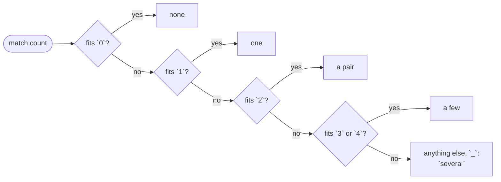

# Match

::note
<!-- sync:needs:start -->

**You'll need**: [Else if](/docs/learn/else-if)
<!-- sync:needs:end -->

::

An `else if` chain that compares one value with a list of constants — `if status == 200 … else if status == 404 … else if status == 500 …` — repeats the same name in every condition, and the reader has to check each line to be sure it really is the same value. `match` says it once. It compares one value against a list of **arms** and runs the first arm whose pattern fits.

## Arms and patterns

```rux
let count: int32 = 2;
match count {
    0 => PrintLine("none"),
    1 => PrintLine("one"),
    2 => PrintLine("a pair"),
    _ => PrintLine("several")
}
```

After `match` comes the value being examined, then the arms in braces. Each arm is `pattern => what to do`, and arms are separated by commas. The patterns here are literals — the arm `2` fits when `count` is 2.

## How an arm is chosen

The arms are tried from the top. The first one that fits runs, and the rest are skipped — exactly like an `else if` chain. Whichever arm runs, the program then carries on after the match:



The last arm may be `_`, which fits any value the arms above it did not name. It must come last — arms after it could never run. If you come from a language that spells the default `else`, the compiler stops you:

```text
error: 'else' is not a match arm
help: use '_' for the default arm
```

## Several values, one arm

Two values that share an outcome share an arm. Join them with `|`, and the arm fits either one:

```rux
match count {
    0 => PrintLine("none"),
    1 => PrintLine("one"),
    2 => PrintLine("a pair"),
    3 | 4 => PrintLine("a few"),
    _ => PrintLine("several")
}
```

## An arm with a block

An arm that needs more than one statement takes a block in braces. The comma after a block arm is optional, but writing it keeps every arm alike:

```rux
match status {
    200 => PrintLine("ok"),
    404 => {
        PrintLine("not found");
        PrintLine("check the address");
    },
    _ => PrintLine("status {}", status)
}
```

## Covering every value

A `bool` has only two values, so naming both covers everything, and no `_` is needed:

```rux
match ready {
    true => PrintLine("ready"),
    false => PrintLine("not ready yet")
}
```

Every match must cover every value. An `int32` has far more values than any list of arms can name, so a match on one without a `_` arm is refused:

```text
error: match on 'int32' is not exhaustive; its arms do not cover every value
help: add a '_' arm
```

When the other values really should do nothing, say so with an empty `_ => {}` arm:

```rux
let missed: int32 = 99;
match missed {
    1 => PrintLine("one"),
    2 => PrintLine("two"),
    _ => {}
}
```

The rule means a value can never slip through a match unnoticed: either an arm names it, or the `_` arm says what to do with the rest.

## What match checks for you

`match` is stricter than an `else if` chain in useful ways. A chain will happily run with a condition that can never be reached, or with no branch for some value, but `match` refuses both:

| Mistake                        | `else if` chain     | `match`                                                                        |
| ------------------------------ | ------------------- | ------------------------------------------------------------------------------ |
| The same case written twice    | the second is dead  | `error: duplicate pattern in match`                                            |
| A catch-all before other cases | the rest are dead   | `error: the default arm must be the last match arm`                            |
| A value no case handles        | nothing runs for it | `error: match on 'int32' is not exhaustive; its arms do not cover every value` |

Later parts add richer patterns — [characters](/docs/learn/character-pattern), [ranges](/docs/learn/range-pattern) such as `1..=9 =>`, and [guards](/docs/learn/guard) that add a condition to an arm.

## The program

The whole lesson is one package in the [Examples repository](https://github.com/rux-lang/Examples/tree/main/ControlFlow/Match). Its comments explain every step.

<!-- sync:program:start -->

```rux [Src/Main.rux]
// `match` compares one value against a list of arms and runs the first arm whose pattern fits.
// It says the same as an `if` / `else if` chain of `==` tests, but names the value once instead
// of repeating it in every condition.
//
// Each arm is `pattern => what to do`, and arms are separated by commas. The last arm may be
// `_`, which fits any value the arms above it did not name. The `else` some languages use is
// refused:
//
//     error: 'else' is not a match arm
//     help: use '_' for the default arm
//
// Two values that share an outcome share an arm: `3 | 4 =>` fits either one.
import Io::PrintLine;

func Main() -> int {
    // Literal patterns, alternatives joined by `|`, and `_` for everything else.
    let count: int32 = 2;
    match count {
        0 => PrintLine("none"),
        1 => PrintLine("one"),
        2 => PrintLine("a pair"),
        3 | 4 => PrintLine("a few"),
        _ => PrintLine("several")
    }

    // An arm that needs more than one statement takes a block.
    let status: int32 = 404;
    match status {
        200 => PrintLine("ok"),
        404 => {
            PrintLine("not found");
            PrintLine("check the address");
        },
        _ => PrintLine("status {}", status)
    }

    // A `bool` has only two values, so naming both covers everything and no `_` is needed.
    let ready = false;
    match ready {
        true => PrintLine("ready"),
        false => PrintLine("not ready yet")
    }

    // Every match must cover every value. An `int32` has far more values than two arms name, so
    // leaving out the `_` arm is refused:
    //
    //     error: match on 'int32' is not exhaustive; its arms do not cover every value
    //     help: add a '_' arm
    //
    // When the other values should do nothing, say so with an empty `_ => {}` arm.
    let missed: int32 = 99;
    match missed {
        1 => PrintLine("one"),
        2 => PrintLine("two"),
        _ => {}
    }
    PrintLine("99 fit no named arm, so that match did nothing");
    return 0;
}
```

<!-- sync:program:end -->

## Run it

```sh
cd Examples/ControlFlow/Match
rux run
```

<!-- sync:output:start -->

```
a pair
not found
check the address
not ready yet
99 fit no named arm, so that match did nothing
```

<!-- sync:output:end -->

## Common mistakes

::mistake
**Using `else` for the default arm.**\
`else => PrintLine("several")` fails with:

```text
error: 'else' is not a match arm
help: use '_' for the default arm
```

::

::mistake
**Separating alternatives with a comma.**\
`3, 4 => PrintLine("a few")` is not one arm with two values; the parser stops with:

```text
error: expected '=>' after the match arm pattern before ','
```

Join the values with `|`: `3 | 4 =>`.
::

::mistake
**Putting `_` first.**\
`_` fits everything, so arms after it could never run:

```text
error: the default arm must be the last match arm
help: move the '_' arm after the other arms
```

::

::mistake
**Leaving out `_`.**\
A match on an integer with no `_` arm fails with:

```text
error: match on 'int32' is not exhaustive; its arms do not cover every value
help: add a '_' arm
```

If the other values should do nothing, write `_ => {}`.
::

## Try it yourself

1. Write a match on an `int32` `day` that prints the name of the day for 1 to 7 and `"no such day"` for anything else.
2. Rewrite the `status` match as an `else if` chain and compare how often `status` is named.
3. Change the `_ => {}` arm of the `missed` match so it prints the value, then set `missed` to `2` and run again.
4. Write a second match on `day` that prints `"weekend"` for `6 | 7` and `"weekday"` for the rest.
5. Write the same case twice in one match and read the error.

## Learn more

- [`match`](/docs/lang/patterns/match) and its [alternatives](/docs/lang/patterns/match#alternatives) in the Rux Reference
- [Match expression](/docs/learn/match-expression) — `match` as a value
- [Exhaustive](/docs/learn/exhaustive) — how a match covers every case
