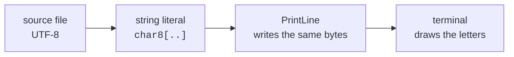

# Greetings

::note
<!-- sync:needs:start -->

**You'll need**: [Hello, World](/docs/learn/hello), [Array](/docs/learn/array)
<!-- sync:needs:end -->

::

Programs talk to people, and people write in many scripts. This lesson prints one greeting in twelve languages — Chinese, Hindi, Arabic, Cyrillic and an emoji line among them — and shows that none of it needs any setting up.

## Text is UTF-8 from the start

A Rux source file is UTF-8, and a string literal keeps its bytes exactly as they were typed. So any script can go straight between the quotes: there are no escapes to write, no special string type to reach for, and no locale to configure.

```rux
"你好，世界"
"Привет мир"
"🐯🐶🐱🐭"
```

Every one of these literals has the same type, `char8[..]` (a view of UTF-8 bytes), whether it holds English, Hindi or emoji.

## One array, twelve strings

Because every literal has that one type, strings of different lengths fit in one array, just as the numbers did in [Array](/docs/learn/array):

```rux
let greetings = [
    "Hello World",
    "你好，世界",
    "नमस्ते दुनिया",
```

`for` then walks the array one greeting at a time, and `PrintLine` writes each one. Given a single string and nothing to fill in, `PrintLine` prints the text as it is rather than reading `{}` placeholders in it:

```rux
for greeting in greetings {
    PrintLine(greeting);
}
```



## Bytes, not letters

The program always writes the right bytes, but two things are worth knowing early:

| What you might expect             | What is true                                                                                                                     |
| --------------------------------- | -------------------------------------------------------------------------------------------------------------------------------- |
| Every terminal shows every script | How the bytes look is up to the terminal and its font: an old console may show boxes or lay right-to-left text out the wrong way |
| `"你好".length` is 2              | It is 6: a string's `length` counts UTF-8 bytes, and each of these characters takes three                                        |

The [Text](/docs/learn/string) part comes back to the gap between bytes and letters, and to working with characters one at a time.

## The program

The whole lesson is one package in the [Examples repository](https://github.com/rux-lang/Examples/tree/main/Sequences/Greetings). Its comments explain every step.

<!-- sync:program:start -->

```rux [Src/Main.rux]
// Text in any language works out of the box. A source file is UTF-8, and a string literal keeps
// its bytes exactly as they were typed, so Chinese, Hindi, Arabic, Cyrillic or emoji can go
// straight between the quotes: no escapes, no special string type and nothing to set up.
import Io::PrintLine;

func Main() -> int {
    // An array of twelve strings, one greeting per language. Strings of different lengths are
    // still values of one type, so they fit in one array just as the numbers in Array did.
    let greetings = [
        "Hello World",
        "你好，世界",
        "नमस्ते दुनिया",
        "Hola Mundo",
        "Bonjour le monde",
        "مرحبا يا عالم",
        "হ্যালো বিশ্ব",
        "Привет мир",
        "Olá Mundo",
        "سلام دنیا",
        "Привіт світ",
        "🐯🐶🐱🐭"
    ];

    // `for` walks the array one greeting at a time. `PrintLine` writes each one as it is: given
    // a single string and nothing to fill in, it prints the text rather than reading `{}`
    // placeholders in it.
    for greeting in greetings {
        PrintLine(greeting);
    }

    // The program writes the right bytes every time, but how they look is up to the terminal: an
    // old console or a font without these scripts may show boxes, or lay right-to-left text out
    // the wrong way. And a string's length counts bytes, not letters, so "你好" is 6 long. The
    // Text part comes back to that gap.
    return 0;
}
```

<!-- sync:program:end -->

## Run it

```sh
cd Examples/Sequences/Greetings
rux run
```

<!-- sync:output:start -->

```
Hello World
你好，世界
नमस्ते दुनिया
Hola Mundo
Bonjour le monde
مرحبا يا عالم
হ্যালো বিশ্ব
Привет мир
Olá Mundo
سلام دنیا
Привіт світ
🐯🐶🐱🐭
```

<!-- sync:output:end -->

## Common mistakes

::mistake
**Mixing strings and numbers in one array.**`let a = ["Hello", 42];` fails with:

```text
error: array element 2 has type 'int', but element 1 established element type 'char8[..]'
```

The first element sets the element type, and every other element has to match it.
::

::mistake
**Putting a non-ASCII letter in a `char8` literal.**`c8'你'` fails with:

```text
error: character '你' (U+4F60) does not fit one 'char8' code unit
```

A `char8` is one UTF-8 byte. Write the letter inside a string, `"你"`, or as a plain character literal, `'你'`, which is a 32-bit `char`.
::

::mistake
**Printing the whole array at once.**`PrintLine("{}", greetings)` fails with:

```text
error: no matching overload for 'PrintLine' with argument types (char8[..], char8[..][12])
```

An array is not printable as one value. Walk it with `for` and print each element, as the program does.
::

## Try it yourself

1. Add a greeting in a language you know to the array, and run the program again.
2. Print each greeting's `length` beside it, and compare the numbers with the number of letters you see.
3. Print only the greetings at even indices by walking `0..greetings.length` and testing `i % 2 == 0`.

## Learn more

- [Array](/docs/learn/array): the array this lesson fills with strings
- [String](/docs/learn/string): text that a program builds and owns, later in the course
- [Character](/docs/learn/character): single characters and their widths
- [String literals](/docs/lang/lexical/literals#string-literals) and [Character literals](/docs/lang/lexical/literals#character-literals) in the Rux Reference
