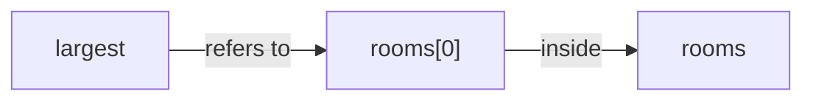

# Reference

::note
<!-- sync:needs:start -->

**You'll need**: [Struct](/docs/learn/struct)
<!-- sync:needs:end -->

::

Passing a struct to a function, as the [Struct](/docs/learn/struct) lesson did, hands the function a copy. For two numbers that costs nothing, but a struct can be large, and copying it only so a function can _read_ it is wasted work.

A **reference**, written `&T`, borrows the caller's value instead. The function reads the original through the reference, and nothing is copied. A plain `&` is read-only: the function may look at the value but not change it, so the caller can lend it out without worrying.

## Borrowing a value

The `&` goes in front of the parameter's type:

```rux
func Area(room: &Room) -> float64 {
    return room.width * room.length;
}
```

```mermaid
flowchart LR
    subgraph copy ["`room: Room`: by value"]
        k1["`kitchen`"] -- "copied" --> r1["`room`<br/>(a second `Room`)"]
    end
    subgraph borrow ["`room: &Room`: by reference"]
        r2["`room`"] -- "refers to" --> k2["`kitchen`<br/>(the only `Room`)"]
    end
```

## Writing the loan

Where a loan starts, it is written `&x`: `Area(&kitchen)` lends `kitchen` to `Area` for reading. For plain data that the function only reads, a call may leave the `&` out:

```rux
Describe(kitchen);
Describe(hall);
```

`Room` is plain data — numbers and a string view, nothing it has to clean up — and `Describe` only reads it, so a copy and a read-only loan cannot be told apart. The parameter asks for a `&Room`, and the bare name is lent to it.

The loan must be written in two cases:

- **The result borrows from the argument.** A function that returns a reference into what it was lent — `Largest` below — needs `&rooms` at the call, so the reader can see that the result depends on `rooms`.
- **The value owns resources**, such as a buffer on the heap. The [Ownership](/docs/learn/ownership) part introduces those values.

Inside the function, a reference is followed automatically: `room.width` reads the field of the borrowed room — there is no separate operator to "go through" the reference first.

## Read-only, and passed on

A function that borrows a value may lend it on. `Describe` hands the room it borrowed straight to `Area`, and `room` is already a reference, so it goes bare:

```rux
func Describe(room: &Room) {
    PrintLine("{}: {} by {} metres, {} square metres", room.name, room.width, room.length,
        Area(room));
}
```

What it may not do is change it. `room.width = 0.0;` inside `Describe` is refused: a `&Room` is a promise to the caller that their room comes back untouched. Lending for writing is a different kind of reference, `&var`, and the subject of the [next lesson](/docs/learn/mutable-reference).

## Anything can be borrowed

A reference is not only for structs. An array of three floats is worth borrowing too:

```rux
func Widest(widths: &float64[3]) -> float64 {
    var widest = widths[0];
    for i in 1..3 {
        if widths[i] > widest {
            widest = widths[i];
        }
    }
    return widest;
}
```

Inside, `widths[i]` indexes the caller's array directly, just as `room.width` read the caller's field. The call `Widest(widths)` lends the array bare, for the same reason `Describe(kitchen)` does.

## Returning a reference

A function may also return a reference — here, to one of the rooms it was lent, not a copy of it:

```rux
func Largest(rooms: &Room[2]) -> &Room {
    if Area(rooms[1]) > Area(rooms[0]) {
        return rooms[1];
    }
    return rooms[0];
}
```

The result is a loan of the caller's array, so this is where the call must write it:

```rux
let rooms = [kitchen, hall];
let largest = Largest(&rooms);
PrintLine("largest: the {}", largest.name);
```



`largest` is only usable while `rooms` is: it reaches into the array, it does not own a room of its own.

## A reference as a local

A reference can also be a local variable — a second name for a value that already exists:

```rux
let chosen = &kitchen;
PrintLine("chosen: the {}", chosen.name);
```

`chosen` is not a new room. It is another way to reach `kitchen`, and its type is `&Room`.

## A value with no name

A struct built on the spot has no name, so it is never lent bare. Writing the loan lends it for the call, and it lives until the statement ends:

```rux
PrintLine("cupboard: {} square metres",
    Area(&Room { name: "cupboard", width: 1.0, length: 0.5 }));
```

| Parameter     | What the function gets      | Copies the value | Can change the caller's value | The call writes                                     |
| ------------- | --------------------------- | ---------------- | ----------------------------- | --------------------------------------------------- |
| `room: Room`  | its own copy                | yes              | no                            | `Area(kitchen)`                                     |
| `room: &Room` | the caller's value, to read | no               | no                            | `Area(&kitchen)`, or `Area(kitchen)` for plain data |

## The program

The whole lesson is one package in the [Examples repository](https://github.com/rux-lang/Examples/tree/main/Types/Reference). Its comments explain every step.

<!-- sync:program:start -->

```rux [Src/Main.rux]
// Passing a struct to a function, as the Struct lesson did, hands the function a copy. For two
// numbers that costs nothing, but a struct can be large, and copying it only so a function can
// read it is wasted work.
//
// A reference, written `&T`, borrows the caller's value instead. The function reads the original
// through the reference and nothing is copied. A plain `&` is read-only: the function may look at
// the value but not change it, so the caller can lend it out without worrying.
//
// Where a loan starts it is written `&x`. A call may leave it out when the value is plain data,
// like `Room`, and the function only reads it: `Area(kitchen)` borrows `kitchen` because the
// parameter asks for a `&Room`, and a copy and a read-only loan of plain data cannot be told
// apart. The loan must be written when the result borrows from the argument, as `Largest` below
// shows, and when the value owns resources, which the Ownership part introduces. And a reference
// is followed automatically, so `room.width` reads the field of the borrowed room.
import Io::PrintLine;

struct Room {
    name: char8[..];
    width: float64;
    length: float64;
}

func Area(room: &Room) -> float64 {
    return room.width * room.length;
}

// A reference can be passed on: `Describe` lends the room it borrowed to `Area`. Assigning through
// it is another matter, and `room.width = 0.0;` here would be rejected.
func Describe(room: &Room) {
    PrintLine("{}: {} by {} metres, {} square metres", room.name, room.width, room.length,
        Area(room));
}

// Any type can be borrowed, an array included.
func Widest(widths: &float64[3]) -> float64 {
    var widest = widths[0];
    for i in 1..3 {
        if widths[i] > widest {
            widest = widths[i];
        }
    }
    return widest;
}

// A function may also return a reference: here, to one of the rooms it borrowed, not a copy of
// it. The result is a loan of the caller's array, so the call must write it: `Largest(&rooms)`.
func Largest(rooms: &Room[2]) -> &Room {
    if Area(rooms[1]) > Area(rooms[0]) {
        return rooms[1];
    }
    return rooms[0];
}

func Main() -> int {
    let kitchen = Room { name: "kitchen", width: 3.5, length: 4.0 };
    let hall = Room { name: "hall", width: 1.5, length: 6.0 };
    Describe(kitchen);
    Describe(hall);

    // A reference can also be a local: a second name for a value that already exists.
    let chosen = &kitchen;
    PrintLine("chosen: the {}", chosen.name);

    let widths: float64[3] = [3.5, 1.5, 2.75];
    PrintLine("widest: {} metres", Widest(widths));

    // Leaving out the `&` here stops with
    //     error: the result of 'Largest' borrows from its argument, so the loan must be written
    //     help: write '&rooms'
    let rooms = [kitchen, hall];
    let largest = Largest(&rooms);
    PrintLine("largest: the {}", largest.name);

    // A struct built on the spot has no name, so it is never lent bare, and `Area(Room { ... })`
    // stops with
    //     error: argument 1 to 'Area' has type 'Room', but parameter 'room' requires '&Room'
    // Writing the loan lends it for the call, and it lives until the statement ends.
    PrintLine("cupboard: {} square metres",
        Area(&Room { name: "cupboard", width: 1.0, length: 0.5 }));
    return 0;
}
```

<!-- sync:program:end -->

## Run it

```sh
cd Examples/Types/Reference
rux run
```

<!-- sync:output:start -->

```
kitchen: 3.5 by 4.0 metres, 14.0 square metres
hall: 1.5 by 6.0 metres, 9.0 square metres
chosen: the kitchen
widest: 3.5 metres
largest: the kitchen
cupboard: 0.5 square metres
```

<!-- sync:output:end -->

## Common mistakes

::mistake
**Lending a value with no name bare.**\
`Area(Room { name: "x", width: 1.0, length: 2.0 })` fails with:

```text
error: argument 1 to 'Area' has type 'Room', but parameter 'room' requires '&Room'
```

Only a named value is lent bare. Write the loan, `Area(&Room { ... })`, and the temporary lives until the end of the statement.
::

::mistake
**Leaving out the `&` when the result borrows.**\
`let largest = Largest(rooms);` fails with:

```text
error: the result of 'Largest' borrows from its argument, so the loan must be written
help: write '&rooms'
```

The returned reference points into `rooms`, and the `&` at the call is what shows it.
::

::mistake
**Writing through a `&`.**\
`room.width = 0.0;` in a function that takes `room: &Room` fails with:

```text
error: cannot modify data through immutable reference '&Room'
```

If the function really must change the caller's value, it needs a `&var Room` — see [Mutable reference](/docs/learn/mutable-reference).
::

::mistake
**Changing a value while a reference to it is in use.**\
With `var kitchen` and `let chosen = &kitchen;`, assigning `kitchen.width = 9.0;` and then reading `chosen.width` fails with:

```text
error: cannot modify 'kitchen.width' while it is immutably borrowed
help: use 'chosen' for the access or wait until its last use
```

The compiler will not let a value change under a reader that is still looking at it. Finish with `chosen` first; once its last use is behind you, `kitchen` is free to change. [Exclusivity](/docs/learn/exclusivity) covers the rule in full.
::

## Try it yourself

1. Write `func Perimeter(room: &Room) -> float64` and add the perimeter to what `Describe` prints.
2. Write `func Narrowest(widths: &float64[3]) -> float64` next to `Widest`.
3. Add `room.width = 0.0;` to `Describe` and read the error.
4. Call `Area` with a struct literal and no `&`, read the error, then write the loan.
5. Write `func Smallest(rooms: &Room[2]) -> &Room` and call it without the `&` to see why the loan is required there.

## Learn more

- [References](/docs/lang/references/overview) — written loans, in the Rux Reference
- [Mutable reference](/docs/learn/mutable-reference) — lending a value for writing
- [Exclusivity](/docs/learn/exclusivity) — why a borrowed value cannot change under its reader
- [Pointer](/docs/learn/pointer) — the lower-level relative of a reference
