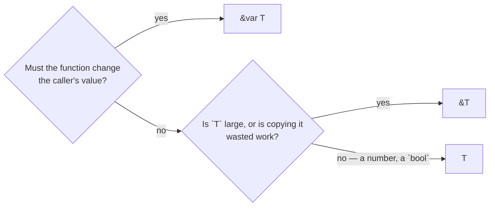

# Mutable reference

::note
<!-- sync:needs:start -->

**You'll need**: [Reference](/docs/learn/reference)
<!-- sync:needs:end -->

::

A `&T` reference lets a function look at the caller's value. A `&var T` reference lets it **change** that value: the writes land in the caller's own storage, so the caller sees them as soon as the call returns. Nothing is copied in, and nothing needs to be handed back.

This is how a function updates something it was given — a bank balance, a counter, a game's score — without the caller having to write `account = Deposit(account, 50);`.

## Writing through &var

The parameter's type is `&var` and the type being lent:

```rux
func Deposit(account: &var Account, amount: int) {
    account.balance += amount;
    account.deposits += 1;
}
```

## Both ends have to agree

The parameter says `&var`, and the call says it too: `&var alice` lends `alice` for writing.

```rux
Deposit(&var alice, 50);
Deposit(&var alice, 25);
```

After those two calls `alice` itself has a balance of 175 and two deposits. A read-only loan of plain data may be passed bare, as `Show(alice)` is, but a loan for writing is always written — so whoever reads a call can see which of its arguments it may change.

The value lent must also be a `var`. A binding declared with `let` was promised never to change, and lending it out for writing would break that promise:

```rux
var alice = Account { owner: "Alice", balance: 100, deposits: 0 };
```

Had `alice` been a `let`, every `Deposit(&var alice, …)` would be refused.

| Call                      | Lends `alice`        | Allowed when                                   |
| ------------------------- | -------------------- | ---------------------------------------------- |
| `Show(alice)`             | for reading, bare    | `alice` is plain data and `Show` only reads it |
| `Show(&alice)`            | for reading, written | always                                         |
| `Deposit(&var alice, 50)` | for writing          | `alice` is a `var`                             |
| `Deposit(alice, 50)`      | —                    | never: the loan for writing must be written    |

## Replacing the whole value

Assigning to a field changes that field. Assigning to the reference itself replaces the caller's whole value in one step:

```rux
func Close(account: &var Account) {
    account = Account { owner: account.owner, balance: 0, deposits: 0 };
}
```

## Any type can be lent

A `&var` is not only for structs. A plain integer can be lent for writing too:

```rux
func Tick(count: &var int) {
    count += 1;
}
```

The loan is still written, because the function writes it. Three calls to `Tick(&var visits)` leave `visits` at 3.

## One writer at a time

Two _different_ accounts may be lent for writing in the same call:

```rux
Transfer(&var alice, &var bob, 70);
```

The same account twice, `Transfer(&var alice, &var alice, 5)`, is refused. Inside `Transfer`, `from` and `to` would be two names for one value, and every write through one would silently change what the other sees. The rule behind this — while something may write a value, nothing else may touch it — is [Exclusivity](/docs/learn/exclusivity), in the Ownership part.

## Choosing a parameter type

You now have three ways to take an argument:

| Parameter         | What the function gets        | Can change the caller's value | The call writes                     |
| ----------------- | ----------------------------- | ----------------------------- | ----------------------------------- |
| `a: Account`      | its own copy, read-only       | no                            | `F(alice)`                          |
| `a: &Account`     | the caller's value, to read   | no                            | `F(&alice)`, or `F(alice)` if plain |
| `a: &var Account` | the caller's value, to change | yes                           | `F(&var alice)`, on a `var`         |



## The program

The whole lesson is one package in the [Examples repository](https://github.com/rux-lang/Examples/tree/main/Types/MutableReference). Its comments explain every step.

<!-- sync:program:start -->

```rux [Src/Main.rux]
// A `&T` reference lets a function look at the caller's value. A `&var T` reference lets it change
// that value: the writes land in the caller's own storage, so the caller sees them once the call
// returns. Nothing is copied in, and nothing needs to be handed back.
//
// Both ends have to agree. The parameter says `&var`, and the call says it too: `&var alice` lends
// `alice` for writing. A read-only loan of plain data is passed bare, but a loan for writing is
// always written, so whoever reads the call can see which arguments it may change. And the value
// lent must be a `var`: a binding declared with `let` was promised never to change, so lending one
// for writing is rejected.
import Io::PrintLine;

struct Account {
    owner: char8[..];
    balance: int;
    deposits: int;
}

// Writing a field through the reference changes that field of the caller's account.
func Deposit(account: &var Account, amount: int) {
    account.balance += amount;
    account.deposits += 1;
}

// Two different accounts may be borrowed for writing in the same call. The same account twice,
// `Transfer(&var alice, &var alice, 5)`, is rejected: two writers to one value at once is the
// kind of conflict the Ownership part is about.
func Transfer(from: &var Account, to: &var Account, amount: int) {
    from.balance -= amount;
    to.balance += amount;
}

// Assigning to the reference itself replaces the caller's whole value in one step.
func Close(account: &var Account) {
    account = Account { owner: account.owner, balance: 0, deposits: 0 };
}

// Any type can be lent this way, a plain integer included. The loan is still written, because
// the function writes it.
func Tick(count: &var int) {
    count += 1;
}

func Show(account: &Account) {
    PrintLine("{}: balance {}, deposits {}", account.owner, account.balance, account.deposits);
}

func Main() -> int {
    var alice = Account { owner: "Alice", balance: 100, deposits: 0 };
    var bob = Account { owner: "Bob", balance: 20, deposits: 0 };

    // Each call writes `&var`, and the changes are visible right after.
    Deposit(&var alice, 50);
    Deposit(&var alice, 25);
    Deposit(&var bob, 5);
    Show(alice);
    Show(bob);

    Transfer(&var alice, &var bob, 70);
    Show(alice);
    Show(bob);

    Close(&var bob);
    Show(bob);

    var visits = 0;
    Tick(&var visits);
    Tick(&var visits);
    Tick(&var visits);
    PrintLine("visits: {}", visits);

    // Leaving the loan out is an error, even though the parameter already says `&var`:
    //     Deposit(alice, 50);
    //         error: 'Deposit' writes its argument 'alice', so the loan must be written
    //         help: write '&var alice'
    // And a `let` binding cannot be lent for writing at all:
    //     let savings = Account { owner: "Savings", balance: 0, deposits: 0 };
    //     Deposit(&var savings, 10);
    //         error: '&var' lends for writing, but this place is immutable
    //         help: declare 'savings' with 'var' to make it mutable
    return 0;
}
```

<!-- sync:program:end -->

## Run it

```sh
cd Examples/Types/MutableReference
rux run
```

<!-- sync:output:start -->

```
Alice: balance 175, deposits 2
Bob: balance 25, deposits 1
Alice: balance 105, deposits 2
Bob: balance 95, deposits 1
Bob: balance 0, deposits 0
visits: 3
```

<!-- sync:output:end -->

## Common mistakes

::mistake
**Leaving out the loan for writing.**\
`Deposit(alice, 50)` fails, even though the parameter already says `&var`:

```text
error: 'Deposit' writes its argument 'alice', so the loan must be written
help: write '&var alice'
```

A call that changes an argument has to say so where it is written.
::

::mistake
**Lending for reading where writing is needed.**\
`Deposit(&alice, 50)` fails with:

```text
error: argument 1 to 'Deposit' has type '&Account', but parameter 'account' requires '&var Account'
help: lend it for writing with '&var'
```

`&alice` is a read-only loan; a `&var` parameter needs `&var alice`.
::

::mistake
**Lending a `let` for writing.**\
With `let savings = Account { … };`, the call `Deposit(&var savings, 10)` fails with:

```text
error: '&var' lends for writing, but this place is immutable
help: declare 'savings' with 'var' to make it mutable
```

::

::mistake
**Changing a by-value parameter.**\
`func Tick(count: int) { count += 1; }` fails with:

```text
error: cannot modify parameter 'count'
help: take 'count' as '&var int' to change the caller's value, or move it into a 'var' local
```

A parameter is read-only, and even if it were not, it would be the function's own copy — the caller would never see the change.
::

::mistake
**Lending one value twice.**\
`Transfer(&var alice, &var alice, 5)` fails with:

```text
error: call arguments create overlapping exclusive borrows of 'alice'
help: split the accesses into non-overlapping calls
```

Each `&var` argument must be a different value.
::

## Try it yourself

1. Write `func Withdraw(account: &var Account, amount: int) -> bool` that refuses (returns `false`) when the balance is too small, and try it on both accounts.
2. Declare `var counts: int[3] = [0, 0, 0];` and call `Tick(&var counts[1])` twice, then print the three elements. An array element is a place, so it can be lent for writing too.
3. Change `var bob` to `let bob` and read the errors, then remove one `&var` and read that error too.
4. Write `func Swap(a: &var int, b: &var int)` and use it to swap two variables. Give the temporary its type, `let saved: int = a;` — written as plain `let saved = a;`, it would be one more reference to `a` rather than a copy of its number, and the compiler would refuse the swap.

## Learn more

- [References](/docs/lang/references/overview) — written loans, in the Rux Reference
- [Reference](/docs/learn/reference) — the read-only kind
- [Mutating method](/docs/learn/mutating-method) — a method that changes the value it is called on
- [Exclusivity](/docs/learn/exclusivity) — why one value cannot be lent for writing twice
- [Out parameter](/docs/learn/out-parameter) — the same idea with pointers
