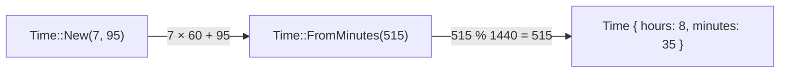

# Constructor

::note
<!-- sync:needs:start -->

**You'll need**: [Method](/docs/learn/method), [Overload](/docs/learn/overload)
<!-- sync:needs:end -->

::

A struct literal names every field at every place a value is built. That is fine for a `Point`, but some types have rules. A time of day has minutes from 0 to 59, and a literal will happily accept `Time { hours: 7, minutes: 95 }`.

A **constructor** is a function that builds the value for you, so the rules are written once instead of at every literal. It is called through the type: `Time::New(9, 30)`.

## Declaring a constructor

A constructor is an ordinary function that lives in the type's `extend` block, beside its methods. Two things set it apart from them:

- it takes **no `self`** — there is no value yet to call it on;
- it **returns the type**.

By convention the plain one, with one argument per field, is named `New`:

```rux
extend Time {
    // The plain form: one argument per field, wrapped round the clock so the fields stay valid.
    func New(hours: int, minutes: int) -> Time {
        return Time::FromMinutes(hours * 60 + minutes);
    }
}
```

Inside the `extend` block the type can also be written `Self`, so `func New(hours: int, minutes: int) -> Self` declares the same constructor.

| Kind of function | Name                          | First parameter        | Called as          |
| ---------------- | ----------------------------- | ---------------------- | ------------------ |
| Method           | anything                      | `&self` or `&var self` | `start.Show()`     |
| Constructor      | `New`, or what it starts from | none                   | `Time::New(9, 30)` |

A type is not a function, so calling the type itself — `Time(9, 30)` — is refused. The `::` names the function inside the type, just as `Io::PrintLine` names a function inside a package.

## A name for each way in

A type can have more than one constructor. This one takes a single count of minutes and does the real work:

```rux
func FromMinutes(totalMinutes: int) -> Time {
    let inDay = totalMinutes % (24 * 60);
    return Time { hours: inDay / 60, minutes: inDay % 60 };
}
```

It could have been a second `New` — a constructor [overloads](/docs/learn/overload) like any function — but `Time::New(570)` would not say what 570 is. A constructor that starts from something other than the fields gets a name that says what it starts from: `FromMinutes`, `FromBytes`, `WithCapacity`. `rux lint` points out an overloaded `New`.

`New` turns its hours and minutes into a total and hands it to `FromMinutes`, so the wrapping is written exactly once:



At the end, the struct literal is still how the value is finally made. A constructor does not replace literals; it decides what goes into one.

## Building new values from old ones

Since `FromMinutes` accepts any count of minutes, "135 minutes later" is just another call:

```rux
let later = Time::FromMinutes(start.TotalMinutes() + 135);
```

And past midnight the clock wraps, because `% (24 * 60)` keeps the total inside one day.

## A convenience, not a lock

The struct literal is still allowed, rules or no rules: `Time { hours: 7, minutes: 95 }` compiles and makes a time that is not a time. A constructor is a convenience the type offers; it does not lock the door. Hiding the fields so the constructor is the only way in is what [Visibility](/docs/learn/visibility) is about.

## The program

The whole lesson is one package in the [Examples repository](https://github.com/rux-lang/Examples/tree/main/Types/Constructor). Its comments explain every step.

<!-- sync:program:start -->

```rux [Src/Main.rux]
// A struct literal names every field at every place a value is built. That is fine for a `Point`,
// but some types have rules: a time of day has minutes from 0 to 59, and a literal will happily
// accept `Time { hours: 7, minutes: 95 }`.
//
// A constructor is a function that builds the value for you. It is an ordinary function declared
// inside the type's `extend` block: it takes no `self` (there is no value yet) and returns the
// type. By convention the plain one is named `New`, and it is called through the type:
// `Time::New(9, 30)`. A type is not a function, so calling the type itself is refused:
//
//     let start = Time(9, 30);
//         error: 'Time' is a type, not a function
//         help: call a constructor by its name, as in 'Time::New(...)'
import Io::PrintLine;

struct Time {
    hours: int;
    minutes: int;
}

extend Time {
    // The plain form: one argument per field, wrapped round the clock so the fields stay valid.
    func New(hours: int, minutes: int) -> Time {
        return Time::FromMinutes(hours * 60 + minutes);
    }

    // A second constructor gets a name that says what it starts from. It does real work,
    // splitting a count of minutes into hours and minutes, which is what `New` relies on. The
    // struct literal is still how the value is finally made.
    //
    // It could have been a second `New`, since constructors overload like any function, but
    // `Time::New(570)` would not say what 570 is, and `rux lint` points that out:
    //     warning: constructor 'New' is overloaded
    //     help: give each constructor its own name that says what it starts from, such as
    //     'FromBytes' or 'WithCapacity'
    func FromMinutes(totalMinutes: int) -> Time {
        let inDay = totalMinutes % (24 * 60);
        return Time { hours: inDay / 60, minutes: inDay % 60 };
    }

    func TotalMinutes(&self) -> int {
        return self.hours * 60 + self.minutes;
    }

    func Show(&self) {
        PrintLine("{:02}:{:02}", self.hours, self.minutes);
    }
}

func Main() -> int {
    let start = Time::New(9, 30);
    start.Show();

    // Minutes past 59 carry into the hours, which a struct literal would not do.
    let odd = Time::New(7, 95);
    odd.Show();

    // Building a new value from an old one is a matter of calling a constructor again.
    let later = Time::FromMinutes(start.TotalMinutes() + 135);
    later.Show();

    // Past midnight, the clock wraps.
    let overnight = Time::FromMinutes(later.TotalMinutes() + 14 * 60);
    overnight.Show();

    // The struct literal is still allowed, rules or no rules. A constructor is a convenience the
    // type offers; it does not lock the door. Hiding the fields so the constructor is the only
    // way in is what the Visibility lesson is about.
    return 0;
}
```

<!-- sync:program:end -->

## Run it

```sh
cd Examples/Types/Constructor
rux run
```

<!-- sync:output:start -->

```
09:30
08:35
11:45
01:45
```

<!-- sync:output:end -->

## Common mistakes

::mistake
**Calling the type.**\
`let start = Time(9, 30);` fails with:

```text
error: 'Time' is a type, not a function
help: call a constructor by its name, as in 'Time::New(...)'
```

::

::mistake
**Naming the constructor after the type.**\
`func Time(hours: int, minutes: int) -> Time` in `extend Time` fails with:

```text
error: a function named after its type 'Time' is not a constructor
help: name it for what it does, as in 'func New(...)'
```

::

::mistake
**Calling a constructor without its type.**\
`let start = New(9, 30);` fails with:

```text
error: name 'New' is not defined in this scope
```

A constructor lives in the type's `extend` block, so it is reached through the type: `Time::New(9, 30)`.
::

::mistake
**Overloading `New`.**\
A second `func New(totalMinutes: int) -> Time` compiles, but `rux lint` warns:

```text
warning: constructor 'New' is overloaded
help: give each constructor its own name that says what it starts from, such as 'FromBytes' or 'WithCapacity'
```

`Time::New(570)` reads as nine hours and thirty minutes only to someone who knows the overloads. `Time::FromMinutes(570)` says so.
::

::mistake
**Expecting `var` to build a value.**\
`var t: Time;` declares empty storage; nothing is constructed. Calling `t.Show()` before assigning it fails with:

```text
error: variable 't' is used before it is initialized
help: assign a value to 't' before this use
```

Write `var t = Time::New(0, 0);` when the variable needs a value from the start.
::

## Try it yourself

1. Write `Time { hours: 7, minutes: 95 }` as a literal, call `Show` on it, and compare with `Time::New(7, 95)`.
2. Add a method `func Later(&self, minutes: int) -> Time` that uses a constructor, and print `start.Later(45)`.
3. Add `func Midnight() -> Time` to the `extend` block — no `self`, a constructor that starts from nothing. Call it as `Time::Midnight()`.
4. Make `FromMinutes` handle a negative count, so that `Time::FromMinutes(-30)` shows `23:30`.
5. Rewrite both constructors with `Self` in place of `Time` and check the program prints the same four lines.

## Learn more

- [Constructors](/docs/lang/structs/constructors) in the Rux Reference
- [Overload](/docs/learn/overload) — several functions with one name
- [Visibility](/docs/learn/visibility) — making the constructor the only way in
- [Struct](/docs/learn/struct) — the struct literal a constructor fills in
