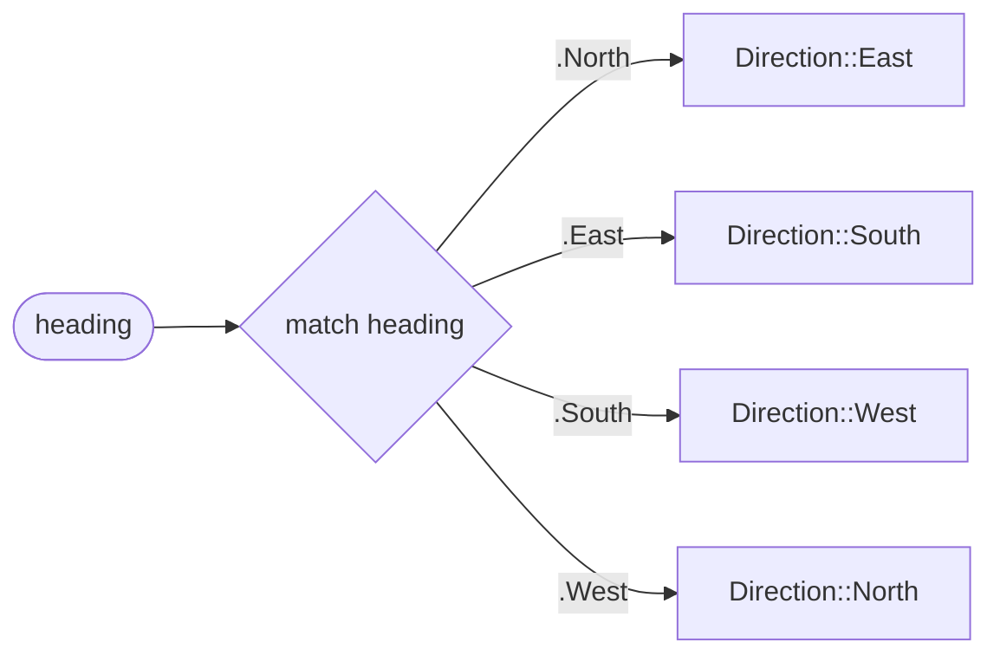

# Enum

::note
<!-- sync:needs:start -->

**You'll need**: [Match expression](/docs/learn/match-expression), [Method](/docs/learn/method)
<!-- sync:needs:end -->

::

An **enum** is a type with a fixed list of named values, called its **cases**. A direction is north, east, south or west, and nothing else. Stored as an `int`, a direction could just as well be 47, and nothing would notice; stored as a `Direction`, it cannot — the type has exactly four values, and the compiler knows all of them.

## Declaring an enum

The declaration is `enum`, a name, and the cases separated by commas:

```rux
enum Direction {
    North,
    East,
    South,
    West
}
```

The cases carry no data; each one is simply itself. A case that needs to carry something — a number, a name — is a [variant](/docs/learn/variant), two lessons on.

## Naming a case

A case is named through its type, with `::`:

```rux
var heading = Direction::North;
```

Here the full name is required: nothing else on the line says that `heading` is a `Direction`.

Cases compare with `==` and `!=`:

```rux
PrintLine("back to north: {}", heading == Direction::North);
```

## Matching on an enum

A `match` on a `Direction` already knows the type, so its patterns may use the short form `.North`:

```rux
func TurnRight(self) -> Direction {
    return match self {
        .North => Direction::East,
        .East => Direction::South,
        .South => Direction::West,
        .West => Direction::North
    };
}
```

The short form works wherever the type is already known. A pattern knows it from the value being matched; a value knows it from where it goes — `TurnRight` returns a `Direction`, so its arms could produce `.East` instead of `Direction::East`, and `let d: Direction = .North;` is fine too. The program spells the produced values in full for clarity. Where nothing says which type is meant, the short form is refused.

| Where                                                 | Spelling                       |
| ----------------------------------------------------- | ------------------------------ |
| A `match` pattern on a `Direction`                    | `.North`                       |
| A value whose type is known — a return, a typed `let` | `.North` or `Direction::North` |
| A value with no expected type — `var heading = …`     | `Direction::North`             |

## Every case, no default arm

Neither `match` in the program has a `_ =>` default arm, and neither needs one. Naming all four cases covers every value a `Direction` can hold:



This is the best thing about enums. Add a fifth case, `Up`, and every `match` that does not handle it stops compiling, pointing at the case it is missing. A `_ =>` arm would have swallowed `Up` silently — so leave it out when you mean "every case".

## Methods on an enum

An enum can be extended with methods like any other type. Taking `self` by value is natural here: a case is as small as a number. The program gives `Direction` a `TurnRight` and a `Name`, because an enum cannot be printed with `{}` directly.

## The program

The whole lesson is one package in the [Examples repository](https://github.com/rux-lang/Examples/tree/main/Types/Enum). Its comments explain every step.

<!-- sync:program:start -->

```rux [Src/Main.rux]
// An enum is a type with a fixed list of named values, called its cases. A direction is north,
// east, south or west, and nothing else. Stored as an `int`, a direction could just as well be
// 47, and nothing would notice; stored as a `Direction`, it cannot.
//
// The cases carry no data; each one is simply itself. A case that needs to carry something is a
// `variant`, two lessons on.
import Io::PrintLine;

enum Direction {
    North,
    East,
    South,
    West
}

// An enum can be extended with methods like any other type. Taking `self` by value is natural
// here: a case is as small as a number.
extend Direction {
    // Inside a `match` on a `Direction`, the type is already known, so a pattern may be written
    // `.North` rather than `Direction::North`. A value may be written short the same way wherever
    // its type is already known, as in a value this method returns, but here each arm spells it
    // in full. Where nothing says which type is meant, the short form is refused:
    //     var heading = .North;
    //         error: case '.North' needs an expected type to name its enum or variant
    //         help: write 'Direction::North'
    func TurnRight(self) -> Direction {
        return match self {
            .North => Direction::East,
            .East => Direction::South,
            .South => Direction::West,
            .West => Direction::North
        };
    }

    // An enum cannot be printed with `{}` directly, so it is given a name to print.
    func Name(self) -> char8[..] {
        return match self {
            .North => "north",
            .East => "east",
            .South => "south",
            .West => "west"
        };
    }
}

func Main() -> int {
    // A case is named through its type. Nothing else here says the binding is a `Direction`,
    // so the type has to be written.
    var heading = Direction::North;
    PrintLine("start facing {}", heading.Name());

    for turn in 1..=4 {
        heading = heading.TurnRight();
        PrintLine("turn {}: facing {}", turn, heading.Name());
    }

    // Cases compare with `==` and `!=`.
    PrintLine("back to north: {}", heading == Direction::North);
    PrintLine("facing east:   {}", heading == Direction::East);

    // Neither `match` above needs a `_` arm: naming all four cases covers every value a
    // `Direction` can hold. Add a fifth case, and both stop compiling until they handle it.
    return 0;
}
```

<!-- sync:program:end -->

## Run it

```sh
cd Examples/Types/Enum
rux run
```

<!-- sync:output:start -->

```
start facing north
turn 1: facing east
turn 2: facing south
turn 3: facing west
turn 4: facing north
back to north: true
facing east:   false
```

<!-- sync:output:end -->

## Common mistakes

::mistake
**The short form with no type to go on.**\
`var heading = .North;` fails with:

```text
error: case '.North' needs an expected type to name its enum or variant
help: write 'Direction::North'
```

`.North` alone could belong to any enum. Write the type — `Direction::North`, or `var heading: Direction = .North;`.
::

::mistake
**A case without its type.**\
`let d = North;` fails with:

```text
error: name 'North' is not defined in this scope
```

Cases live inside their enum: `Direction::North`.
::

::mistake
**Leaving a case out of a `match`.**\
A `match` naming only three directions fails with:

```text
error: match on 'Direction' is not exhaustive; missing Direction::West
help: add arms for the missing cases, or a '_' arm
```

Add the missing arm. A `_` arm would also compile, but it hides the next case someone adds.
::

::mistake
**Printing an enum with `{}`.**\
`PrintLine("{}", heading)` fails with:

```text
error: no matching overload for 'PrintLine' with argument types (char8[..], Direction)
```

Give the enum a `Name` method, as the program does.
::

## Try it yourself

1. Add a `TurnLeft` method, and check that turning left then right comes back to the same heading.
2. Add `func Opposite(self) -> Direction`, writing its arm values in the short form.
3. Add a fifth case, `Up`, and read the errors from both `match`es. Then handle it.
4. Declare `enum Suit { Clubs, Diamonds, Hearts, Spades }` with a `Name` method, and print all four.

## Learn more

- [Enumerations](/docs/lang/enums/overview) in the Rux Reference
- [Match expression](/docs/learn/match-expression) — the `match` that produces a value
- [Enum value](/docs/learn/enum-value) — the number behind each case
- [Exhaustive](/docs/learn/exhaustive) — how the compiler checks that every case is handled
