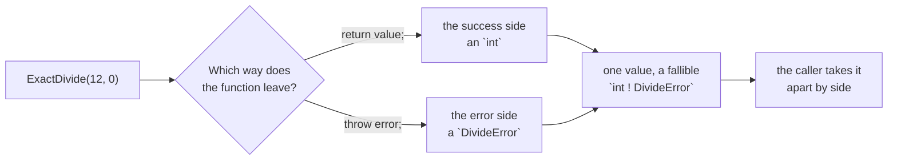

# Fallible

::note
<!-- sync:needs:start -->

**You'll need**: [Optional](/docs/learn/optional), [Variant](/docs/learn/variant)
<!-- sync:needs:end -->

::

An [optional](/docs/learn/optional) says that a value is missing, but never _why_. Often the why is exactly what the caller needs. Dividing 12 by 0 and dividing 13 by 4 both fail to give an exact answer — for different reasons that deserve different replies.

A function that can fail says so in its signature, and names the reason. `-> int ! DivideError` reads "returns an `int`, or else fails with a `DivideError`". This lesson introduces that signature and shows how a caller finds out which of the two it got; the rest of Part 9 is about the shorter ways of handling the second one.

## Two sides

The type before the `!` is the **success**, the answer. The type after it is the **error**, an ordinary value describing what went wrong. The error type is whatever suits, and a [variant](/docs/learn/variant) is a natural fit: one case for each way the operation can go wrong.

```rux
variant DivideError {
    ByZero,
    NotExact(int)
}
```

`NotExact` carries the remainder with it, so the caller can say how far off the division was. The signature puts the two sides together, success first, error after the `!`:

```rux
func ExactDivide(numerator: int, denominator: int) -> int ! DivideError {
```

| Signature              | The call gives                                      |
| ---------------------- | --------------------------------------------------- |
| `-> int`               | always an `int`                                     |
| `-> int?`              | an `int`, or nothing — with no reason given         |
| `-> int ! DivideError` | an `int`, or a `DivideError` saying what went wrong |

## The success needs no ceremony

Inside a function that can fail, `return value;` is the success, just as a plain value returned from an `int?` function is a present one. `throw`, the subject of the [next lesson](/docs/learn/fail), leaves through the error side instead:

```rux
if denominator == 0 {
    throw DivideError::ByZero;
}
if numerator % denominator != 0 {
    throw DivideError::NotExact(numerator % denominator);
}
return numerator / denominator;
```



## A call gives a fallible

A call to `ExactDivide` is not an `int`. It is a _fallible_, `int ! DivideError`: one value that holds either the success or the error. `match` takes it apart by side:

```rux
match ExactDivide(numerator, denominator) {
    .Success(value) => PrintLine("{} / {} = {}", numerator, denominator, value),
    .Failure(.ByZero) => PrintLine("{} / {} fails: no dividing by zero", numerator, denominator),
    .Failure(.NotExact(remainder)) => PrintLine("{} / {} fails: {} left over", numerator, denominator, remainder)
}
```

`.Success(...)` is the success side and binds the answer. `.Failure(...)` is the error side, and the pattern inside it is matched against the error — the same patterns as in a [variant match](/docs/learn/variant-match) — so each case of `DivideError` gets its own reply.

| Pattern                          | Matches                        | Binds                     |
| -------------------------------- | ------------------------------ | ------------------------- |
| `.Success(value)`                | the success side               | the answer, a plain `int` |
| `.Failure(.ByZero)`              | the error side with `ByZero`   | nothing                   |
| `.Failure(.NotExact(remainder))` | the error side with `NotExact` | the remainder             |

Together the arms must cover both sides and every case, so no failure can slip through unnoticed.

## An error is never dropped by accident

A fallible is not its success. Dividing it by 2 is refused, because there may be an error inside instead of a number, and so is calling `ExactDivide(12, 4);` on its own line and ignoring what comes back. An error can never be dropped without the code saying so.

Matching by side is the long way of handling an error. The lessons ahead show the shorter ones: `catch`, `!!` and `!`.

## The program

The whole lesson is one package in the [Examples repository](https://github.com/rux-lang/Examples/tree/main/Errors/Fallible). Its comments explain every step.

<!-- sync:program:start -->

```rux [Src/Main.rux]
// An optional says that a value is missing, but never why. Often the why is exactly what the
// caller needs: dividing 12 by 0 and dividing 13 by 4 both fail to give an exact answer, for
// different reasons that deserve different replies.
//
// `-> int ! DivideError` reads "returns an `int`, or else fails with a `DivideError`". The type
// before the `!` is the success, the answer. The type after it is the error, a value describing
// what went wrong. The error type is whatever suits, and a variant is a natural fit: one case for
// each way the operation can go wrong.
//
// The success needs no ceremony. `return value;` in a function that can fail is the success, just
// as a plain value returned from an `int?` function is a present one.
import Io::PrintLine;

// The ways an exact division can go wrong. `NotExact` carries the remainder with it.
variant DivideError {
    ByZero,
    NotExact(int)
}

// The signature says it all: this produces an `int`, or fails with a `DivideError`. `throw`, the
// subject of the next lesson, leaves through the error side; an ordinary `return` is the success.
func ExactDivide(numerator: int, denominator: int) -> int ! DivideError {
    if denominator == 0 {
        throw DivideError::ByZero;
    }
    if numerator % denominator != 0 {
        throw DivideError::NotExact(numerator % denominator);
    }
    return numerator / denominator;
}

// A call to `ExactDivide` is not an `int`. It is a *fallible*, `int ! DivideError`: one value that
// holds either the success or the error, and `match` takes it apart by side. `.Success(value)`
// is the success side and binds the answer. `.Failure(...)` is the error side, and the pattern
// inside it is matched against the error, so each case of `DivideError` gets its own reply.
// Together the arms must cover both sides and every case.
func Report(numerator: int, denominator: int) {
    match ExactDivide(numerator, denominator) {
        .Success(value) => PrintLine("{} / {} = {}", numerator, denominator, value),
        .Failure(.ByZero) => PrintLine("{} / {} fails: no dividing by zero", numerator, denominator),
        .Failure(.NotExact(remainder)) => PrintLine("{} / {} fails: {} left over", numerator, denominator, remainder)
    }
}

func Main() -> int {
    Report(12, 4);
    Report(12, 0);
    Report(13, 4);

    // A fallible is not its success. `let half = ExactDivide(12, 2) / 2;` is rejected — "operator
    // '/' cannot combine left operand 'int ! DivideError' with right operand 'int'" — and so is
    // calling `ExactDivide(12, 4);` and ignoring what comes back — "'ExactDivide' can fail with
    // 'DivideError', and the result is not used". An error can never be dropped without the code
    // saying so. The lessons ahead show the shorter ways to handle one: `catch`, `!!` and `!`.
    return 0;
}
```

<!-- sync:program:end -->

## Run it

```sh
cd Examples/Errors/Fallible
rux run
```

<!-- sync:output:start -->

```
12 / 4 = 3
12 / 0 fails: no dividing by zero
13 / 4 fails: 1 left over
```

<!-- sync:output:end -->

## Common mistakes

::mistake
**Using a fallible as if it were the answer.**\
`let half = ExactDivide(12, 2) / 2;` fails with:

```text
error: operator '/' cannot combine left operand 'int ! DivideError' with right operand 'int'
help: pass the error on with '!', replace it with '!!', or handle it with 'catch { ... }'
```

The call gives the whole outcome, not the `int` inside it. Take it apart first — with a `match` here, or with one of the forms the help names.
::

::mistake
**Ignoring the outcome.**\
`ExactDivide(12, 4);` written on its own line is refused:

```text
error: 'ExactDivide' can fail with 'DivideError', and the result is not used
help: pass the error on with '!', ignore it with '!!;', or handle it with 'catch { ... }'
```

An error that nothing handles would be lost. [Discard](/docs/learn/discard) shows how to drop one on purpose.
::

::mistake
**Leaving a case out.**\
Delete the `NotExact` arm from `Report` and the match fails with:

```text
error: match on 'int ! DivideError' is not exhaustive; missing DivideError::NotExact(_)
```

The `.Failure` arms are matched against the error, so every case of the error needs one.
::

## Try it yourself

1. Add `Report(0, 5);` to `Main`. Predict the line it prints before you run it.
2. Delete the `.Failure(.NotExact(remainder))` arm from `Report` and read the error. Which case does the compiler say is missing?
3. Add a case `Negative` to `DivideError` and throw it when the denominator is below zero. Where does the compiler send you next, and why?

## Learn more

- [Fail](/docs/learn/fail) — leaving through the error side with `throw`
- [Outcome](/docs/learn/outcome) — keeping a fallible to look at later
- [Optional](/docs/learn/optional) — the simpler form, for a value that may be missing with no reason given
- [Errors](/docs/lang/errors/overview) and [Matching by side](/docs/lang/errors/fallible-values#matching-by-side) in the Rux Reference
