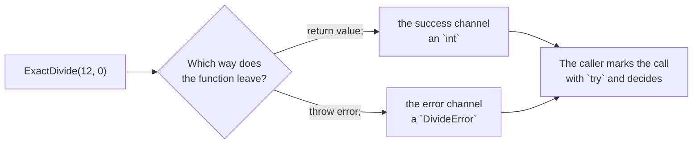

# Fallible

::note
<!-- sync:needs:start -->

**You'll need**: [Optional](/docs/learn/optional), [Variant](/docs/learn/variant)
<!-- sync:needs:end -->

::

An [optional](/docs/learn/optional) says that a value is missing, but never _why_. Often the why is exactly what the caller needs. Dividing 12 by 0 and dividing 13 by 4 both fail to give an exact answer — for different reasons that deserve different replies.

A function that can fail says so in its signature, and names the reason. `-> int throws DivideError` reads "returns an `int`, or else throws a `DivideError`". This lesson introduces that signature and shows how a caller finds out which of the two it got; the rest of Part 9 is about the many ways of handling the second one.

## Two channels

A throwing function has two ways out. The **success** channel carries the answer, the type after `->`. The **error** channel carries an _error_ — an ordinary value describing what went wrong, of the type after `throws`. The error type is whatever suits, and a [variant](/docs/learn/variant) is a natural fit: one case for each way the operation can go wrong.

```rux
variant DivideError {
    ByZero,
    NotExact(int)
}
```

`NotExact` carries the remainder with it, so the caller can say how far off the division was. The signature puts the two channels side by side, success type first, error type after `throws`:

```rux
func ExactDivide(numerator: int, denominator: int) -> int throws DivideError {
```

| Signature                   | The call gives                                      |
| --------------------------- | --------------------------------------------------- |
| `-> int`                    | always an `int`                                     |
| `-> int?`                   | an `int`, or nothing — with no reason given         |
| `-> int throws DivideError` | an `int`, or a `DivideError` saying what went wrong |

## The success needs no ceremony

Inside a throwing function, `return value;` is the success, just as a plain value returned from an `int?` function is a present one. `throw`, the subject of the [next lesson](/docs/learn/fail), leaves through the error channel instead:

```rux
if denominator == 0 {
    throw DivideError::ByZero;
}
if numerator % denominator != 0 {
    throw DivideError::NotExact(numerator % denominator);
}
return numerator / denominator;
```



## Handling the error with try and catch

A call to a throwing function is never just a value: the caller has to say what happens if it throws. The simplest way is a `try { ... } catch { ... }` block. The statements in the block run as long as every call succeeds; the first error jumps to the `catch` arms:

```rux
try {
    let value = ExactDivide(numerator, denominator);
    PrintLine("{} / {} = {}", numerator, denominator, value);
} catch {
    DivideError::ByZero => PrintLine("{} / {} fails: no dividing by zero", numerator, denominator),
    DivideError::NotExact(remainder) => PrintLine("{} / {} fails: {} left over", numerator, denominator, remainder)
}
```

Inside the block, `value` is a plain `int` — the success, already taken out. The `catch` arms are ordinary match arms over the error, the same [variant match](/docs/learn/variant-match) you already know, and together they must cover every case.

An error can never slip past unnoticed. A call that can throw and is not marked with `try` — written in a `try` block, or behind one of the other forms later lessons cover — does not compile.

## The program

The whole lesson is one package in the [Examples repository](https://github.com/rux-lang/Examples/tree/main/Errors/Fallible). Its comments explain every step.

<!-- sync:program:start -->

```rux [Src/Main.rux]
// An optional says that a value is missing, but never why. Often the why is exactly what the
// caller needs: dividing 12 by 0 and dividing 13 by 4 both fail to give an exact answer, for
// different reasons that deserve different replies.
//
// `-> int throws DivideError` reads "returns an `int`, or else throws a `DivideError`". The
// return type holds the answer. The `throws` clause names the error, a value describing what
// went wrong. The error type is whatever suits, and a variant is a natural fit: one case for each
// way the operation can go wrong.
//
// The success needs no ceremony. `return value;` in a throwing function is the success, just as a
// plain value returned from an `int?` function is a present one.
import Io::PrintLine;

// The ways an exact division can go wrong. `NotExact` carries the remainder with it.
variant DivideError {
    ByZero,
    NotExact(int)
}

// The signature says it all: this produces an `int`, or throws a `DivideError`. `throw`, the
// subject of the next lesson, leaves through the error channel; an ordinary `return` is the
// success.
func ExactDivide(numerator: int, denominator: int) -> int throws DivideError {
    if denominator == 0 {
        throw DivideError::ByZero;
    }
    if numerator % denominator != 0 {
        throw DivideError::NotExact(numerator % denominator);
    }
    return numerator / denominator;
}

// To use the answer, mark the call with `try` and say what happens on failure. In a
// `try { ... } catch { ... }` block, the statements run as long as every call succeeds; the first
// error jumps to the `catch` arms. The arms are match arms over the error, so each case of
// `DivideError` gets its own reply, and together they must cover every case.
func Report(numerator: int, denominator: int) {
    try {
        let value = ExactDivide(numerator, denominator);
        PrintLine("{} / {} = {}", numerator, denominator, value);
    } catch {
        DivideError::ByZero => PrintLine("{} / {} fails: no dividing by zero", numerator, denominator),
        DivideError::NotExact(remainder) => PrintLine("{} / {} fails: {} left over", numerator, denominator, remainder)
    }
}

func Main() -> int {
    Report(12, 4);
    Report(12, 0);
    Report(13, 4);

    // A throwing call must be marked. `let half = ExactDivide(12, 2) / 2;` is rejected, and so is
    // calling `ExactDivide(12, 4);` and ignoring what may come back — "call to 'ExactDivide' can
    // throw 'DivideError' but is not marked with 'try'". An error can never be dropped without the
    // code saying so.
    return 0;
}
```

<!-- sync:program:end -->

## Run it

```sh
cd Examples/Errors/Fallible
rux run
```

<!-- sync:output:start -->

```
12 / 4 = 3
12 / 0 fails: no dividing by zero
13 / 4 fails: 1 left over
```

<!-- sync:output:end -->

## Common mistakes

::mistake
**Using a throwing call as if it were the answer.**\
`let half = ExactDivide(12, 2) / 2;` outside a `try` block fails with:

```text
error: call to 'ExactDivide' can throw 'DivideError' but is not marked with 'try'
help: write 'try' before the expression
```

The same error stops `ExactDivide(12, 4);` written on its own line: an error that nothing handles would be lost. [Discard](/docs/learn/discard) shows how to drop one on purpose.
::

::mistake
**Leaving a case out of `catch`.**\
Delete the `NotExact` arm and the block fails with:

```text
error: match on 'DivideError' is not exhaustive; missing DivideError::NotExact
help: add arms for the missing cases, or a '_' arm
```

The arms of a `catch` are a match over the error, so every case needs one.
::

::mistake
**Forgetting `throws` in the signature.**\
Write `-> int` without `throws DivideError` and every `throw` in the body is refused:

```text
error: 'throw' needs a function that throws, but 'ExactDivide' returns 'int'
help: declare 'throws E' on the function, or throw inside 'try { ... } catch { ... }'
```

The error type is part of the contract, so it has to be in the signature.
::

## Try it yourself

1. Add `Report(0, 5);` to `Main`. Predict the line it prints before you run it.
2. Delete the `NotExact` arm from `Report`'s `catch` and read the error. Which case does the compiler say is missing?
3. Add a case `Negative` to `DivideError` and throw it when the denominator is below zero. Where does the compiler send you next, and why?

## Learn more

- [Fail](/docs/learn/fail) — leaving through the error channel with `throw`
- [Outcome](/docs/learn/outcome) — keeping an outcome in Core's `Result<T, E>`
- [Optional](/docs/learn/optional) — the simpler form, for a value that may be missing with no reason given
- [Errors](/docs/lang/errors/overview) and [Handling errors](/docs/lang/errors/handling) in the Rux Reference
