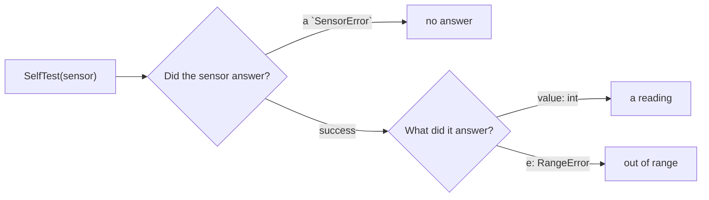

# Nested fallible

::note
<!-- sync:needs:start -->

**You'll need**: [Nested optional](/docs/learn/nested-optional), [Outcome](/docs/learn/outcome)
<!-- sync:needs:end -->

::

A return type and an error combine, and each level keeps its own meaning. You saw nesting with optionals in [Nested optional](/docs/learn/nested-optional); this lesson does the same with errors. Two shapes come up all the time, and both are about keeping two different answers apart.

## The next value, the end, or an error

`-> int? ! SensorError` is the shape of "read the next value". Three answers are possible: a value, no more values (`none`), or the read itself broke (an error):

```rux
func Reading(sensor: int, index: int) -> int? ! SensorError {
```

The `?` binds tighter than the `!`, so this is an optional `int` that can fail. Running out is not an error, and a broken sensor is not "no more", so both levels are needed. The `catch` deals with the error, and a `match` on what is left tells a value from the end:

```rux
let next = Reading(sensor, index) catch {
    e => {
        PrintLine(" (sensor {} broke)", e.sensor);
        break;
    }
};
match next {
    value? => Print(" {}", value),
    none => {
        PrintLine(" (end)");
        break;
    }
}
```

A `catch` arm may leave the loop with `break`, just as it may leave the function with `return`. What is left is the `int?`, with its own `none` untouched.

| Where           | Means                                  |
| --------------- | -------------------------------------- |
| `value?`        | the read worked and found a value      |
| `none`          | the read worked and found nothing more |
| the `catch` arm | the read itself broke                  |

Walking a folder in the `FileSystem` package has exactly this shape, as you will see in [Directory](/docs/learn/directory).

## An answer that can itself be a failure

`-> (int ! RangeError) ! SensorError` is the shape of "ask for a result that can itself be a failure". The outer error means the question never got an answer. The success holds the answer, and that answer is itself a [fallible](/docs/learn/outcome): the sensor replied, and what it replied may be "out of range".

```rux
func SelfTest(sensor: int) -> (int ! RangeError) ! SensorError {
```

The inner fallible is grouped in parentheses, because `!` does not chain. Inside, the answer comes from `InRange`, which fails with a `RangeError`:

```rux
if sensor == 3 {
    throw SensorError { sensor: sensor };
}
// The inner fallible is returned as the success, not passed on with `!`.
let answer = InRange(if sensor == 2 { 999 } else { 21 });
return answer;
```

An outcome that has to be handed back as data, rather than handled at the call, is kept this way.



## Levels never merge

`catch`, `!!` and `!` on the call handle only the outer error, and what they leave is the success with its inner level intact. So the `catch` sees only the `SensorError`, and `answer` is the inner `int ! RangeError`, which an ordinary `match` by side takes apart:

```rux
let answer = SelfTest(sensor) catch {
    e => {
        PrintLine("sensor {} test: no answer", e.sensor);
        continue;
    }
};
match answer {
    value: int => PrintLine("sensor {} test: reads {}", sensor, value),
    e: RangeError => PrintLine("sensor {} test: {} is out of range", sensor, e.value)
}
```

Sensor 2 did answer, so the `catch` has nothing to do, and the `match` prints `999 is out of range`. Only sensor 3, which never answered, reaches the `catch` arm.

## The program

The whole lesson is one package in the [Examples repository](https://github.com/rux-lang/Examples/tree/main/Errors/NestedFallible). Its comments explain every step.

<!-- sync:program:start -->

```rux [Src/Main.rux]
// A return type and an error combine, and each level keeps its own meaning.
// Two shapes come up all the time.
//
// `-> int? ! SensorError`: "read the next value". Three answers are
// possible: a value, no more values (`none`), or the read itself broke (an
// error). Running out is not an error and a broken sensor is not "no more",
// so both levels are needed. The `?` binds tighter than the `!`, so this is
// an optional `int` that can fail. Walking a folder in the `FileSystem`
// package has exactly this shape.
//
// `-> (int ! RangeError) ! SensorError`: "ask for a result that can itself
// be a failure". The outer error means the question never got an answer. The
// success holds the answer, and that answer is itself a fallible: the sensor
// replied, and what it replied may be "out of range". An outcome that has to
// be handed back as data, rather than handled at the call, is kept this way.
// The inner fallible is grouped in parentheses, because `!` does not chain.
//
// Levels never merge. `catch`, `!!` and `!` on the call handle only the outer
// error, and what they leave is the success with its inner level intact; a
// `match` on it reaches every other case.
import Io::{ Print, PrintLine };

struct SensorError {
    sensor: int;
}

struct RangeError {
    value: int;
}

// Sensor 1 logged three readings. Sensor 2 broke while reading its third.
func Reading(sensor: int, index: int) -> int? ! SensorError {
    if sensor == 2 && index == 2 {
        throw SensorError { sensor: sensor };
    }
    if index >= 3 {
        return none;
    }
    return 20 + index;
}

// Accepts a reading up to 100.
func InRange(value: int) -> int ! RangeError {
    if value > 100 {
        throw RangeError { value: value };
    }
    return value;
}

// Sensor 1 answers 21, sensor 2 answers with a reading it rejects, and
// sensor 3 does not answer at all.
func SelfTest(sensor: int) -> (int ! RangeError) ! SensorError {
    if sensor == 3 {
        throw SensorError { sensor: sensor };
    }
    // The inner fallible is returned as the success, not passed on with `!`.
    let answer = InRange(if sensor == 2 { 999 } else { 21 });
    return answer;
}

func Main() -> int {
    for sensor in 1..=2 {
        Print("sensor {} log:", sensor);
        for index in 0..10 {
            // A `catch` arm may leave the loop with `break`. What is left is
            // the `int?`, with its own `none` untouched.
            let next = Reading(sensor, index) catch {
                e => {
                    PrintLine(" (sensor {} broke)", e.sensor);
                    break;
                }
            };
            match next {
                value? => Print(" {}", value),
                none => {
                    PrintLine(" (end)");
                    break;
                }
            }
        }
    }

    for sensor in 1..=3 {
        // `catch` sees only the outer `SensorError`; `answer` is the inner
        // `int ! RangeError`, which the `match` takes apart.
        let answer = SelfTest(sensor) catch {
            e => {
                PrintLine("sensor {} test: no answer", e.sensor);
                continue;
            }
        };
        match answer {
            value: int => PrintLine("sensor {} test: reads {}", sensor, value),
            e: RangeError => PrintLine("sensor {} test: {} is out of range", sensor, e.value)
        }
    }
    return 0;
}
```

<!-- sync:program:end -->

## Run it

```sh
cd Examples/Errors/NestedFallible
rux run
```

<!-- sync:output:start -->

```
sensor 1 log: 20 21 22 (end)
sensor 2 log: 20 21 (sensor 2 broke)
sensor 1 test: reads 21
sensor 2 test: 999 is out of range
sensor 3 test: no answer
```

<!-- sync:output:end -->

## Common mistakes

::mistake
**Forgetting the end of the data.**\
Drop the `none` arm from `match next` and the compiler says:

```text
error: match on 'int?' is not exhaustive; missing none
```

::

::mistake
**Treating the answer as the reading.**\
After the `catch`, `answer` is an `int ! RangeError`, not an `int`. `answer * 2` is an error:

```text
error: operator '*' cannot combine left operand 'int ! RangeError' with right operand 'int'
help: pass the error on with '!', replace it with '!!', or handle it with 'catch { ... }'
```

The `catch` removed only the outer level; the inner fallible is still there to match.
::

::mistake
**Chaining ! in a type.**\
`-> int ! RangeError ! SensorError` does not read as two levels:

```text
error: '!' does not chain in a type
help: group the inner fallible, as in '(T ! E) ! F'
```

::

## Try it yourself

1. Extend the first loop to sensor 3 with `1..=3`. Predict its log line before you run.
2. Make sensor 1's self-test answer 150 and check that it is reported as out of range.
3. Write `func FirstReading(sensor: int) -> int? ! SensorError` that returns the reading at index 0, passing the error on with `!`. What type does `Reading(sensor, 0)!` have?

## Learn more

- [Nested optional](/docs/learn/nested-optional): the same idea with `T??`
- [Outcome](/docs/learn/outcome): keeping a fallible and taking it apart by side
- [Iterator](/docs/learn/iterator): `T?` as "the next item, or the end"
- [Directory](/docs/learn/directory): a real `-> T? ! E` from the `FileSystem` package
- [Nested fallibles](/docs/lang/errors/fallible-values#nested-fallibles) in the Rux Reference
