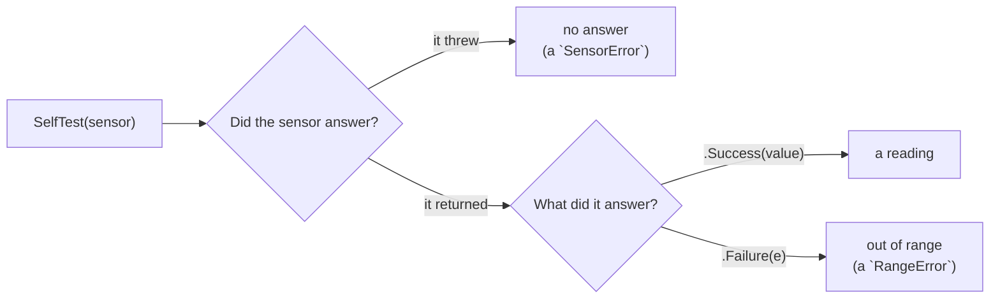

# Nested fallible

::note
<!-- sync:needs:start -->

**You'll need**: [Nested optional](/docs/learn/nested-optional), [Outcome](/docs/learn/outcome)
<!-- sync:needs:end -->

::

A return type and a `throws` clause combine, and each level keeps its own meaning. You saw nesting with optionals in [Nested optional](/docs/learn/nested-optional); this lesson does the same with errors. Two shapes come up all the time, and both are about keeping two different answers apart.

## The next value, the end, or an error

`-> int? throws SensorError` is the shape of "read the next value". Three answers are possible: a value, no more values, or the read itself broke:

```rux
func Reading(sensor: int, index: int) -> int? throws SensorError {
```

Running out is not an error, and a broken sensor is not "no more" — so both levels are needed. The `catch` deals with the thrown error, and a `match` on what comes back tells a value from the end:

```rux
let next = try Reading(sensor, index) catch {
    e => {
        PrintLine(" (sensor {} broke)", e.sensor);
        break;
    }
};
match next {
    .Some(value) => Print(" {}", value),
    none => {
        PrintLine(" (end)");
        break;
    }
}
```

A `catch` arm may leave the loop with `break`, just as it may leave the function with `return`.

| Where           | Means                                  |
| --------------- | -------------------------------------- |
| `.Some(value)`  | the read worked and found a value      |
| `none`          | the read worked and found nothing more |
| the `catch` arm | the read itself broke                  |

Walking a folder in the `FileSystem` package has exactly this shape, as you will see in [Directory](/docs/learn/directory).

## An answer that can itself be a failure

`-> Result<int, RangeError> throws SensorError` is the shape of "ask for a result that can itself be a failure". The thrown error means the question never got an answer. A returned value holds the answer, and that answer is Core's [`Result`](/docs/learn/outcome), an ordinary variant: the sensor replied, and what it replied may be "out of range".

```rux
if sensor == 3 {
    throw SensorError { sensor: sensor };
}
let answer: Result<int, RangeError> = if sensor == 2 {
    .Failure(RangeError { value: 999 })
} else {
    .Success(21)
};
return answer;
```

An outcome that has to be handed back as data, rather than handled at the call, is stored this way.



## Levels never merge

The inner failure is ordinary data inside the returned value, so `try` and `catch` on the call never touch it. `catch` handles the thrown error; a `match` on what comes back reaches every other case:

```rux
try {
    match SelfTest(sensor) {
        .Success(value) => PrintLine("sensor {} test: reads {}", sensor, value),
        .Failure(e) => PrintLine("sensor {} test: {} is out of range", sensor, e.value)
    }
} catch {
    e => PrintLine("sensor {} test: no answer", e.sensor)
}
```

Sensor 2 did answer, so the `catch` has nothing to do, and the `match` prints `999 is out of range`. Only sensor 3, which threw, reaches the `catch` arm.

## The program

The whole lesson is one package in the [Examples repository](https://github.com/rux-lang/Examples/tree/main/Errors/NestedFallible). Its comments explain every step.

<!-- sync:program:start -->

```rux [Src/Main.rux]
// A return type and a `throws` clause combine, and each level keeps its own
// meaning. Two shapes come up all the time.
//
// `-> int? throws SensorError` — "read the next value". Three answers are
// possible: a value, no more values (`none`), or the read itself broke (an
// error). Running out is not an error and a broken sensor is not "no more",
// so both levels are needed. Walking a folder in the `FileSystem` package has
// exactly this shape.
//
// `-> Result<int, RangeError> throws SensorError` — "ask for a result that
// can itself be a failure". The thrown error means the question never got an
// answer. A returned value holds the answer, and that answer is Core's
// `Result`, an ordinary variant: the sensor replied, and what it replied may
// be "out of range". An outcome that has to be handed back as data, rather
// than handled at the call, is stored this way.
//
// Levels never merge. The inner failure is ordinary data inside the returned
// value, so `try` and `catch` on the call never touch it. `catch` handles the
// thrown error; a `match` on what comes back reaches every other case.
import Core::Result;
import Io::{ Print, PrintLine };

struct SensorError {
    sensor: int;
}

struct RangeError {
    value: int;
}

// Sensor 1 logged three readings. Sensor 2 broke while reading its third.
func Reading(sensor: int, index: int) -> int? throws SensorError {
    if sensor == 2 && index == 2 {
        throw SensorError { sensor: sensor };
    }
    if index >= 3 {
        return none;
    }
    return 20 + index;
}

// Sensor 1 answers 21, sensor 2 answers with a reading it rejects, and
// sensor 3 does not answer at all.
func SelfTest(sensor: int) -> Result<int, RangeError> throws SensorError {
    if sensor == 3 {
        throw SensorError { sensor: sensor };
    }
    let answer: Result<int, RangeError> = if sensor == 2 {
        .Failure(RangeError { value: 999 })
    } else {
        .Success(21)
    };
    return answer;
}

func Main() -> int {
    for sensor in 1..=2 {
        Print("sensor {} log:", sensor);
        for index in 0..10 {
            // A `catch` arm may leave the loop with `break`.
            let next = try Reading(sensor, index) catch {
                e => {
                    PrintLine(" (sensor {} broke)", e.sensor);
                    break;
                }
            };
            match next {
                .Some(value) => Print(" {}", value),
                none => {
                    PrintLine(" (end)");
                    break;
                }
            }
        }
    }

    for sensor in 1..=3 {
        try {
            match SelfTest(sensor) {
                .Success(value) => PrintLine("sensor {} test: reads {}", sensor, value),
                .Failure(e) => PrintLine("sensor {} test: {} is out of range", sensor, e.value)
            }
        } catch {
            e => PrintLine("sensor {} test: no answer", e.sensor)
        }
    }
    return 0;
}
```

Besides `Io`, its `Rux.toml` lists `Core` under `[Dependencies]`.
<!-- sync:program:end -->

## Run it

```sh
cd Examples/Errors/NestedFallible
rux run
```

<!-- sync:output:start -->

```
sensor 1 log: 20 21 22 (end)
sensor 2 log: 20 21 (sensor 2 broke)
sensor 1 test: reads 21
sensor 2 test: 999 is out of range
sensor 3 test: no answer
```

<!-- sync:output:end -->

## Common mistakes

::mistake
**Forgetting the end of the data.**\
Drop the `none` arm from `match next` and the compiler says:

```text
error: match on 'int?' is not exhaustive; missing none
```

::

::mistake
**Treating the optional as the reading.**\
After the `catch`, `next` is an `int?`, not an `int`. `next + 1` is an error:

```text
error: operator '+' cannot combine left operand 'int?' with right operand 'int'
```

The `catch` removed only the error level; the absence level is still there to match.
::

::mistake
**Treating the result as the reading.**\
`SelfTest(sensor) * 2` in the `try` block is an error:

```text
error: operator '*' cannot combine left operand 'Result<int, RangeError>' with right operand 'int'
```

The answer is a `Result`; match it to reach the `int`.
::

## Try it yourself

1. Extend the first loop to sensor 3 with `1..=3`. Predict its log line before you run.
2. Make sensor 1's self-test answer 150 and treat anything over 100 as out of range.
3. Write `func FirstReading(sensor: int) -> int? throws SensorError` that returns the reading at index 0 with plain `try`. What type does `try Reading(sensor, 0)` have?

## Learn more

- [Nested optional](/docs/learn/nested-optional) — the same idea with `T??`
- [Outcome](/docs/learn/outcome) — Core's `Result` as patterns and constructors
- [Iterator](/docs/learn/iterator) — `T?` as "the next item, or the end"
- [Directory](/docs/learn/directory) — a real `-> T? throws E` from the `FileSystem` package
