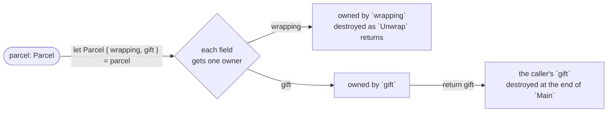

# Replace and swap

::note
<!-- sync:needs:start -->

**You'll need**: [Give away](/docs/learn/give-away), [Destructor](/docs/learn/destructor), [Mutable reference](/docs/learn/mutable-reference), [Destructure](/docs/learn/destructure), [Struct pattern](/docs/learn/struct-pattern)
<!-- sync:needs:end -->

::

A parcel is wrapping paper around a gift. It is tempting to give just the gift away and leave the rest where it is, but Rux refuses: a field cannot be [given away](/docs/learn/give-away) on its own. Every value has exactly one owner, and half a parcel would break that.

There are two ways round it. Core's `Replace` and `Swap` take a field out by putting another value in its place, so the parcel stays whole. Or a [struct pattern](/docs/learn/struct-pattern) takes the **whole** parcel apart, so that every field gets exactly one new owner.

## The parcel

`Item` announces its own destruction. `Parcel` holds two of them and has no destructor of its own:

```rux
struct Item {
    name: char8[..];
}

extend Item {
    destructor {
        PrintLine("    {} destroyed", self.name);
    }
}

// No destructor of its own, so a pattern may take it apart.
struct Parcel {
    wrapping: Item;
    gift: Item;
}
```

`Item` has a [destructor](/docs/learn/destructor), so it owns something and is never copied. Because both its fields are items, `Parcel` is never copied either: copying a parcel would copy the items inside it.

## One field on its own is refused

With `var parcel = Parcel { … };`, the obvious way to get the gift out does not compile:

```rux
let gift = parcel.gift;
```

```
error: 'gift' is a field of 'parcel' and cannot be given away by itself
  note: only a local, a parameter or a temporary is given away; the rest of the value would be left without it
  help: take it with 'Replace(&var parcel.gift, value)' or 'Swap', or take 'parcel' apart with a pattern
```

Half a parcel would be a value that is partly alive. When `parcel`'s scope ended, the compiler could no longer say what to destroy: the wrapping, yes, but not the gift, which has gone elsewhere. Rather than track a value that is part here and part gone, Rux keeps the rule simple: only a whole local, a parameter or a temporary is given away. The same goes for an element of an array and for a value reached through a [reference](/docs/learn/reference): it can be read, but not taken.

The help line names the ways out (`Replace`, `Swap` and a pattern), and the program uses each of them.

## Swap: exchange two places

The gifts went into the wrong parcels. `Swap` exchanges them where they are:

```rux
// The gifts went into the wrong parcels.
var forAda = Parcel { wrapping: Item { name: "red paper" }, gift: Item { name: "scarf" } };
var forBo = Parcel { wrapping: Item { name: "blue paper" }, gift: Item { name: "book" } };

PrintLine("swapping:");
Swap(&var forAda.gift, &var forBo.gift);
```

Both places are lent for writing with `&var`, as in [Mutable reference](/docs/learn/mutable-reference), so both parcels are `var`. Afterwards each place holds the other's value. Nothing is copied and nothing is destroyed: every item still has exactly one owner, just a different one.

## Replace: put one in, take one out

`Replace` puts a new value in a place and hands back the one that was there:

```rux
// The old wrapping comes back to the caller, who owns it now.
PrintLine("replacing:");
let torn = Replace(&var forAda.wrapping, Item { name: "green paper" });
```

`forAda` is whole throughout: its wrapping is green paper now, and `torn` owns the red paper, which is destroyed at the end of `Main` like any other local. Both functions live in Core, so the program imports them:

```rux
import Core::Ownership::{ Replace, Swap };
```

`Replace` and `Swap` work on any place you can lend for writing — a field of a local, an element of an array, or a field reached through a `&var` parameter — and on any struct, with or without a destructor of its own.

## Taking the whole value apart

The third way is to take the whole parcel. A struct pattern in `let` takes the value, and every field gets exactly one owner again:

```rux
// The pattern takes the whole parcel. The gift goes on to the caller, and the wrapping stays with
// this function, which destroys it as it returns. Written `wrapping: _`, it would be destroyed at
// the `let` instead.
func Unwrap(parcel: Parcel) -> Item {
    let Parcel { wrapping, gift } = parcel;
    PrintLine("    unwrapped the {} from the {}", gift.name, wrapping.name);
    return gift;
}
```

- A field bound to a name belongs to that binding. `wrapping` and `gift` are locals of `Unwrap` now, and `return gift;` gives the gift to the caller.
- A field bound to `_`, or left out of the pattern, belongs to nobody, so it is destroyed on the spot, at the `let`.

`Main` hands the whole parcel over with `Unwrap(forAda)`, so `forAda` is empty afterwards. That is why the output reads "green paper destroyed" right after "unwrapped the book": the wrapping ends with `Unwrap`, while the book lives on in `Main`.



## Only a struct that is just its fields

A struct can be taken apart only when it has no destructor of its own. Give `Parcel` a destructor, and that destructor needs the whole parcel to run on, so the same pattern is refused:

```
error: cannot split 'Parcel' with a moving pattern, because it declares a destructor
  note: the destructor runs on the whole value, so no part of it can be taken out on its own
  help: bind the whole value and read its fields, or match a value that stays with its owner
```

| You want                               | Write                                     | Allowed when                  |
| -------------------------------------- | ----------------------------------------- | ----------------------------- |
| one field, given away                  | `let gift = parcel.gift;`                 | never                         |
| one field, with a new one in its place | `Replace(&var parcel.gift, value)`        | `parcel` can be written       |
| two places exchanged                   | `Swap(&var a.gift, &var b.gift)`          | both can be written           |
| every field, each to one owner         | `let Parcel { wrapping, gift } = parcel;` | the struct has no destructor  |
| to look at a field                     | `parcel.gift.name`                        | always: reading takes nothing |

## The program

The whole lesson is one package in the [Examples repository](https://github.com/rux-lang/Examples/tree/main/Ownership/ReplaceSwap). Its comments explain every step.

<!-- sync:program:start -->

```rux [Src/Main.rux]
// A parcel is wrapping paper around a gift. It is tempting to give just the gift away and leave the
// rest where it is, but Rux refuses: a field cannot be given away on its own.
//
//     let gift = parcel.gift;
//
// error: 'gift' is a field of 'parcel' and cannot be given away by itself
//   note: only a local, a parameter or a temporary is given away; the rest of the value would be
//         left without it
//   help: take it with 'Replace(&var parcel.gift, value)' or 'Swap', or take 'parcel' apart with
//         a pattern
//
// Half a parcel would be a value that is partly alive, and the compiler could no longer say what
// to destroy when its scope ends.
//
// Core offers two ways to take a field and leave the value whole. `Replace(&var place, value)`
// puts a new value in the place and returns the old one, and `Swap(&var a, &var b)` exchanges two
// places. Neither copies or destroys anything, so every value still has exactly one owner.
//
// The third way is taking the whole value apart. A struct pattern in `let` takes the parcel, and
// every field gets exactly one owner again: a field bound to a name belongs to that binding, and a
// field bound to `_`, or left out of the pattern, belongs to nobody and is destroyed on the spot.
//
// Only a struct that is nothing more than its fields can be taken apart. Give `Parcel` its own
// destructor and that destructor needs the whole parcel, so the same pattern is refused:
//
// error: cannot split 'Parcel' with a moving pattern, because it declares a destructor
//   note: the destructor runs on the whole value, so no part of it can be taken out on its own
//   help: bind the whole value and read its fields, or match a value that stays with its owner
import Core::Ownership::{ Replace, Swap };
import Io::PrintLine;

struct Item {
    name: char8[..];
}

extend Item {
    destructor {
        PrintLine("    {} destroyed", self.name);
    }
}

// No destructor of its own, so a pattern may take it apart.
struct Parcel {
    wrapping: Item;
    gift: Item;
}

// The pattern takes the whole parcel. The gift goes on to the caller, and the wrapping stays with
// this function, which destroys it as it returns. Written `wrapping: _`, it would be destroyed at
// the `let` instead.
func Unwrap(parcel: Parcel) -> Item {
    let Parcel { wrapping, gift } = parcel;
    PrintLine("    unwrapped the {} from the {}", gift.name, wrapping.name);
    return gift;
}

func Main() -> int {
    // The gifts went into the wrong parcels.
    var forAda = Parcel { wrapping: Item { name: "red paper" }, gift: Item { name: "scarf" } };
    var forBo = Parcel { wrapping: Item { name: "blue paper" }, gift: Item { name: "book" } };

    PrintLine("swapping:");
    Swap(&var forAda.gift, &var forBo.gift);
    PrintLine("    Ada gets the {}, Bo the {}", forAda.gift.name, forBo.gift.name);

    // The old wrapping comes back to the caller, who owns it now.
    PrintLine("replacing:");
    let torn = Replace(&var forAda.wrapping, Item { name: "green paper" });
    PrintLine("    took off the {}, wrapped it in {}", torn.name, forAda.wrapping.name);

    PrintLine("unwrapping:");
    let gift = Unwrap(forAda);
    PrintLine("    reading the {}", gift.name);

    PrintLine("end of Main:");
    return 0;
}
```

Besides `Io`, its `Rux.toml` lists `Core` under `[Dependencies]`.
<!-- sync:program:end -->

## Run it

```sh
cd Examples/Ownership/ReplaceSwap
rux run
```

<!-- sync:output:start -->

```
swapping:
    Ada gets the book, Bo the scarf
replacing:
    took off the red paper, wrapped it in green paper
unwrapping:
    unwrapped the book from the green paper
    green paper destroyed
    reading the book
end of Main:
    book destroyed
    red paper destroyed
    scarf destroyed
    blue paper destroyed
```

<!-- sync:output:end -->

## Common mistakes

::mistake
**Giving a single field away.**\
With a `var` parcel, `let gift = parcel.gift;` fails with:

```text
error: 'gift' is a field of 'parcel' and cannot be given away by itself
  help: take it with 'Replace(&var parcel.gift, value)' or 'Swap', or take 'parcel' apart with a pattern
```

Take it with `Replace` or `Swap`, take the parcel apart with a pattern, or read the field without taking it. `Replace` and `Swap` write the place, so they need one that can be written: for a `let` parcel the help offers only the pattern. Through a reference the message is `'parcel.gift' is reached through a loan and cannot be given away`; through `&var` the help still offers `Replace` and `Swap`, and through a read-only `&` it says to clone the field.
::

::mistake
**Leaving out the `&var`.**\
`Swap(forAda.gift, forBo.gift);` fails once for each argument:

```text
error: 'Swap' writes its argument 'forAda.gift', so the loan must be written
  help: write '&var forAda.gift'
```

`Swap` and `Replace` write the places they are given, so the loan is written out, and the parcels must be `var`. With `let forAda`, the loan fails with `'&var' lends for writing, but this place is immutable`.
::

::mistake
**Splitting a struct that has its own destructor.**\
With a destructor declared in `extend Parcel`, the pattern in `Unwrap` fails with:

```text
error: cannot split 'Parcel' with a moving pattern, because it declares a destructor
```

Bind the parcel whole and read its fields, use `Replace` to take a field out, or drop the destructor if the struct does not really need one.
::

## Try it yourself

1. Leave `wrapping` out of the pattern altogether: `let Parcel { gift } = parcel;`, and print only the gift's name. Where does "green paper destroyed" appear now?
2. Write `func Rewrap(parcel: &var Parcel, paper: Item) -> Item` that puts new paper on a parcel and returns the old paper. Then try `return parcel.gift;` in a function that takes `parcel: &var Parcel`, and read the error.
3. Swap the two whole parcels with `Swap(&var forAda, &var forBo);` instead of the gifts. Predict the rest of the output before you run it.
4. Add a destructor to `Parcel` that prints "parcel opened", and read the error. Then change `Unwrap` to take the gift with `Replace` from a `var` copy of its parameter, `var opened = parcel;`.

## Learn more

- [Struct pattern](/docs/learn/struct-pattern) and [Destructure](/docs/learn/destructure): the patterns used here
- [Mutable reference](/docs/learn/mutable-reference): the `&var` loans `Replace` and `Swap` take
- [Destructor](/docs/learn/destructor): why `Item` and `Parcel` are never copied
- [Initialization](/docs/learn/initialization): the same "whole value" rule when a variable starts empty
- [Copy and move](/docs/lang/ownership/copy-and-move) in the Rux Reference, and [`Replace` and `Swap`](/docs/api/core/ownership) in the Core API
