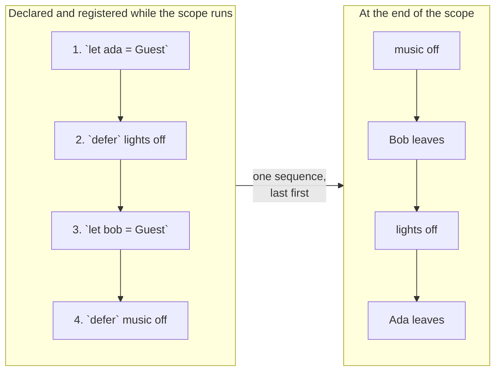

# Defer

::note
<!-- sync:needs:start -->

**You'll need**: [Method](/docs/learn/method), [Return](/docs/learn/return)
<!-- sync:needs:end -->

::

Some work has to be undone however a function ends. A valve that is opened must be shut, on the normal path and on every early `return` as well. Writing the shut before each exit is easy to get wrong, and the mistake is silent: the program runs, and the valve stays open.

`defer` registers a statement now and runs it when the enclosing scope ends, by whichever way it ends. So the cleanup is written **once**, on the line right after the work it undoes, where a reader can check that the two match.

## Cleanup next to the work

A `Valve` can be opened and shut; each method prints, so you can see the order:

```rux
struct Valve {
    name: char8[..];
}

extend Valve {
    func Open(&self) {
        PrintLine("    open {}", self.name);
    }

    func Shut(&self) {
        PrintLine("    shut {}", self.name);
    }
}
```

`Fill` opens two valves, and pairs each `Open` with a deferred `Shut` on the very next line:

```rux
let supply = Valve { name: "supply" };
supply.Open();
defer supply.Shut();

let drain = Valve { name: "drain" };
drain.Open();
defer drain.Shut();
```

Nothing is shut yet. `defer` only remembers the statement; it runs later, when `Fill` ends, and reads `supply` and `drain` as they are then.

## Every way out

`Fill` has two exits — an early `return false` for too much water, and the normal `return true`:

```rux
// An early exit. Both valves are still shut, drain first.
if litres > 100 {
    PrintLine("    {} litres is too much, stopping", litres);
    return false;
}

PrintLine("    filling {} litres", litres);
return true;
```

Neither `return` mentions a valve, yet both valves are shut on both paths. Add a third exit next year, and it will shut them too: the cleanup belongs to the scope, not to any one `return`.

## Last registered, first run

Several defers run in **reverse** order: the last one registered runs first. The drain was opened last, so it is shut first:

```
fill 40:
    open supply
    open drain
    filling 40 litres
    shut drain
    shut supply
```

That is the order cleanup usually needs, because what was set up last tends to depend on what came before it. Values with [destructors](/docs/learn/destructor) follow the same rule, and when a scope has both, they take their turns in **one** sequence: whatever was declared or registered last goes first, defer or value alike.



Here `Guest` is the type from [Destructor](/docs/learn/destructor), whose destructor prints "… leaves". A deferred statement that uses a guest can therefore count on it: anything declared before the `defer` is still alive when the deferred statement runs.

## A defer is registered when it is reached

`defer` is a statement like any other, and it counts only once execution reaches it. A `return` that comes before a `defer` line leaves without running it, which is exactly right, because the work it would undo has not been done yet either. Put a `return` between opening the supply and opening the drain, and only the supply is shut on that path.

A `defer` belongs to the scope it is written in. Inside a loop body, it runs at the end of every pass, not once after the loop. And it may hold more than one step: `defer { … }` defers a whole block.

## Defer or destructor?

|            | Destructor                             | `defer`                           |
| ---------- | -------------------------------------- | --------------------------------- |
| Belongs to | a type: every value of it              | one piece of work in one function |
| Written    | once, `destructor { … }` in `extend T` | at the place the work starts      |
| Runs       | when a value's life ends               | when the enclosing scope ends     |

A destructor cleans up after a value. `defer` is for cleanup that belongs to a piece of work rather than to any one value's life. The valves here are ordinary values with no destructor, and opening one is something `Fill` does, not something every `Valve` needs undone.

## The program

The whole lesson is one package in the [Examples repository](https://github.com/rux-lang/Examples/tree/main/Ownership/Defer). Its comments explain every step.

<!-- sync:program:start -->

```rux [Src/Main.rux]
// Some work has to be undone however a function ends: a valve that is opened must be shut, on
// the normal path and on every early `return` as well. Shutting it before each exit by hand is easy
// to get wrong, and the mistake is silent.
//
// `defer` registers a statement now and runs it when the enclosing scope ends, by whichever way
// it ends. So the cleanup is written once, on the line right after the work it undoes, where a
// reader can check that the two match.
//
// Several defers run in reverse order: the last one registered runs first. That is the order
// cleanup usually needs, because what was set up last tends to depend on what came before it.
//
// A destructor cleans up after a value. `defer` is for cleanup that belongs to a piece of work
// rather than to any one value's life.
import Io::PrintLine;

struct Valve {
    name: char8[..];
}

extend Valve {
    func Open(&self) {
        PrintLine("    open {}", self.name);
    }

    func Shut(&self) {
        PrintLine("    shut {}", self.name);
    }
}

func Fill(litres: int32) -> bool {
    let supply = Valve { name: "supply" };
    supply.Open();
    defer supply.Shut();

    let drain = Valve { name: "drain" };
    drain.Open();
    defer drain.Shut();

    // An early exit. Both valves are still shut, drain first.
    if litres > 100 {
        PrintLine("    {} litres is too much, stopping", litres);
        return false;
    }

    PrintLine("    filling {} litres", litres);
    return true;
}

func Main() -> int {
    PrintLine("fill 40:");
    let first = Fill(40);
    PrintLine("    filled: {}", first);

    PrintLine("fill 500:");
    let second = Fill(500);
    PrintLine("    filled: {}", second);
    return 0;
}
```

<!-- sync:program:end -->

## Run it

```sh
cd Examples/Ownership/Defer
rux run
```

<!-- sync:output:start -->

```
fill 40:
    open supply
    open drain
    filling 40 litres
    shut drain
    shut supply
    filled: true
fill 500:
    open supply
    open drain
    500 litres is too much, stopping
    shut drain
    shut supply
    filled: false
```

<!-- sync:output:end -->

## Common mistakes

::mistake
**Leaving the function from a deferred statement.**\
A `return` inside a deferred block — `defer { drain.Shut(); return false; }` — fails with:

```text
error: 'return' cannot leave a deferred statement
  help: move the 'return' out of the 'defer'
```

A deferred statement runs while its scope is already being left, so it cannot leave another way. The same holds for an error: a call that can fail is handled inside the defer with `!!` or `catch`, never passed on with `!`.
::

::mistake
**Giving away a value a defer still uses.**\
With a type that owns something (one with a destructor), `defer supply.Shut();` followed by a call that takes `supply` by value fails with:

```text
error: 'supply' is given away here, and the deferred statement on line 23 still lends it
  help: give 'supply' away after the scope ends, or assign it a new value instead
```

The deferred statement runs at the end of the scope, and it needs the value to still be there.
::

::mistake
**Registering the cleanup too late.**\
A `defer` written at the end of a function, or after an early `return`, does not run on the paths that leave before it. There is no error for this; it is the very mistake `defer` exists to prevent. Write it on the line right after the work it undoes.
::

## Try it yourself

1. Add a third valve, `vent`, opened after the drain. Predict the order of the three shuts on both paths, then run it.
2. Add an early `return false` for `litres <= 0` between opening the supply and opening the drain. Which valves are shut when you call `Fill(0)`?
3. Write a `for` loop over `0..3` whose body defers a `PrintLine` of the pass number. Does each line print at the end of its own pass, or all after the loop?

## Learn more

- [Defer return](/docs/learn/defer-return): what a deferred statement sees when a function returns a value
- [Destructor](/docs/learn/destructor): cleanup that belongs to a value
- [Return](/docs/learn/return): the early exits `defer` has to cover
- [Defer](/docs/lang/ownership/defer) in the Rux Reference
