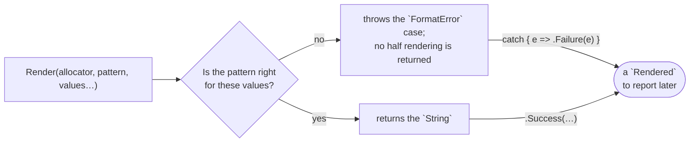

# Render

::note
<!-- sync:needs:start -->

**You'll need**: [Format number](/docs/learn/format-number), [String](/docs/learn/string), [Outcome](/docs/learn/outcome), [Variant match](/docs/learn/variant-match)
<!-- sync:needs:end -->

::

`PrintLine` formats text and sends it straight to the console. Often you want the formatted text itself — to keep it, measure it, pass it on, or print it later. `Render`, from the Format package, does the same formatting but hands the text back as a [`String`](/docs/learn/string):

```rux
Render(allocator, pattern, values...) -> String throws FormatError
```

It throws because the pattern itself can be wrong, and the way it fails is the other half of this lesson: a wrong pattern is found **before** anything is written, and the error says exactly what was wrong.

## Text you keep

`InvoiceCode` builds a code such as `INV-0042` once, as a value the caller owns:

```rux
func InvoiceCode(allocator: Allocator, number: int) -> String throws FormatError {
    return try Render(allocator, "INV-{:04}", number);
}
```

The pattern is the same as `PrintLine`'s — `{:04}` is the zero padding from [Format number](/docs/learn/format-number). `try` passes an error from `Render` on to the caller, so `InvoiceCode` throws `FormatError` too. Each call produces a `String` that lives on after it, unlike a printed line, so `Main` can print both codes in one line and measure one of them:

```rux
let first = try InvoiceCode(allocator, 7);
let second = try InvoiceCode(allocator, 42);
PrintLine("codes     {} and {}, {} bytes each", first.View(), second.View(), first.Length());
```

## Why it can throw

What can go wrong is the pattern, not the memory — a `String` that cannot get its storage ends the program, as every allocation in one does. `FormatError` is a variant with a case for each kind of mistake:

| Case                                   | When                                                              |
| -------------------------------------- | ----------------------------------------------------------------- |
| `InvalidSpecification(at)`             | a spec does not parse; `at` is the byte where it stopped          |
| `UnsupportedRequest`                   | a spec parses, but asks for something this value does not support |
| `ArgumentCountMismatch(wanted, given)` | placeholders and values do not match in number                    |
| `InsufficientCapacity`                 | a destination of fixed size cannot take the whole text            |
| `ValueOutOfRange`                      | a valid value cannot be shown in the form asked for               |
| `TextFailure(kind)`                    | text handling failed — this is where rejected UTF-8 arrives       |
| `WriterFailure`                        | the destination failed on its own terms                           |

## Keeping an outcome to report later

`Show` reports an outcome after the call that produced it, so the outcome has to be kept as a value. That is Core's [`Result`](/docs/learn/outcome), an ordinary variant with a `Success` and a `Failure` case, given a short name here:

```rux
type Rendered = Result<String, FormatError>;
```

`Show` takes an outcome apart with two nested `match`es. The cases that carry a position or counts are taken apart; everything else prints its own description through the `_` arm:

```rux
func Show(outcome: Rendered) {
    match move outcome {
        .Success(text) => PrintLine("rendered  {}", text.View()),
        .Failure(error) => match error {
            .InvalidSpecification(at) => PrintLine("refused   bad spec at byte {}", at),
            .ArgumentCountMismatch(wanted, given) =>
                PrintLine("refused   {} placeholders but {} values", wanted, given),
            _ => PrintLine("refused   {}", error)
        }
    }
}
```

A `Rendered` may hold a `String`, which owns its memory, so the outcome is move-only: `match move outcome` hands it to the match, and `.Success(text)` takes the `String` over.

## One right pattern and three wrong ones

`Main` keeps each outcome with `try .Success(…) catch { e => .Failure(e) }`, then moves it into `Show`:

```rux
var outcome: Rendered = try .Success(Render(allocator, "{} of {}", 3, 10)) catch {
    e => .Failure(e)
};
Show(move outcome);
outcome = try .Success(Render(allocator, "[{:>>>}]", 3)) catch { e => .Failure(e) };
Show(move outcome);
let pattern = "{}, {} and {}";
outcome = try .Success(Render(allocator, pattern, 3, 4)) catch { e => .Failure(e) };
Show(move outcome);
outcome = try .Success(Render(allocator, "{:x}", "text")) catch { e => .Failure(e) };
Show(move outcome);
```

| Pattern      | Values   | Result                                                                                  |
| ------------ | -------- | --------------------------------------------------------------------------------------- |
| `"{} of {}"` | 3, 10    | `3 of 10`                                                                               |
| `"[{:>>>}]"` | 3        | `InvalidSpecification(5)` — `>>` is a fill and an alignment; the third `>` fits nowhere |
| `pattern`    | 3, 4     | `ArgumentCountMismatch(3, 2)`                                                           |
| `"{:x}"`     | `"text"` | `UnsupportedRequest` — text has no hexadecimal                                          |



## Counted while compiling, or while running

Why is the third pattern in a variable? Because the compiler counts the placeholders of a pattern written in the call itself. `Render(allocator, "{}, {} and {}", 3, 4)` does not build at all. A pattern that arrives as a value — read from a file, chosen at run time — can be counted only when it runs, and that is when `ArgumentCountMismatch` appears.

`PrintLine` refuses the same patterns too, but its `IoError` can only say that the request was invalid, not where or why. When a pattern might be wrong, `Render` is the one that tells you.

## The program

The whole lesson is one package in the [Examples repository](https://github.com/rux-lang/Examples/tree/main/Text/Render). Its comments explain every step.

<!-- sync:program:start -->

```rux [Src/Main.rux]
// `PrintLine` formats text and sends it straight to the console. `Render`, from the Format
// package, does the same formatting but hands the text back as a `String`, to be kept, measured,
// passed on or printed later:
//
//     Render(allocator, pattern, values...) -> String throws FormatError
//
// It throws because the pattern itself can be wrong: a spec that does not parse, a spec the
// value cannot honour, or a different number of placeholders than values. A wrong pattern is
// found before anything is written, so an error never leaves half a rendering behind.
import Allocator::{ Allocator, SystemAllocator };
import Format::Render;
import Io::PrintLine;
import Text::{ FormatError, String };

// Builds a code such as "INV-0042" once, as a value the caller owns.
func InvoiceCode(allocator: Allocator, number: int) -> String throws FormatError {
    return try Render(allocator, "INV-{:04}", number);
}

// An outcome of a render, kept as a value: Core's `Result`, an ordinary variant with a
// `Success` and a `Failure` case.
type Rendered = Result<String, FormatError>;

// Reports either outcome of a render. `FormatError` is a variant, so the cases that carry a
// position or counts can be taken apart; the rest print their own description.
func Show(outcome: Rendered) {
    match move outcome {
        .Success(text) => PrintLine("rendered  {}", text.View()),
        .Failure(error) => match error {
            .InvalidSpecification(at) => PrintLine("refused   bad spec at byte {}", at),
            .ArgumentCountMismatch(wanted, given) =>
                PrintLine("refused   {} placeholders but {} values", wanted, given),
            _ => PrintLine("refused   {}", error)
        }
    }
}

func Main() throws FormatError {
    let allocator = SystemAllocator();

    // Each call produces a String that lives on after it, unlike a printed line.
    let first = try InvoiceCode(allocator, 7);
    let second = try InvoiceCode(allocator, 42);
    PrintLine("codes     {} and {}, {} bytes each", first.View(), second.View(), first.Length());

    // A pattern that works, then three ways a pattern can be wrong, each refused with its own
    // case. `PrintLine` refuses the same patterns too, but its `IoError` can only say the
    // request was invalid, not where or why. `try .Success(...) catch { e => .Failure(e) }`
    // keeps either outcome as a value to hand to `Show`.
    var outcome: Rendered = try .Success(Render(allocator, "{} of {}", 3, 10)) catch {
        e => .Failure(e)
    };
    Show(move outcome);
    outcome = try .Success(Render(allocator, "[{:>>>}]", 3)) catch { e => .Failure(e) };
    Show(move outcome);
    // The compiler counts the placeholders of a pattern written in the call itself, so
    // `Render(allocator, "{}, {} and {}", 3, 4)` does not build: "format string has 3
    // placeholders, but 2 arguments were provided". A pattern that arrives as a value is
    // counted only when it runs.
    let pattern = "{}, {} and {}";
    outcome = try .Success(Render(allocator, pattern, 3, 4)) catch { e => .Failure(e) };
    Show(move outcome);
    outcome = try .Success(Render(allocator, "{:x}", "text")) catch { e => .Failure(e) };
    Show(move outcome);
}
```

Besides `Io`, its `Rux.toml` lists `Allocator`, `Format` and `Text` under `[Dependencies]`.
<!-- sync:program:end -->

## Run it

```sh
cd Examples/Text/Render
rux run
```

<!-- sync:output:start -->

```
codes     INV-0007 and INV-0042, 8 bytes each
rendered  3 of 10
refused   bad spec at byte 5
refused   3 placeholders but 2 values
refused   unsupported formatting request
```

<!-- sync:output:end -->

## Common mistakes

::mistake
**Calling a throwing function without `try`.**\
`let first = InvoiceCode(allocator, 7);` fails with:

```text
error: call to 'InvoiceCode' can throw 'FormatError' but is not marked with 'try'
```

Mark it with `try` to pass the error on, as `Main` does, or keep the outcome in a `Result` with `try … catch`.
::

::mistake
**A literal pattern with the wrong number of values.**\
`Render(allocator, "{}, {} and {}", 3, 4)` fails while compiling:

```text
error: format string has 3 placeholders, but 2 arguments were provided
```

::

::mistake
**Matching `FormatError` without a `_` arm.**\
Leave out the `_` arm and the inner `match` fails with:

```text
error: match on 'FormatError' is not exhaustive; missing FormatError::UnsupportedRequest, FormatError::InsufficientCapacity, …
```

Handle the cases you care about and let `_` print the rest.
::

## Try it yourself

1. Render a price with two digits after the point, `"{:.2}"`, and print its `Length()`.
2. Write `Label(allocator: Allocator, name: char8[..], score: int) -> String throws FormatError` that produces lines such as `Ada.......17`.
3. Keep the outcome of `Render(allocator, "{:q}", 5)` and pass it to `Show`. Which case is it?
4. Change `"[{:>>>}]"` to `"[{:>>}]"`. What does it render?
5. Remove a `move` from one of the `Show(move outcome)` calls and read the error. Why can a `Rendered` not be copied?

## Learn more

- [Format](/docs/api/format) in the API reference
- [Format](/docs/learn/format) and [Format number](/docs/learn/format-number) — the pattern language
- [String](/docs/learn/string) — what `Render` returns
- [Outcome](/docs/learn/outcome) — keeping an outcome in `Result`
- [Variant match](/docs/learn/variant-match) — taking `FormatError` apart
