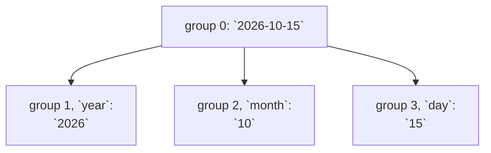

# Regex captures

::note
<!-- sync:needs:start -->

**You'll need**: [Regular expressions](/docs/learn/regex), [Iterator](/docs/learn/iterator)
<!-- sync:needs:end -->

::

[Regular expressions](/docs/learn/regex) answered _where_: `Find` reported the bytes a time of day sat at in a log line. Usually you want more — from a date, the year on its own; every date in a text; or the same text with its dates written another way. This lesson covers the rest of the Regex package:

```rux
import Regex::{ Match, Regex, RegexError };
```

## Groups

Parentheses in a pattern make a **group**, and a group remembers which part of the text it matched. Groups are numbered by their opening `(`, counting from 1; group 0 is always the whole match. A group can also have a name, written `(?<name>...)`:

```rux
let date = Regex::New(allocator, "(?<year>\\d{4})-(?<month>\\d{2})-(?<day>\\d{2})")?;
```



`GroupCount()` says how many groups a pattern has, not counting group 0: here 3. Parentheses that only group, without capturing, are written `(?:...)`, and get no number.

## Capturing

`Capture` searches as `Find` does, and answers with a `Captures?` — `none` when there is no match. `Group` asks for a group by number and `Named` by name, and each returns a `Match?`:

```rux
match date.Capture(notes)? {
    groups? => {
        PrintLine("match     {}", Part(groups.Group(0), notes));
        PrintLine("year      {}", Part(groups.Named("year"), notes));
        PrintLine("month     {}", Part(groups.Group(2), notes));
        PrintLine("day       {}", Part(groups.Named("day"), notes));
    },
    none => PrintLine("no date")
}
```

A group's answer is optional because a group can take no part in a match. In `v(\d+)(?:\.(\d+))?` the minor version is optional, so for `v4` group 2 has nothing to report. The program's `Part` function turns that `none` into a `-`:

```rux
func Part(span: Match?, text: char8[..]) -> char8[..] {
    return match span {
        found? => found.Slice(text),
        none => "-"
    };
}
```

Prefer names to numbers once a pattern has more than one or two groups. `Named("year")` still reads correctly after someone adds a group in front of it; `Group(1)` quietly starts answering with something else.

## Every match: `FindAll`

`FindAll` returns an [iterator](/docs/learn/iterator) over every match, leftmost first and never overlapping, so a `for` loop walks them:

```rux
for found in date.FindAll(notes)? {
    PrintLine("found     {} at byte {}", found.Slice(notes), found.start);
}
```

Making the iterator can fail for want of memory, so the `?` comes before the loop starts. Unlike the hand-written `FindAt` loop of the last lesson, `FindAll` steps past an empty match, so a pattern such as `\d*` cannot trap it. It walks matches, not groups; for the groups of each match, call `CaptureAt` from where the previous match ended.

## Between the matches: `Split`

`Split` returns an iterator over the pieces of text _between_ the matches. It is the [string view](/docs/learn/string-view)'s `Split` with a pattern for a separator, so one call copes with commas or semicolons and any spaces around them:

```rux
let list = "apples, pears;plums ,  figs";
let separator = Regex::New(allocator, "\\s*[,;]\\s*")?;
for part in separator.Split(list)? {
    PrintLine("part      [{}]", part);
}
```

There is always one more piece than there are matches. So a separator at the very start or end of the text gives an empty piece there: `,` splits `"a,b,"` into `a`, `b` and an empty piece.

## Replacing

`Replace` makes a new `String` with every match replaced. In the replacement text, a `$` refers back to the match:

| In the replacement | Stands for                    |
| ------------------ | ----------------------------- |
| `$0`               | the whole match               |
| `$1`, `${1}`       | what group 1 matched          |
| `$year`, `${year}` | what the group `year` matched |
| `$$`               | a single `$`                  |

```rux
let dotted = date.Replace(allocator, notes, "${day}.${month}.${year}")?;
PrintLine("{}", dotted);
let marked = date.ReplaceFirst(allocator, notes, "[$0]")?;
PrintLine("{}", marked);
```

`ReplaceFirst` stops after the first match. Both take an allocator for the new text, and the text searched is left as it was.

## The program

The whole lesson is one package in the [Examples repository](https://github.com/rux-lang/Examples/tree/main/Text/RegexCapture). Its comments explain every step.

<!-- sync:program:start -->

```rux [Src/Main.rux]
// Finding where a pattern matches is often only the first step: what you want is a piece of the
// match. In a date the year, the month and the day are each a part of their own. Wrapping a part
// of a pattern in parentheses makes it a group, and `Capture` reports where each group matched as
// well as where the whole match is. A group can have a name, `(?<year>...)`, so the code that
// reads it says what it wants instead of counting parentheses.
//
// Three more operations work through a whole text. `FindAll` walks every match in turn, `Split`
// walks the parts between the matches, and `Replace` makes a new text with every match replaced,
// where `${year}` or `$1` in the replacement stands for what a group matched.
import Allocator::{ Allocator, SystemAllocator };
import Io::PrintLine;
import Regex::{ Match, Regex, RegexError };

// The text a group matched, or "-" when the group took no part in the match. A group answers
// with a `Match?`, so `groups.Named("year").Slice(notes)` is refused until the `none` is dealt
// with:
//
//     error: type 'Match?' has no field 'Slice'
func Part(span: Match?, text: char8[..]) -> char8[..] {
    return match span {
        found? => found.Slice(text),
        none => "-"
    };
}

func Main() -> ! RegexError {
    var system = SystemAllocator();
    let allocator: Allocator = system;

    let notes = "Released 2026-10-15, patched 2026-11-02, retired 2027-01-31.";
    let date = Regex::New(allocator, "(?<year>\\d{4})-(?<month>\\d{2})-(?<day>\\d{2})")?;
    PrintLine("groups    {}", date.GroupCount());

    // `Capture` finds the first match, as `Find` does, and answers with its `Captures`, or `none`.
    // Group 0 is the whole match, and the others count from 1 in the order their `(` appear. A
    // named group can be asked for either way.
    match date.Capture(notes)? {
        groups? => {
            PrintLine("match     {}", Part(groups.Group(0), notes));
            PrintLine("year      {}", Part(groups.Named("year"), notes));
            PrintLine("month     {}", Part(groups.Group(2), notes));
            PrintLine("day       {}", Part(groups.Named("day"), notes));
        },
        none => PrintLine("no date")
    }

    // Each group answers with a `Match?`, because a group may take no part in a match: here the
    // minor version is optional, so in "v4" group 2 has nothing to report.
    let version = Regex::New(allocator, "v(\\d+)(?:\\.(\\d+))?")?;
    for text in ["v3.1", "v4"] {
        match version.Capture(text)? {
            groups? => PrintLine("{:<9} major {}, minor {}", text, Part(groups.Group(1), text),
                Part(groups.Group(2), text)),
            none => PrintLine("{:<9} no version", text)
        }
    }

    // `FindAll` is an iterator over every match, leftmost first, never overlapping. Making one can
    // fail for want of memory, so the `?` comes before the loop can start; without it:
    //
    //     error: cannot iterate over 'MatchIterator ! RegexError'
    for found in date.FindAll(notes)? {
        PrintLine("found     {} at byte {}", found.Slice(notes), found.start);
    }

    // `Split` is an iterator over what lies between the matches. Because the separator is a
    // pattern, one call copes with commas or semicolons and any spaces around them.
    let list = "apples, pears;plums ,  figs";
    let separator = Regex::New(allocator, "\\s*[,;]\\s*")?;
    for part in separator.Split(list)? {
        PrintLine("part      [{}]", part);
    }

    // `Replace` builds a new String with every match replaced. In the replacement, `${name}` is
    // what that group matched, `$1` is group 1 and `$0` the whole match. `ReplaceFirst` stops
    // after the first match.
    let dotted = date.Replace(allocator, notes, "${day}.${month}.${year}")?;
    PrintLine("{}", dotted);
    let marked = date.ReplaceFirst(allocator, notes, "[$0]")?;
    PrintLine("{}", marked);
}
```

Besides `Io`, its `Rux.toml` lists `Allocator` and `Regex` under `[Dependencies]`.
<!-- sync:program:end -->

## Run it

```sh
cd Examples/Text/RegexCapture
rux run
```

<!-- sync:output:start -->

```
groups    3
match     2026-10-15
year      2026
month     10
day       15
v3.1      major 3, minor 1
v4        major 4, minor -
found     2026-10-15 at byte 9
found     2026-11-02 at byte 29
found     2027-01-31 at byte 49
part      [apples]
part      [pears]
part      [plums]
part      [figs]
Released 15.10.2026, patched 02.11.2026, retired 31.01.2027.
Released [2026-10-15], patched 2026-11-02, retired 2027-01-31.
```

<!-- sync:output:end -->

## Common mistakes

::mistake
**Treating a group as text.**\
`groups.Named("year").Slice(notes)` fails with:

```text
error: type 'Match?' has no field 'Slice'
```

The group may not have taken part in the match. Deal with the `none` first, as `Part` does.
::

::mistake
**Misspelling a group name.**\
`groups.Named("yaer")` is not an error. There is no group by that name, so it answers `none`, exactly as a group that did not match would — and the program prints `-` instead of the year. Check the name against the pattern when a group seems to match nothing.
::

::mistake
**Iterating the outcome.**\
`for found in date.FindAll(notes)` fails with:

```text
error: cannot iterate over 'MatchIterator ! RegexError'
```

`FindAll` and `Split` can fail before the walk starts. Put `?` after the call.
::

::mistake
**A group number followed by letters.**\
In `"$3rd of $2"`, `$3rd` refers to a group named `3rd`, which does not exist, so it is replaced by nothing: the result is `Released  of 10.`. Put the number in braces — `"${3}rd of $2"` gives `Released 15rd of 10.`
::

## Try it yourself

1. Add a fourth group, `(?<weekday>[A-Z][a-z]+)?`, before the date, and run the program. Which of the `Group(2)` and `Named("month")` lines still prints the month?
2. Reorder the dates as `month/day/year` with `Replace`, using numbered groups this time.
3. Split `"one  two\tthree"` on `\s+` and print each word in brackets. What does splitting `" one two "` give at the ends?
4. Count the dates in `notes` with `FindAll` and a counter, then print the count.

## Learn more

- [Regular expressions](/docs/learn/regex) — compiling, `IsMatch`, `Find` and `Escape`
- [Iterator](/docs/learn/iterator) — the `Next` behind every `for` loop here
- [String view](/docs/learn/string-view) — `Split` on fixed text
- [Grep](/docs/learn/grep) — a checkpoint project that searches files with a pattern
- [Regex](/docs/api/regex) in the API reference
- [Iteration](/docs/lang/interfaces/iteration) in the Rux Reference
