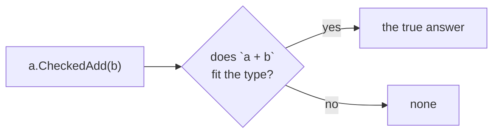

# Checked arithmetic

::note
<!-- sync:needs:start -->

**You'll need**: [Optional](/docs/learn/optional), [Presence](/docs/learn/presence), [Coalesce](/docs/learn/coalesce), [Number limit](/docs/learn/number-limit)
<!-- sync:needs:end -->

::

Ordinary `+`, `-` and `*` refuse to carry on with a wrong number. A result too big for its type stops the program with `Panic: integer overflow in '+'` and the line it happened on: in a `uint8`, 255 + 1 has no answer. That is the right response to a bug. But for a size, a price or a count read from outside, overflow is a case the program should handle, not a reason to stop.

Then ask for a **checked** answer instead. Every integer type, signed or unsigned, has `CheckedAdd`, `CheckedSub` and `CheckedMul` methods. They do the same arithmetic as `+`, `-` and `*` and never stop the program: when the result does not fit, they say so instead.

## An answer that may be missing

A checked operation answers with an [optional](/docs/learn/optional): the true result when it fits, and `none` when it overflows. Within range, the answer is present, and it is the true sum:

```rux
let high: uint8 = uint8::Max - 5;
match high.CheckedAdd(5) {
    sum? => PrintLine("250 + 5    result {}", sum),
    none => PrintLine("250 + 5    overflow")
}
```

`high.CheckedAdd(5)` is a `uint8?`. Here it holds 255, so the `sum?` arm runs. The `uint8::Max` comes from `Core::Primitives`, which the program imports whole with `import Core::Primitives::*;`.



## When it overflows

One step too far, and there is no answer at all:

```rux
match uint8::Max.CheckedAdd(1) {
    sum? => PrintLine("255 + 1    result {}", sum),
    none => PrintLine("255 + 1    overflow")
}
```

There is no wrong number to misuse by accident. An optional cannot take part in arithmetic or be printed as a number, so the answer cannot be used until `??`, `match` or `if let` has decided what overflow means here.

An unsigned type has nothing below zero, so subtraction overflows downwards:

```rux
let stock: uint32 = 3;
match stock.CheckedSub(5) {
    left? => PrintLine("3 - 5      result {}", left),
    none => PrintLine("3 - 5      overflow")
}
```

Signed types overflow at both ends; one below the minimum is out of range too:

```rux
match int32::Min.CheckedSub(1) {
    level? => PrintLine("Min - 1    result {}", level),
    none => PrintLine("Min - 1    overflow")
}
```

| Call                       | Answer |
| -------------------------- | ------ |
| `250u8.CheckedAdd(5)`      | 255    |
| `255u8.CheckedAdd(1)`      | `none` |
| `3u32.CheckedSub(5)`       | `none` |
| `int32::Min.CheckedSub(1)` | `none` |

The operand in the parentheses must have the same type as the value the method is called on. A plain literal such as `5` takes that type by itself.

## Reporting overflow in a type

A function that does the checking can report overflow in its own type. `Area` has nothing to add, so it hands the optional on:

```rux
// The area of a rectangle, or `none` when it does not fit in 32 bits.
func Area(width: uint32, height: uint32) -> uint32? {
    return width.CheckedMul(height);
}
```

A caller gets `none` for an area that does not fit, and has to decide, with `??` or with a `match`:

```rux
PrintLine("area       {}", Area(1920, 1080) ?? 0);
match Area(100000, 100000) {
    area? => PrintLine("area       {}", area),
    none => PrintLine("area       too large")
}
```

100 000 × 100 000 is ten billion, more than a `uint32` holds, so the second call prints `too large`.

## The program

The whole lesson is one package in the [Examples repository](https://github.com/rux-lang/Examples/tree/main/Numbers/CheckedArithmetic). Its comments explain every step.

<!-- sync:program:start -->

```rux [Src/Main.rux]
// Ordinary `+`, `-` and `*` refuse to carry on with a wrong number: a result too big for its type
// stops the program with `Panic: integer overflow in '+'`. When overflow is a case the program
// should handle rather than a bug, as in a size, a price or a count read from outside, ask for a
// checked answer instead. Every integer type, signed or unsigned, has `CheckedAdd`, `CheckedSub`
// and `CheckedMul` methods, as in `width.CheckedMul(height)`.
//
// Each one answers with an optional: the true result when it fits, and `none` when it overflows.
// There is no wrong number to misuse by accident. The answer cannot be used as a number until
// `??`, `match` or `if let` has decided what overflow means here.
//
// A function that does the checking can then report overflow in its own type, here by handing
// the optional on.
import Core::Primitives::*;
import Io::PrintLine;

// The area of a rectangle, or `none` when it does not fit in 32 bits.
func Area(width: uint32, height: uint32) -> uint32? {
    return width.CheckedMul(height);
}

func Main() -> int {
    // Within range: the answer is present, and it is the true sum.
    let high: uint8 = uint8::Max - 5;
    match high.CheckedAdd(5) {
        sum? => PrintLine("250 + 5    result {}", sum),
        none => PrintLine("250 + 5    overflow")
    }

    // One step too far: there is no answer at all.
    match uint8::Max.CheckedAdd(1) {
        sum? => PrintLine("255 + 1    result {}", sum),
        none => PrintLine("255 + 1    overflow")
    }

    // An unsigned type has nothing below zero.
    let stock: uint32 = 3;
    match stock.CheckedSub(5) {
        left? => PrintLine("3 - 5      result {}", left),
        none => PrintLine("3 - 5      overflow")
    }

    // Signed types overflow at both ends.
    match int32::Min.CheckedSub(1) {
        level? => PrintLine("Min - 1    result {}", level),
        none => PrintLine("Min - 1    overflow")
    }

    // The check, hidden behind a function that says what went wrong in its type.
    PrintLine("area       {}", Area(1920, 1080) ?? 0);
    match Area(100000, 100000) {
        area? => PrintLine("area       {}", area),
        none => PrintLine("area       too large")
    }
    return 0;
}
```

Besides `Io`, its `Rux.toml` lists `Core` under `[Dependencies]`.
<!-- sync:program:end -->

## Run it

```sh
cd Examples/Numbers/CheckedArithmetic
rux run
```

<!-- sync:output:start -->

```
250 + 5    result 255
255 + 1    overflow
3 - 5      overflow
Min - 1    overflow
area       2073600
area       too large
```

<!-- sync:output:end -->

## Common mistakes

::mistake
**Using the answer as a number.**\
`let sum: uint8 = high.CheckedAdd(5);` fails with:

```text
error: cannot assign 'uint8?' to 'uint8'
```

The answer may be `none`. Decide what overflow means first: `high.CheckedAdd(5) ?? uint8::Max`, or a `match` with a `none` arm.
::

::mistake
**Mixing types in one call.**\
Both operands must have one type. With a `uint8` called `a` and an `int32` called `b`, `a.CheckedAdd(b)` fails with:

```text
error: argument 1 to 'CheckedAdd' has type 'int32', but parameter 'other' requires 'uint8'
```

Convert one of them first, checking that it fits.
::

::mistake
**Asking for a limit without importing the type.**\
The methods need no import, but `uint8::Max` and `int32::Min` do. Without `import Core::Primitives::*;`, `uint8::Max.CheckedAdd(1)` fails with:

```text
error: 'Max' not found in extend for type 'uint8'
```

::

## Try it yourself

1. Write `func Total(prices: uint32[..]) -> uint32?` that adds the prices with `CheckedAdd` and returns `none` at the first overflow. The `?` from [Optional propagate](/docs/learn/optional-propagate) makes the loop body one line: `total = total.CheckedAdd(price)?;`.
2. Use `CheckedMul` on two `int8` values, −128 and −1. Does it overflow? Why?
3. Make `Area` fail instead: `-> uint32 ! AreaError`, with a variant `AreaError` whose case `TooLarge` it throws when `CheckedMul` answers `none`. Handle it in `Main` with `!!` or [`catch`](/docs/lang/errors/handling).
4. Rewrite the first `match` in `Main` as an `if let sum? = high.CheckedAdd(5) { … } else { … }`.

## Learn more

- [Arithmetic operations](/docs/lang/expressions/arithmetic) in the Rux Reference
- [Wrapping arithmetic](/docs/learn/wrapping-arithmetic): when overflow is the plan, not the problem
- [Checked convert](/docs/learn/checked-convert): the same idea for conversions between types
- [Presence](/docs/learn/presence) and [Coalesce](/docs/learn/coalesce): the `match` arms and the `??` that take the optional apart
