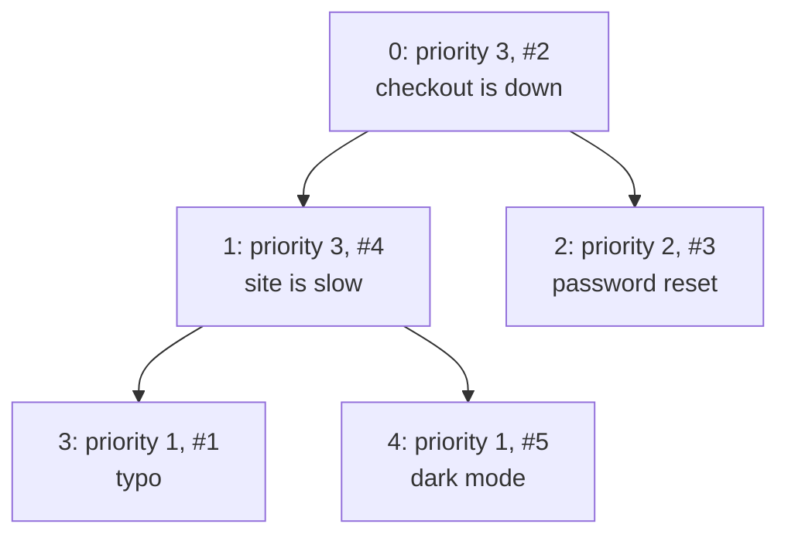

# Priority queue

::note
<!-- sync:needs:start -->

**You'll need**: [Operator overload](/docs/learn/operator-overload), [Coalesce exit](/docs/learn/coalesce-exit), [Vector](/docs/learn/vector)
<!-- sync:needs:end -->

::

A [deque](/docs/learn/deque) is a fair queue: whoever came first is served first. Plenty of work is not fair in that way. A support desk takes the outage before the typo, a game loop runs the timer due soonest, a route planner explores the cheapest path found so far. Each wants the **most important** item next, whenever it arrived.

A `PriorityQueue<T>` is that queue. Items go in in any order, and `Pop` always hands out the largest one still inside:

```rux
import Collections::{ CollectionError, PriorityQueue };
```

## Largest first

"Largest" is the element type's own `<`. Unlike a [tree map](/docs/learn/tree-map), a priority queue takes no ordering function — so a type to be queued declares `<`, as in [Operator overload](/docs/learn/operator-overload). A support ticket is larger when it is more urgent, and, among equals, when it arrived first:

```rux
pub struct Ticket {
    priority: int32;
    arrival: int32;
    subject: char8[..];
}

extend Ticket {
    pub func <(self: &Ticket, other: Ticket) -> bool {
        if self.priority != other.priority {
            return self.priority < other.priority;
        }
        return self.arrival > other.arrival;
    }
}
```

Both the struct and its `<` are `pub`. The queue's code lives in the `Collections` package, and an operator is only visible to another package when it and its type are public — see [Visibility](/docs/lang/modules/visibility).

## Push, peek and pop

```rux
var tickets = PriorityQueue<Ticket>(allocator);
tickets.Push(Ticket { priority: 1, arrival: 1, subject: "typo on the pricing page" })?;
tickets.Push(Ticket { priority: 3, arrival: 2, subject: "checkout is down" })?;
```

| Method    | Returns             | Does                                                                |
| --------- | ------------------- | ------------------------------------------------------------------- |
| `Push`    | `! CollectionError` | adds an item; may need more room, and so can fail                   |
| `Peek`    | `(*T)?`             | points at the largest item without taking it out                    |
| `Pop`     | `T?`                | takes the largest item out, `none` when empty                       |
| `Length`  | `uint`              | how many items are inside                                           |
| `IsEmpty` | `bool`              | whether there are none                                              |
| `Clear`   | —                   | destroys every item, keeping the storage                            |
| `AsSlice` | `T[..]`             | every item, in heap order — the largest first, then no useful order |

`Pop` returns an optional, because the queue may be empty, so a loop that drains the queue stops at the first `none` with [`?? break`](/docs/learn/coalesce-exit):

```rux
loop {
    let ticket = tickets.Pop() ?? break;
    PrintLine("  priority {}  #{}  {}", ticket.priority, ticket.arrival, ticket.subject);
}
```

`Peek` returns a [pointer](/docs/learn/pointer) to the front item rather than a copy, so a large item is not copied just to be looked at. The pointer is valid only until the queue next changes.

## The heap inside

The queue keeps its items in a vector arranged as a **binary heap**: a tree flattened into the vector, where item `i` has its children at `2i + 1` and `2i + 2`, and every parent is at least as large as its children. After the five pushes, the tickets sit like this:



The largest item is always at index 0, which is why `Peek` costs nothing. `Push` puts the new item at the end and swaps it upwards past every smaller parent; `Pop` moves the last item to the top and swaps it downwards past its larger child. Either repairs one path from the top to the bottom — about 20 steps for a million items, where keeping a sorted vector would move up to a million.

The price is that nothing but the front is in order. Below the top, siblings and cousins in the tree are in no promised order, so the heap is the right tool when you only ever want the next item, and a [sort](/docs/learn/sort) or a [tree set](/docs/learn/tree-set) is right when you want them all in order.

## Smallest first

A queue that should hand out the smallest first — the earliest timer, the cheapest path — needs no other type of queue. Reverse the element's `<`, so that a later timer counts as the smaller:

```rux
extend Timer {
    pub func <(self: &Timer, other: Timer) -> bool {
        return self.at > other.at;
    }
}
```

The same `PriorityQueue` now pops the timer at 5 seconds first. Keeping the order in the type means every queue of `Timer` agrees on it, with no function to pass and none to pass wrongly.

## The program

The whole lesson is one package in the [Examples repository](https://github.com/rux-lang/Examples/tree/main/Collections/PriorityQueue). Its comments explain every step.

<!-- sync:program:start -->

```rux [Src/Main.rux]
// A queue serves whoever came first. A priority queue serves whoever matters most: the most
// urgent support ticket, the next timer to go off, the cheapest route found so far. Items go in
// in any order, and `Pop` always hands out the largest one still inside.
//
// `PriorityQueue<T>` keeps its items in a vector arranged as a binary heap: a tree, flattened
// into the vector, in which every parent is at least as large as its children. The largest is
// therefore always at the front, and a `Push` or a `Pop` only repairs one path from the top to
// the bottom of the tree — a few steps even for a million items. What the heap does not keep is
// a sorted order: only the front is known to be the largest.
//
// "Largest" means the element type's own `<`. There is no ordering function to pass, as there is
// for a tree map: to change the order, change the type's `<`. The queue lives in another package,
// so both the type and its `<` must be `pub` for the queue's code to see them. Without `pub`, the
// operator is invisible there and the queue reports it as missing:
//
//     error: operator '<' is not defined for 'Ticket'
//     help: declare '<' on 'Ticket'
import Allocator::{ Allocator, SystemAllocator };
import Collections::{ CollectionError, PriorityQueue };
import Io::PrintLine;

// A support ticket. A higher priority is more urgent; among equals, the one that arrived first
// should be served first, so it counts as the larger.
pub struct Ticket {
    priority: int32;
    arrival: int32;
    subject: char8[..];
}

extend Ticket {
    pub func <(self: &Ticket, other: Ticket) -> bool {
        if self.priority != other.priority {
            return self.priority < other.priority;
        }
        return self.arrival > other.arrival;
    }
}

// A timer that goes off at a given second. The earliest should come out first, so its `<` is
// reversed: a later timer counts as the smaller.
pub struct Timer {
    at: int32;
    name: char8[..];
}

extend Timer {
    pub func <(self: &Timer, other: Timer) -> bool {
        return self.at > other.at;
    }
}

func Main() -> ! CollectionError {
    var system = SystemAllocator();
    let allocator: Allocator = system;

    // `Push` may need more room, and so can fail; `?` hands that failure to `Main`.
    var tickets = PriorityQueue<Ticket>(allocator);
    tickets.Push(Ticket { priority: 1, arrival: 1, subject: "typo on the pricing page" })?;
    tickets.Push(Ticket { priority: 3, arrival: 2, subject: "checkout is down" })?;
    tickets.Push(Ticket { priority: 2, arrival: 3, subject: "password reset email is late" })?;
    tickets.Push(Ticket { priority: 3, arrival: 4, subject: "site is slow" })?;
    tickets.Push(Ticket { priority: 1, arrival: 5, subject: "dark mode request" })?;

    // `Peek` looks at the front without taking it out. It returns a pointer, valid until the
    // queue next changes, or `none` when the queue is empty.
    match tickets.Peek() {
        top? => PrintLine("next up: {} ({} waiting)", top.subject, tickets.Length()),
        none => PrintLine("no tickets")
    }

    // `Pop` takes the front out and returns it, or `none` once the queue is empty.
    loop {
        let ticket = tickets.Pop() ?? break;
        PrintLine("  priority {}  #{}  {}", ticket.priority, ticket.arrival, ticket.subject);
    }
    PrintLine("empty: {}", tickets.IsEmpty());

    // The same queue over the reversed `<` hands out the earliest time first.
    var timers = PriorityQueue<Timer>(allocator);
    timers.Push(Timer { at: 30, name: "autosave" })?;
    timers.Push(Timer { at: 5, name: "blink the cursor" })?;
    timers.Push(Timer { at: 60, name: "check mail" })?;
    timers.Push(Timer { at: 12, name: "refresh the feed" })?;
    loop {
        let timer = timers.Pop() ?? break;
        PrintLine("at {:2}s  {}", timer.at, timer.name);
    }
}
```

Besides `Io`, its `Rux.toml` lists `Allocator` and `Collections` under `[Dependencies]`.
<!-- sync:program:end -->

## Run it

```sh
cd Examples/Collections/PriorityQueue
rux run
```

<!-- sync:output:start -->

```
next up: checkout is down (5 waiting)
  priority 3  #2  checkout is down
  priority 3  #4  site is slow
  priority 2  #3  password reset email is late
  priority 1  #1  typo on the pricing page
  priority 1  #5  dark mode request
empty: true
at  5s  blink the cursor
at 12s  refresh the feed
at 30s  autosave
at 60s  check mail
```

<!-- sync:output:end -->

## Common mistakes

::mistake
**A private `<`.**\
Leave `pub` off the struct or off its `<`, and the queue's code in `Collections` cannot see the operator. Every place it compares reports it as missing:

```text
error: operator '<' is not defined for 'Ticket'
help: declare '<' on 'Ticket'
```

The operator is declared; it is just not visible from there. Mark both `pub`.
::

::mistake
**Expecting first come, first served among equals.**\
A heap keeps no arrival order. Five tickets of the same priority, pushed as #1 to #5 into a queue whose `<` compares only the priority, come out as #1, #5, #4, #3, #2. When equals must keep their order, make the order part of `<`, as `Ticket` does with `arrival`.
::

::mistake
**Treating `AsSlice` as sorted.**\
Only its first element is known to be the largest. The tickets above read `3 3 2 1 1` by priority, but that is luck: in general the rest are in heap order, not sorted order. Pop them to get them in order, or [sort](/docs/learn/sort) a copy.
::

::mistake
**Treating `Pop` as an item.**\
`let first: Ticket = tickets.Pop();` fails with:

```text
error: cannot assign 'Ticket?' to 'Ticket'
```

The queue may be empty. Say what to do then, with `?? break`, `??` and a default, or a `match`.
::

## Try it yourself

1. Push a sixth ticket of priority 2 that arrives last. Where does it come out, and why?
2. Make a min-queue of plain numbers without a new type: push each value negated into a `PriorityQueue<int32>`, and negate what comes out.
3. Before draining the tickets, print `tickets.Peek()` after each `Push`, to watch the front change only when a more urgent ticket arrives.
4. Merge two sorted lists of times into one sorted list with a single `PriorityQueue<Timer>`.

## Learn more

- [Operator overload](/docs/learn/operator-overload) — declaring `<` for a type of your own
- [Comparable](/docs/learn/comparable) — a type's order as an interface, with three answers
- [Tree set](/docs/learn/tree-set) — every element in order, not just the largest
- [Collections API](/docs/api/collections) — `PriorityQueue` and the other containers
- [Operators](/docs/lang/interfaces/operators) and [Visibility](/docs/lang/modules/visibility) in the Rux Reference
