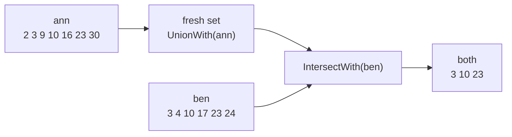

# Bit set

::note
<!-- sync:needs:start -->

**You'll need**: [Bitwise](/docs/learn/bitwise), [Move](/docs/learn/move), [Hash set](/docs/learn/hash-set)
<!-- sync:needs:end -->

::

A [hash set](/docs/learn/hash-set) can hold anything, and pays for it: every member costs a slot, a hash and the bytes of the value. When the members are small non-negative integers — the days of a month, seat numbers, the ids of a few hundred features — there is a far cheaper way. Give every possible member one bit, and set the bit when the number is in the set.

`BitSet` is that set. Thirty days of availability fit in a single 64-bit word, and asking whether day 9 is free is a shift and a mask:

```rux
import Collections::{ BitSet, CollectionError };
```

## One bit per member

The bits live in 64-bit words, member 0 in the lowest bit of the first word. Ann's free days, `2 3 9 10 16 23 30`, are one word with seven bits set — here its low 32 bits, the highest on the left:

```
bit 31                            bit 0
0100 0000 1000 0001 0000 0110 0000 1100
 ^        ^       ^       ^^       ^^
 30       23      16      10,9     3,2
```

| Method          | Returns             | Does                                                  |
| --------------- | ------------------- | ----------------------------------------------------- |
| `Set(i)`        | `! CollectionError` | puts `i` in, growing the set to span it               |
| `Reset(i)`      | —                   | takes `i` out                                         |
| `Toggle(i)`     | `! CollectionError` | flips `i`, growing the set to span it                 |
| `Get(i)`        | `bool`              | whether `i` is in — `false` for anything past the end |
| `Count()`       | `uint`              | how many members                                      |
| `Length()`      | `uint`              | how many bits the set spans, set or not               |
| `NextSet(from)` | `uint?`             | the smallest member at or after `from`                |
| `IsEmpty()`     | `bool`              | whether no bit is set                                 |

`Set` and `Toggle` can fail because a bit past the end needs another word, and that may need memory. `Get` never fails: a bit the set does not span is simply not set, so `ann.Get(99)` is `false`, not an error.

## Walking the members

A bit set has no iterator. `NextSet(from)` finds the lowest member at or after `from`, so each answer plus one is where to look next, and the walk visits the members in increasing order:

```rux
var from: uint = 0;
loop {
    let day = days.NextSet(from) ?? break;
    Print(" {}", day);
    from = day + 1;
}
```

`NextSet` skips a whole word of zeros at a time, so walking a sparse set does not visit every bit.

## Combining sets

The three set operations change the set they are called on, using another set's bits:

| Operation             | Keeps                      | Day picker meaning |
| --------------------- | -------------------------- | ------------------ |
| `a.UnionWith(b)`      | members of `a` or `b`      | either is free     |
| `a.IntersectWith(b)`  | members of `a` and `b`     | both are free      |
| `a.DifferenceWith(b)` | members of `a` but not `b` | only Ann is free   |

Each works a whole word — 64 members — per step. Only `UnionWith` can fail, since it may have to grow to span the other set.

A bit set owns its words, so it is [move-only](/docs/learn/move): `var both = ann;` is refused, and `var both <- ann;` would use Ann's set up. To combine two sets and keep both, build the result in a fresh set:

```rux
var both = BitSet(allocator);
both.UnionWith(ann)?;
both.IntersectWith(ben);
```



## Length and count

`Length` is how many bits the set spans; `Count` is how many of them are set. After Ann books the 10th she has six free days, but her set still spans 31 bits, because its highest member is 30. The two differ most for a sparse set: one member at 1,000,000 makes a set of `Count` 1 and `Length` 1,000,001 — about 122 KiB of words for a single member.

## The program

The whole lesson is one package in the [Examples repository](https://github.com/rux-lang/Examples/tree/main/Collections/BitSet). Its comments explain every step.

<!-- sync:program:start -->

```rux [Src/Main.rux]
// A hash set of small numbers spends many bytes on each one. When the members are small
// non-negative integers — the days of a month, seat numbers, the ids of a few hundred features
// — one bit per possible member is enough: bit 7 set means 7 is in the set.
//
// `BitSet` keeps those bits in 64-bit words. A membership test is a shift and a mask, counting
// the members is a population count per word, and union, intersection and difference combine
// two sets a whole word — 64 members — at a time. Setting a bit past the end grows the set;
// asking about a bit past the end answers false, since an absent bit is an unset one.
//
// A bit set owns its words, so it cannot be copied:
//
//     var both = ann;
//         error: move-only value 'ann' requires an explicit '<-' in initialization
//
// Moving it with `<-` would use `ann` up. To combine sets and keep the originals, build the
// combination in a new set.
import Allocator::{ Allocator, SystemAllocator };
import Collections::{ BitSet, CollectionError };
import Io::{ Print, PrintLine };

// Prints the members in order. `NextSet(from)` finds the lowest set bit at or after `from`, so
// each answer plus one is where to look next.
func Show(label: char8[..], days: &BitSet) {
    Print("{:<10}", label);
    var from: uint = 0;
    loop {
        let day = days.NextSet(from) ?? break;
        Print(" {}", day);
        from = day + 1;
    }
    PrintLine("   ({} days)", days.Count());
}

func Main() -> ! CollectionError {
    var system = SystemAllocator();
    let allocator: Allocator = system;

    // The days of June each person is free. `Set` may need another word, and so can fail.
    var ann = BitSet(allocator);
    let annFree: uint[7] = [2, 3, 9, 10, 16, 23, 30];
    for day in annFree[..] {
        ann.Set(day)?;
    }
    var ben = BitSet(allocator);
    let benFree: uint[6] = [3, 4, 10, 17, 23, 24];
    for day in benFree[..] {
        ben.Set(day)?;
    }
    Show("ann", ann);
    Show("ben", ben);
    PrintLine("ann free on the 9th? {}  on the 99th? {}", ann.Get(9), ann.Get(99));

    // Days both are free: start from Ann's days and keep only those Ben has too.
    var both = BitSet(allocator);
    both.UnionWith(ann)?;
    both.IntersectWith(ben);
    Show("both", both);

    // Days either is free, and days only Ann is free.
    var either = BitSet(allocator);
    either.UnionWith(ann)?;
    either.UnionWith(ben)?;
    Show("either", either);
    var annOnly = BitSet(allocator);
    annOnly.UnionWith(ann)?;
    annOnly.DifferenceWith(ben);
    Show("ann only", annOnly);

    // Plans change: Ann books the 10th, and `Toggle` flips Ben's 17th off and his 18th on.
    ann.Reset(10);
    ben.Toggle(17)?;
    ben.Toggle(18)?;
    Show("ann now", ann);
    Show("ben now", ben);

    // The set spans as many bits as its highest member needed: 31 here, in one word.
    PrintLine("ann spans {} bits", ann.Length());
}
```

Besides `Io`, its `Rux.toml` lists `Allocator` and `Collections` under `[Dependencies]`.
<!-- sync:program:end -->

## Run it

```sh
cd Examples/Collections/BitSet
rux run
```

<!-- sync:output:start -->

```
ann        2 3 9 10 16 23 30   (7 days)
ben        3 4 10 17 23 24   (6 days)
ann free on the 9th? true  on the 99th? false
both       3 10 23   (3 days)
either     2 3 4 9 10 16 17 23 24 30   (10 days)
ann only   2 9 16 30   (4 days)
ann now    2 3 9 16 23 30   (6 days)
ben now    3 4 10 18 23 24   (6 days)
ann spans 31 bits
```

<!-- sync:output:end -->

## Common mistakes

::mistake
**Copying a set to combine it.**\
`var both = ann;` fails with:

```text
error: move-only value 'ann' requires an explicit '<-' in initialization
```

Moving it with `var both <- ann;` compiles, but then any later use of `ann` fails with `error: value 'ann' is used after it was moved`. Start from a fresh set and `UnionWith` the one to keep.
::

::mistake
**A signed index.**\
Members are `uint`. With `let day: int32 = 5;`, `ann.Set(day)?;` fails with:

```text
error: argument 1 to 'Set' has type 'int32', but parameter 'index' requires 'uint'
```

A bit set has no place for a negative member. Convert only after checking the value is not negative.
::

::mistake
**Large or scattered numbers.**\
A bit set spans every number up to its largest member. Setting member 1,000,000 alone makes it 1,000,001 bits long — around 122 KiB to hold one number. For a few large or scattered values, a [hash set](/docs/learn/hash-set) is smaller.
::

::mistake
**Shrinking and expecting the bits back.**\
`Resize` to a shorter length drops the bits past it for good. Set 30, resize to 10 and back to 40, and `Get(30)` is `false`.
::

## Try it yourself

1. Add Cai, free on `3 10 11 23 29`, and find the days all three are free.
2. Print the days of June that **nobody** is free: `Set` days 1 to 30 in a fresh set, then take away `either` with `DifferenceWith`.
3. Write the Sieve of Eratosthenes with a `BitSet`: mark every multiple of each prime up to 100, then walk the unmarked numbers from 2 with a loop over `Get`.

## Learn more

- [Bitwise](/docs/learn/bitwise) — the shifts and masks a bit set is made of
- [Hash set](/docs/learn/hash-set) — a set of any type, for members that are not small integers
- [Move](/docs/learn/move) — why a set that owns memory moves rather than copies
- [Collections API](/docs/api/collections) — `BitSet` and the other containers
- [Bitwise operators](/docs/lang/expressions/bitwise) in the Rux Reference
