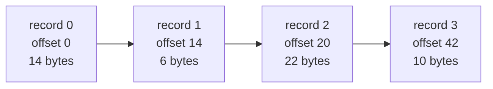

# Scan

::note
<!-- sync:needs:start -->

**You'll need**: [Fold](/docs/learn/fold), [Writable slice](/docs/learn/writable-slice), [Wrapping arithmetic](/docs/learn/wrapping-arithmetic), [Overload](/docs/learn/overload)
<!-- sync:needs:end -->

::

[Fold](/docs/learn/fold) collapses a slice into one answer: a week's sales into one total. A **scan** keeps every step of the way instead — the total so far after each day. That running answer is a slice of its own, as long as the input, and it answers questions a single total cannot: on which day did the sales pass 100, what was the best day up to Friday, where in a file does record 3 begin.

This lesson's functions come from the `Algorithms` package, like the rest of the part:

```rux
import Algorithms::{ ExclusiveScan, InclusiveScan, Iota, Midpoint, PartialSum };
```

## Running totals

`PartialSum` writes the running sums of a slice into a [writable slice](/docs/learn/writable-slice) you supply. Element `i` of the result is the sum of the first `i + 1` inputs:

```rux
var total: int32[7] = [0; 7];
PartialSum<int32>(sales[..], total[..]);
```

| day   | 1   | 2   | 3   | 4   | 5   | 6   | 7   |
| ----- | --- | --- | --- | --- | --- | --- | --- |
| sales | 12  | 30  | 7   | 25  | 18  | 40  | 9   |
| total | 12  | 42  | 49  | 74  | 92  | 132 | 141 |

The last running total is what `Fold` with `+` would have returned; the scan keeps the six before it too. The sales passed 100 on day 6.

The scans allocate nothing: you provide the destination. It may even be the input itself — each element is read before its result is written — so `PartialSum<int32>(values[..], values[..])` turns a slice into its running sums in place. A destination shorter than the input is refused: the function returns `false` and writes nothing.

## Any combination

`InclusiveScan` is the same scan with a function of yours in place of `+`. With `Larger`, each place holds the best day so far — a running maximum:

```rux
var best: int32[7] = [0; 7];
InclusiveScan<int32>(sales[..], best[..], Larger);
```

`PartialSum` is `InclusiveScan` with `+`. A running product, a running minimum, a running bitwise or: each is one small function away.

## Everything before

`ExclusiveScan` writes, at each place, the combination of everything **before** it, starting from a value you give. Its classic use is turning lengths into offsets. Records of 14, 6, 22 and 10 bytes stored one after another start at the sum of the lengths before each:

```rux
let lengths: int32[4] = [14, 6, 22, 10];
var offsets: int32[4] = [0; 4];
ExclusiveScan<int32>(lengths[..], offsets[..], 0, Add);
```



| Function        | Element `i` of the result                    | First element |
| --------------- | -------------------------------------------- | ------------- |
| `PartialSum`    | the first `i + 1` inputs added               | `items[0]`    |
| `InclusiveScan` | the first `i + 1` inputs combined            | `items[0]`    |
| `ExclusiveScan` | `initial` combined with the first `i` inputs | `initial`     |

`ExclusiveScan` has no `+` built in, so the program passes `Add`, a two-line function. The last length, 10, takes part in no offset; add it to the last offset to get the total size, 52.

## Counting sequences

`Iota` fills a slice with `start`, `start + step`, `start + 2 * step` and so on. The program uses it for the day numbers:

```rux
var days: int32[7] = [0; 7];
Iota<int32>(days[..], 1, 1);
```

## A midpoint that cannot overflow

Halfway between `low` and `high` looks like `(low + high) / 2`. Binary search does it on every step. But the sum can be too large for the type even when the answer is not. Two positions near the top of `int32`:

```rux
let low: int32 = 2000000000;
let high: int32 = 2100000000;
PrintLine("(low + high) / 2  {}", (low + high) / 2);
PrintLine("Midpoint          {}", Midpoint(low, high));
```

The true sum, 4,100,000,000, is past `int32`'s largest value of 2,147,483,647, so `+` [wraps round](/docs/learn/wrapping-arithmetic) to −194,967,296, and halving that gives the nonsense `-97483648`. The bug is famous: it sat for years in the binary search of Java's standard library, waiting for an array of a billion elements.

`Midpoint` never forms the sum. It takes the **distance** between the two — which, for any two `int32` values, fits in a `uint32` — halves that, and steps from `low` towards `high`:

```
low + (high − low) / 2  =  2000000000 + 100000000 / 2  =  2050000000
```

There is one `Midpoint` for each of `int32`, `int64`, `uint32`, `uint64` and `float64`, each right across that type's whole range. With an odd distance there is no exact middle, and integers round **towards the first argument**: `Midpoint(3i32, 8i32)` is 5, but `Midpoint(8i32, 3i32)` is 6.

## The program

The whole lesson is one package in the [Examples repository](https://github.com/rux-lang/Examples/tree/main/Algorithms/Scan). Its comments explain every step.

<!-- sync:program:start -->

```rux [Src/Main.rux]
// `Fold` collapses a slice into one answer: the total of a month's sales. A scan keeps every
// step of the way instead: the total so far after each day. That running answer is a slice of
// its own, as long as the input, and it answers questions a single total cannot — when did the
// sales pass 100, what was the best day up to Friday, where does record 4 start in a file.
//
// `PartialSum` writes the running sums; `InclusiveScan` does the same with any combining function;
// `ExclusiveScan` writes, at each place, the combination of everything *before* it. All three
// write into a writable slice that you supply, which may be the input itself, and refuse one that
// is too short by returning false. `Iota` fills a slice with a counting sequence.
//
// `Midpoint` finds the number halfway between two others. That sounds like `(a + b) / 2`, but
// the sum can be too large for the type even when the answer is not, and then it wraps round to
// a nonsense value. `Midpoint` never forms the sum, so it is right for any two values.
import Algorithms::{ ExclusiveScan, InclusiveScan, Iota, Midpoint, PartialSum };
import Io::{ Print, PrintLine };

func Larger(left: int32, right: int32) -> int32 {
    return left > right ? left : right;
}

func Add(left: int32, right: int32) -> int32 {
    return left + right;
}

func Show(label: char8[..], values: int32[..]) {
    Print("{:<10}", label);
    for value in values {
        Print("{:>5}", value);
    }
    PrintLine();
}

func Main() -> int {
    // A week's sales, and the day numbers 1 to 7 to label them: start at 1, step by 1.
    let sales: int32[7] = [12, 30, 7, 25, 18, 40, 9];
    var days: int32[7] = [0; 7];
    Iota<int32>(days[..], 1, 1);
    Show("day", days[..]);
    Show("sales", sales[..]);

    // The total so far after each day.
    var total: int32[7] = [0; 7];
    PartialSum<int32>(sales[..], total[..]);
    Show("total", total[..]);

    // The best day so far: the same scan, combining with `Larger` instead of `+`.
    var best: int32[7] = [0; 7];
    InclusiveScan<int32>(sales[..], best[..], Larger);
    Show("best", best[..]);

    // Records of these lengths sit one after another in a file. Where does each start? At the
    // sum of the lengths before it — an exclusive scan from 0.
    let lengths: int32[4] = [14, 6, 22, 10];
    var offsets: int32[4] = [0; 4];
    ExclusiveScan<int32>(lengths[..], offsets[..], 0, Add);
    Show("length", lengths[..]);
    Show("offset", offsets[..]);

    // A destination too short is refused, and left as it was.
    var short: int32[3] = [0; 3];
    PrintLine("fits in 3? {}", PartialSum<int32>(sales[..], short[..]));

    // Halfway between two large positions. Their sum, 4100000000, does not fit in an `int32`, so
    // `(low + high) / 2` wraps round to a negative number. `Midpoint` takes the distance between
    // them instead — always representable as a `uint32` — and adds half of it to `low`.
    let low: int32 = 2000000000;
    let high: int32 = 2100000000;
    PrintLine("(low + high) / 2  {}", (low + high) / 2);
    PrintLine("Midpoint          {}", Midpoint(low, high));

    // With an odd distance there is no exact middle; integers round towards the first argument.
    // There is one `Midpoint` per type, so a bare literal, which several of them accept, needs
    // its type written:
    //
    //     Midpoint(3, 8)
    //         error: call to 'Midpoint' is ambiguous: 4 overloads accept argument types (int, int)
    PrintLine("Midpoint(3, 8) {}", Midpoint(3i32, 8i32));
    PrintLine("Midpoint(8, 3) {}", Midpoint(8i32, 3i32));
    return 0;
}
```

Besides `Io`, its `Rux.toml` lists `Algorithms` under `[Dependencies]`.
<!-- sync:program:end -->

## Run it

```sh
cd Examples/Algorithms/Scan
rux run
```

<!-- sync:output:start -->

```
day           1    2    3    4    5    6    7
sales        12   30    7   25   18   40    9
total        12   42   49   74   92  132  141
best         12   30   30   30   30   40   40
length       14    6   22   10
offset        0   14   20   42
fits in 3? false
(low + high) / 2  -97483648
Midpoint          2050000000
Midpoint(3, 8) 5
Midpoint(8, 3) 6
```

<!-- sync:output:end -->

## Common mistakes

::mistake
**Bare literals to `Midpoint`.**\
There is one `Midpoint` per type, and an unsuffixed literal fits several of them, so `Midpoint(3, 8)` fails with:

```text
error: call to 'Midpoint' is ambiguous: 4 overloads accept argument types (int, int)
```

Give the literals a type, `Midpoint(3i32, 8i32)`, or pass variables that have one.
::

::mistake
**Ignoring a refused destination.**\
A destination shorter than the input is not half filled: the scan returns `false` and writes nothing. The program's `PartialSum` into three places prints `fits in 3? false`. A scan whose answer is ignored leaves the destination as it was — all zeros here — with no sign that anything went wrong. Size the destination from the input, or check the `bool`.
::

::mistake
**Running totals that outgrow the type.**\
The scans add with the element type's own `+`, which wraps. The running sums of two `int32` values of 2,000,000,000 are `2000000000` and `-294967296`. Scan in a wider type — `int64` — when the totals can grow large.
::

::mistake
**Forgetting the last element of an exclusive scan.**\
`ExclusiveScan` stops before the last input: the offsets `0 14 20 42` say nothing about the 10 bytes of the last record. The total size is the last offset plus the last length, 52.
::

## Try it yourself

1. Find the first day on which the running total passes 100 by searching `total` — it is sorted, since sales are never negative.
2. Write `Smaller` and compute the running minimum of the sales.
3. Use `Iota<int32>` with a step of 7 to list the first days of five weeks starting on day 1.
4. Write a binary search over `total` that uses `Midpoint` for the middle index, and look up the day the total reached 92.

## Learn more

- [Fold](/docs/learn/fold) — one answer from a whole slice, where a scan keeps them all
- [Binary search](/docs/learn/binary-search) — the search whose midpoint must not overflow
- [Wrapping arithmetic](/docs/learn/wrapping-arithmetic) — what `+` does past the largest value
- [Overload](/docs/learn/overload) — why `Midpoint` needs a typed argument
- [Algorithms API](/docs/api/algorithms) — the scans, `Iota` and `Midpoint`
- [Arithmetic](/docs/lang/expressions/arithmetic) and [Overloading](/docs/lang/functions/overloading) in the Rux Reference
