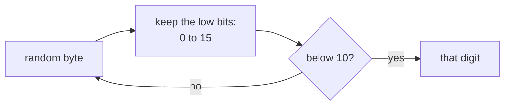

# Nano ID

::note
<!-- sync:needs:start -->

**You'll need**: [UUID](/docs/learn/uuid), [Writable slice](/docs/learn/writable-slice)
<!-- sync:needs:end -->

::

A [UUID](/docs/learn/uuid) names a thing in 36 characters, and four of those are hyphens. When the identifier ends up in a URL, a file name or a short link — `example.com/s/V1StGXR8_Z5jdHi6B-myT` — something shorter that needs no escaping is welcome. A **Nano ID** is exactly that: 21 characters, each one of the 64 that are safe in a URL, and still more random bits than a UUID.

This lesson makes one, reads one back, and then fills a buffer of its own length from an alphabet of its own choosing — six digits for a confirmation code:

```rux
import NanoId::{ GenerateNanoId, NanoId, NanoIdAlphabet, NanoIdLength, NanoIdParseError,
    ValidateAlphabet };
```

## Short and random

The default alphabet is `A`–`Z`, `a`–`z`, `0`–`9`, `_` and `-`: 64 characters, so each one carries exactly six random bits.

|                | UUID version 4 | Nano ID |
| -------------- | -------------- | ------- |
| Characters     | 36             | 21      |
| Random bits    | 122            | 126     |
| Safe in a URL  | yes            | yes     |
| Fixed hyphens  | four           | none    |
| Case-sensitive | no             | yes     |

The last row matters: in a UUID `A` and `a` are the same digit, but in a Nano ID they are different characters, and `V1St…` and `v1st…` are two different identifiers.

## Making one

`NanoId::Generate()` draws 21 random bytes from the operating system, as [Entropy](/docs/learn/entropy) does, and so returns `NanoId ! EntropyError`:

```rux
let id = NanoId::Generate() catch {
    else => {
        PrintLine("no entropy for a new identifier");
        return 1;
    }
};
PrintLine("a new one:   {}", id);
```

If the system has no entropy there is no identifier at all — never a predictable one. A `NanoId` is a small `Copy` value holding its 21 characters inline; `{}` prints them, and `Text()` lends them out as a `char8[..]`.

## Reading one back

`NanoId::Parse` is as strict as the UUID parser: exactly 21 bytes, every one from the default alphabet. The error says why and, through `Offset()`, where:

```rux
func Reason(error: NanoIdParseError) -> char8[..] {
    return match error {
        .WrongLength(_) => "wrong length",
        .InvalidCharacter(_) => "not in the alphabet"
    };
}
```

| Text                      | Result                                   |
| ------------------------- | ---------------------------------------- |
| `V1StGXR8_Z5jdHi6B-myT`   | accepted                                 |
| `V1StGXR8_Z5jdHi6B`       | wrong length, at byte 17 — the text ends |
| `V1StGXR8_Z5jdHi6B-myT42` | wrong length, at byte 21 — the form ends |
| `V1StGXR8+Z5jdHi6B-myT`   | not in the alphabet, at byte 8           |

Whatever `Generate` returns, its text parses back to an equal value. `Equals` compares every byte whatever it finds, so the time it takes says nothing about how much of a guessed identifier was right — which matters when the identifier is a secret, such as a session token.

## Your own length and alphabet

`GenerateNanoId` fills a buffer you provide, of any length, from the default alphabet or from one you pass:

```rux
var code: char8[6];
GenerateNanoId(code[..], "0123456789") catch {
    else => {
        PrintLine("no entropy for a code");
        return 1;
    }
};
```

The buffer is a [writable slice](/docs/learn/writable-slice) of a local array, and the code is as long as the buffer. With an alphabet, the call returns `! NanoIdError`, which adds the ways an alphabet can be unusable to the entropy failure.

The point of the rules is that every character must be equally likely. Each character starts as one random byte, masked down to the smallest power of two that covers the alphabet. For ten digits that is 0–15; a value from 10 to 15 is thrown away and another byte is used:



Folding 10–15 back with a remainder instead would make `0` to `5` likelier than `6` to `9`. For the same reason an alphabet must have between 2 and 256 characters, all distinct and all ASCII. `ValidateAlphabet` checks that, and the generators call it before spending any entropy:

| Alphabet           | Verdict                                         |
| ------------------ | ----------------------------------------------- |
| `0123456789abcdef` | usable                                          |
| `x`                | too few characters — one carries no information |
| `abcabc`           | a duplicate at byte 3, which would be likelier  |
| `abé`              | not ASCII at byte 2 — `é` is two bytes in UTF-8 |

## The program

The whole lesson is one package in the [Examples repository](https://github.com/rux-lang/Examples/tree/main/Utilities/NanoId). Its comments explain every step.

<!-- sync:program:start -->

```rux [Src/Main.rux]
// A Nano ID is a short random identifier, such as V1StGXR8_Z5jdHi6B-myT. It does the job of a
// UUID in less space: twenty-one characters drawn from the sixty-four that are safe in a URL or a
// file name, A-Z, a-z, 0-9, `_` and `-`. Each character carries six random bits, so a standard
// identifier carries 126, more than a version 4 UUID, in twenty-one characters instead of 36.
//
// `NanoId::Generate()` makes one from the operating system's entropy and returns
// `NanoId ! EntropyError`. `NanoId::Parse` reads the text form back, strictly: exactly twenty-one
// characters, every one from the default alphabet.
//
// `GenerateNanoId` fills a buffer you provide instead, of any length and from any alphabet, such
// as six digits for a confirmation code. An alphabet must be two to 256 distinct ASCII
// characters, so that every character is equally likely; `ValidateAlphabet` says which rule a bad
// one breaks, before any entropy is spent.
import Io::PrintLine;
import NanoId::{ GenerateNanoId, NanoId, NanoIdAlphabet, NanoIdLength, NanoIdParseError,
    ValidateAlphabet };

func Reason(error: NanoIdParseError) -> char8[..] {
    return match error {
        .WrongLength(_) => "wrong length",
        .InvalidCharacter(_) => "not in the alphabet"
    };
}

func Show(text: char8[..]) {
    match NanoId::Parse(text) {
        .Success(id) => PrintLine("{:<23} -> {}", text, id),
        .Failure(error) => PrintLine("{:<23} -> {} at byte {}", text, Reason(error), error.Offset())
    }
}

func Check(alphabet: char8[..]) {
    match ValidateAlphabet(alphabet) {
        .Success(_) => PrintLine("{:<16} -> usable", alphabet),
        .Failure(error) => match error {
            .AlphabetTooSmall => PrintLine("{:<16} -> too few characters", alphabet),
            .AlphabetTooLarge => PrintLine("{:<16} -> too many characters", alphabet),
            .DuplicateCharacter(at) => PrintLine("{:<16} -> a duplicate at byte {}", alphabet, at),
            .NonAsciiCharacter(at) => PrintLine("{:<16} -> not ASCII at byte {}", alphabet, at),
            .Entropy(_) => PrintLine("{:<16} -> no entropy", alphabet)
        }
    }
}

// Whether every character of `text` appears in `alphabet`.
func AllFrom(text: char8[..], alphabet: char8[..]) -> bool {
    for c in text {
        var found = false;
        for member in alphabet {
            if member == c { found = true; }
        }
        if !found { return false; }
    }
    return true;
}

func Main() -> int {
    PrintLine("default alphabet: {} characters, {} per identifier", NanoIdAlphabet.length,
        NanoIdLength);

    // Reading the text form. The first is the example from Nano ID's own documentation.
    Show("V1StGXR8_Z5jdHi6B-myT");
    Show("V1StGXR8_Z5jdHi6B");
    Show("V1StGXR8_Z5jdHi6B-myT42");
    Show("V1StGXR8+Z5jdHi6B-myT");

    // A new identifier, different on every run. Generating can fail when the system has no
    // entropy, and then there is no identifier at all, never a predictable one. So the outcome is
    // not the identifier itself:
    //
    //     let id: NanoId = NanoId::Generate();
    //         error: cannot assign 'NanoId ! EntropyError' to 'NanoId'
    let id = NanoId::Generate() catch {
        else => {
            PrintLine("no entropy for a new identifier");
            return 1;
        }
    };
    PrintLine("a new one:   {}", id);
    // Whatever it is, its shape is fixed: twenty-one characters that parse back to the same value.
    match NanoId::Parse(id.Text()) {
        .Success(back) => PrintLine("length {}, parses back to itself: {}", id.Text().length,
            back.Equals(id)),
        .Failure(_) => PrintLine("does not parse back")
    }

    // A six-digit code from a custom alphabet, in a buffer of exactly the length wanted. This
    // call returns `! NanoIdError`, since the alphabet could be unusable, and that failure must be
    // handled too:
    //
    //     GenerateNanoId(code[..], "0123456789");
    //         error: fallible result of type '! NanoIdError' is discarded
    var code: char8[6];
    GenerateNanoId(code[..], "0123456789") catch {
        else => {
            PrintLine("no entropy for a code");
            return 1;
        }
    };
    PrintLine("a code:      {}", code[..]);
    PrintLine("length {}, digits only: {}", code.length, AllFrom(code[..], "0123456789"));

    // Alphabets that would make some characters likelier than others are refused.
    Check("0123456789abcdef");
    Check("x");
    Check("abcabc");
    Check("abé");
    return 0;
}
```

Besides `Io`, its `Rux.toml` lists `NanoId` under `[Dependencies]`.
<!-- sync:program:end -->

## Run it

```sh
cd Examples/Utilities/NanoId
rux run
```

<!-- sync:output:start -->

```
default alphabet: 64 characters, 21 per identifier
V1StGXR8_Z5jdHi6B-myT   -> V1StGXR8_Z5jdHi6B-myT
V1StGXR8_Z5jdHi6B       -> wrong length at byte 17
V1StGXR8_Z5jdHi6B-myT42 -> wrong length at byte 21
V1StGXR8+Z5jdHi6B-myT   -> not in the alphabet at byte 8
a new one:   wjQ9BAvSAUonmlZf6TfIw
length 21, parses back to itself: true
a code:      198099
length 6, digits only: true
0123456789abcdef -> usable
x                -> too few characters
abcabc           -> a duplicate at byte 3
abé              -> not ASCII at byte 2
```

The `a new one` and `a code` lines are samples: each run draws a new identifier and a new code.
Every other line is the same on each run.
<!-- sync:output:end -->

## Common mistakes

::mistake
**Using the outcome as the identifier.**\
`let id: NanoId = NanoId::Generate();` fails with:

```text
error: cannot assign 'NanoId ! EntropyError' to 'NanoId'
```

Generating can fail when the system has no entropy; handle that first.
::

::mistake
**Ignoring the result of `GenerateNanoId`.**\
The call fills the buffer, so it is tempting to write it as a statement on its own. It fails with:

```text
error: fallible result of type '! NanoIdError' is discarded
```

If it failed, the buffer holds no code — never even the start of one — so the failure must be handled.
::

::mistake
**Keeping a custom code in a `NanoId`.**\
A `NanoId` is the standard form only. `NanoId::Parse("198099")` is refused as the wrong length at byte 6. A code of another length or alphabet stays in its own buffer.
::

::mistake
**Treating Nano IDs as case-insensitive.**\
Lower-casing an identifier, or storing it in a column that ignores case, merges different identifiers. Compare them exactly.
::

## Try it yourself

1. Make a ten-character identifier from the default alphabet: `GenerateNanoId` without an alphabet fills a `char8[10]` and returns `! EntropyError`.
2. Make a 32-character code from `"0123456789abcdef"`. How many random bits does it carry, and how does that compare with a UUID?
3. Show `"V1StGXR8 Z5jdHi6B-myT"`, with a space. Which reason and byte do you get?
4. Check the alphabet `"01"`. Is it usable? How long must an identifier from it be to carry 126 bits?

## Learn more

- [NanoId API](/docs/api/nanoid) — every function and error case
- [UUID](/docs/learn/uuid) — the longer, case-insensitive identifier with a fixed layout
- [Entropy](/docs/learn/entropy) — where the random bytes come from, and why asking can fail
- [Writable slice](/docs/learn/writable-slice) — a function filling a buffer it was lent
- [Password](/docs/learn/password) — a checkpoint project that draws characters from entropy without bias
- [Slices](/docs/lang/slices/overview) in the Rux Reference
