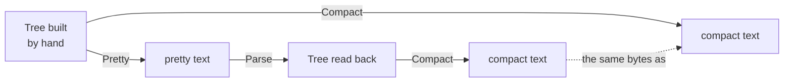

# Writing JSON

::note
<!-- sync:needs:start -->

**You'll need**: [JSON](/docs/learn/json), [String builder](/docs/learn/string-builder), [Display](/docs/learn/display), [Move](/docs/learn/move), [Error sum](/docs/learn/error-sum)
<!-- sync:needs:end -->

::

Writing JSON is the [parse lesson](/docs/learn/json) run backwards: a tree of `JsonValue`s goes in, text comes out. The tree can come from `Parse`, or — as here — be built by hand, one value at a time. This lesson builds a small document, writes it two ways, and proves the writing is faithful by reading the output back.

```rux
import Json::{ JsonError, JsonStyle, JsonValue, Parse, WriteValue };
import Text::{ FormatError, String, StringBuilder, TextError, TextWriter };
```

## Building a tree by hand

Each kind has a constructor: `JsonValue::Text`, `Number`, `Boolean`, `Null`, `Array` and `Object`. Containers start empty; `Push` appends to an array and `Insert` adds a member to an object:

```rux
var tags = JsonValue::Array(allocator);
try tags.Push(JsonValue::Text(allocator, "fast"));
try tags.Push(JsonValue::Number(allocator, "2.50"));
var root = JsonValue::Object(allocator);
try root.Insert(String::FromBytes(allocator, "name"), JsonValue::Text(allocator, "Rux"));
try root.Insert(String::FromBytes(allocator, "quote"),
            JsonValue::Text(allocator, "say \"hi\"\n"));
try root.Insert(String::FromBytes(allocator, "tags"), move tags);
try root.Insert(String::FromBytes(allocator, "license"), JsonValue::Null(allocator));
```

Four things to notice:

- **Text is copied into the tree.** `Text` and `String::FromBytes` copy their bytes into memory from the allocator, and they throw a `TextError` when the bytes are not valid UTF-8.
- **A number is given as text.** `"2.50"` stays `2.50`, exactly as written, the same way a parsed number keeps its text. `Number` throws `JsonError::MalformedNumber` for text that is not a JSON number.
- **The containers check their kind.** `Push` into a value that is not an array, or `Insert` into one that is not an object, throws `JsonError::WrongKind`.
- **Values are move-only.** A `JsonValue` owns everything under it, so it cannot be copied. `Push` and `Insert` take ownership of what they are given, and handing over the finished `tags` array is an explicit [move](/docs/learn/move): `move tags`. After that line `tags` is gone, and the array lives on inside `root`.

So almost every line can throw, and each one is marked with `try`. One `try` covers the whole expression to its right, so `try tags.Push(JsonValue::Text(allocator, "fast"))` marks both the `Text` call and the `Push`. `Main` is declared `throws (TextError | FormatError | JsonError)` — an [error sum](/docs/learn/error-sum) — so plain `try` [passes](/docs/learn/propagate) a failure of any of the three kinds on, and a [throwing `Main`](/docs/learn/fallible-main) turns it into the program's exit status.

## Writing it out

`WriteValue` writes a tree into any `TextWriter`:

```
WriteValue(writer, value, style) throws FormatError
```

`Written` points it at a [`StringBuilder`](/docs/learn/string-builder), so the text can be kept, measured and parsed again, and hands the result back as a `String` the caller owns:

```rux
func Written(allocator: Allocator, value: &JsonValue, style: JsonStyle) -> String throws FormatError {
    var builder = StringBuilder(allocator);
    let sink: &var TextWriter = builder;
    try WriteValue(sink, value, style);
    return builder.TakeString();
}
```

`JsonStyle` chooses the layout:

| Style                  | Layout                               | Size of this document | For            |
| ---------------------- | ------------------------------------ | --------------------- | -------------- |
| `JsonStyle::Compact()` | no whitespace at all                 | 73 bytes              | a wire, a file |
| `JsonStyle::Pretty()`  | one value per line, two-space indent | 103 bytes             | a person       |

Either way the writer escapes exactly what JSON requires inside strings and nothing more: the quote's `"` and its newline come out as `\"` and `\n`.

## The round trip

A writer is only trustworthy if what it writes reads back as the same thing. The program parses the pretty text and writes it compact again. A failed parse here is handled on the spot by the [`catch`](/docs/learn/catch) arms, which print the reason and leave `Main`:

```rux
let again = try Parse(allocator, pretty.View().Bytes()) catch {
    reason => {
        PrintLine("the written text did not parse: {}", reason);
        return;
    }
};
let rewritten = try Written(allocator, again, JsonStyle::Compact());
PrintLine("round trip gives the same text: {}", rewritten.View().Equals(compact.View()));
```



The layout was only presentation, so the same 73 bytes come back — including `2.50`, which did not become `2.5`, because a number keeps the text it was written with.

## What JSON cannot say

JSON has no spelling for NaN or infinity. A number with the text `"NaN"` is refused as soon as it is made, so it never reaches the tree and is never written out as something invented. The `try` block sees two kinds of error — `JsonError` from `Number`, `FormatError` from `Written` — so its arms take each [type](/docs/learn/typed-pattern) in turn:

```rux
try {
    let notANumber = JsonValue::Number(allocator, "NaN");
    let text = Written(allocator, notANumber, JsonStyle::Compact());
    PrintLine("wrote {}", text.View());
} catch {
    _: JsonError => PrintLine("NaN refused: not a JSON number"),
    error: FormatError => PrintLine("NaN not written: {}", error)
}
```

The first arm runs, and the program prints `NaN refused: not a JSON number`.

## The program

The whole lesson is one package in the [Examples repository](https://github.com/rux-lang/Examples/tree/main/DataFormats/JsonWrite). Its comments explain every step.

<!-- sync:program:start -->

```rux [Src/Main.rux]
// Writing JSON is the parse lesson run backwards: a tree of `JsonValue`s goes in, text comes
// out. The tree can come from `Parse` or be built by hand, and `WriteValue` writes it into any
// `TextWriter` — a StringBuilder here, so the text can be kept and parsed again.
//
//     WriteValue(writer, value, style) throws FormatError
//
// `JsonStyle` chooses the layout. `Compact()` writes no whitespace at all, for a document going
// over a wire; `Pretty()` indents by two spaces, for a person. Either way the writer escapes
// exactly what JSON requires inside strings, and nothing more.
import Allocator::{ Allocator, SystemAllocator };
import Io::PrintLine;
import Json::{ JsonError, JsonStyle, JsonValue, Parse, WriteValue };
import Text::{ FormatError, String, StringBuilder, TextError, TextWriter };

// Writes `value` in `style` and hands the text back as a String the caller owns.
func Written(allocator: Allocator, value: &JsonValue, style: JsonStyle) -> String throws FormatError {
    var builder = StringBuilder(allocator);
    let sink: &var TextWriter = builder;
    try WriteValue(sink, value, style);
    return builder.TakeString();
}

func Main() throws (TextError | FormatError | JsonError) {
    var system = SystemAllocator();
    let allocator: Allocator = system;

    // Building by hand. Values are move-only: `Push` and `Insert` take ownership of what they
    // are given, and a member's name is an owned String. `Push` into a value that is not an
    // array, or `Insert` into one that is not an object, throws `JsonError::WrongKind`.
    var tags = JsonValue::Array(allocator);
    try tags.Push(JsonValue::Text(allocator, "fast"));
    try tags.Push(JsonValue::Number(allocator, "2.50"));
    var root = JsonValue::Object(allocator);
    try root.Insert(String::FromBytes(allocator, "name"), JsonValue::Text(allocator, "Rux"));
    try root.Insert(String::FromBytes(allocator, "quote"),
                JsonValue::Text(allocator, "say \"hi\"\n"));
    try root.Insert(String::FromBytes(allocator, "tags"), move tags);
    try root.Insert(String::FromBytes(allocator, "license"), JsonValue::Null(allocator));

    let compact = try Written(allocator, root, JsonStyle::Compact());
    let pretty = try Written(allocator, root, JsonStyle::Pretty());
    PrintLine("compact, {} bytes:\n{}", compact.Length(), compact.View());
    PrintLine("pretty, {} bytes:\n{}", pretty.Length(), pretty.View());

    // The round trip: parse the pretty text and write it compact again. The layout was only
    // presentation, so the same bytes come back. A number keeps the text it was written with,
    // which is why `2.50` did not become `2.5`.
    let again = try Parse(allocator, pretty.View().Bytes()) catch {
        reason => {
            PrintLine("the written text did not parse: {}", reason);
            return;
        }
    };
    let rewritten = try Written(allocator, again, JsonStyle::Compact());
    PrintLine("round trip gives the same text: {}", rewritten.View().Equals(compact.View()));

    // JSON cannot spell NaN or infinity, so a number with that text is refused as soon as it is
    // made, and never written out as something invented. The `try` block sees both errors, so
    // its arms take each type in turn.
    try {
        let notANumber = JsonValue::Number(allocator, "NaN");
        let text = Written(allocator, notANumber, JsonStyle::Compact());
        PrintLine("wrote {}", text.View());
    } catch {
        _: JsonError => PrintLine("NaN refused: not a JSON number"),
        error: FormatError => PrintLine("NaN not written: {}", error)
    }
}
```

Besides `Io`, its `Rux.toml` lists `Allocator`, `Json` and `Text` under `[Dependencies]`.
<!-- sync:program:end -->

## Run it

```sh
cd Examples/DataFormats/JsonWrite
rux run
```

<!-- sync:output:start -->

```
compact, 73 bytes:
{"name":"Rux","quote":"say \"hi\"\n","tags":["fast",2.50],"license":null}
pretty, 103 bytes:
{
  "name": "Rux",
  "quote": "say \"hi\"\n",
  "tags": [
    "fast",
    2.50
  ],
  "license": null
}
round trip gives the same text: true
NaN refused: not a JSON number
```

<!-- sync:output:end -->

## Common mistakes

::mistake
**Using a value after handing it over.**\
After `root.Insert(…, move tags)`, the array belongs to `root`. A later `tags.Push(…)` fails with:

```text
error: value 'tags' is used after it was moved
help: clone 'tags' before moving it if both uses are required
```

Finish filling a container before you insert it.
::

::mistake
**Inserting without `move`.**\
`root.Insert(String::FromBytes(allocator, "tags"), tags)` fails with:

```text
error: cannot copy 'JsonValue', which owns resources
note: a named value used by value in argument position is copied, and only plain data copies
help: write 'move tags' to transfer it, or 'tags.Clone()' to copy it
```

The `move` makes the hand-over visible where it happens.
::

::mistake
**A literal as a member name.**\
`Insert` takes an owned `String`. `root.Insert("name", …)` fails with:

```text
error: argument 1 to 'Insert' has type 'char8[..]', but parameter 'name' requires 'String'
```

Make one with `String::FromBytes(allocator, "name")`.
::

::mistake
**Passing an error on with `?`.**\
`tags.Push(JsonValue::Text(allocator, "fast")?)` fails with:

```text
error: '?' does not propagate errors
help: write 'try' before the expression to pass the error on
```

`?` only passes on the absence of an optional. Write `try` at the start of the whole expression: `try tags.Push(JsonValue::Text(allocator, "fast"))`.
::

## Try it yourself

1. Add a boolean member, `"beta": true`, with `JsonValue::Boolean(allocator, true)`. How many bytes is the compact text now?
2. Build a nested object — say `"author": {"name": "Ada"}` — and look at how `Pretty()` indents it.
3. Try `"Infinity"` and `"01"` instead of `"NaN"`. Are they refused too?
4. `Insert` never replaces: insert `"name"` a second time and write the tree. What does `Parse` say when it reads that text back?
5. Parse the document from the [JSON lesson](/docs/learn/json) and write it out with `Pretty()`.

## Learn more

- [JSON](/docs/learn/json) — reading a document into the tree this lesson writes
- [Move](/docs/learn/move) — what `move` does, and why a `JsonValue` cannot be copied
- [String builder](/docs/learn/string-builder) — the `TextWriter` that collects the text
- [Error sum](/docs/learn/error-sum) — one throwing `Main` for three kinds of error
- [Passing errors on](/docs/lang/errors/propagation) in the Rux Reference
- [Notes](/docs/learn/notes) — a checkpoint project that saves a to-do list as JSON and loads it back
