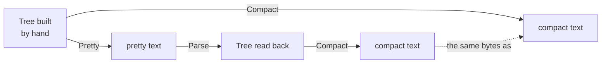

# Writing JSON

::note
<!-- sync:needs:start -->

**You'll need**: [JSON](/docs/learn/json), [String builder](/docs/learn/string-builder), [Display](/docs/learn/display), [Give away](/docs/learn/give-away), [Error sum](/docs/learn/error-sum)
<!-- sync:needs:end -->

::

Writing JSON is the [parse lesson](/docs/learn/json) run backwards: a tree of `JsonValue`s goes in, text comes out. The tree can come from `Parse`, or, as here, be built by hand, one value at a time. This lesson builds a small document, writes it two ways, and proves the writing is faithful by reading the output back.

```rux
import Json::{ JsonError, JsonStyle, JsonValue, Parse, WriteValue };
import Text::{ String, StringBuilder, TextError, TextWriter };
import Text::Formatting::FormatError;
```

## Building a tree by hand

Each kind has a constructor: `JsonValue::Text`, `Number`, `Boolean`, `Null`, `Array` and `Object`. Containers start empty; `Push` appends to an array and `Insert` adds a member to an object:

```rux
var tags = JsonValue::Array(allocator);
tags.Push(JsonValue::Text(allocator, "fast")!)!;
tags.Push(JsonValue::Number(allocator, "2.50")!)!;
var root = JsonValue::Object(allocator);
root.Insert(String::FromBytes(allocator, "name")!, JsonValue::Text(allocator, "Rux")!)!;
root.Insert(String::FromBytes(allocator, "quote")!,
    JsonValue::Text(allocator, "say \"hi\"\n")!)!;
root.Insert(String::FromBytes(allocator, "tags")!, tags)!;
root.Insert(String::FromBytes(allocator, "license")!, JsonValue::Null(allocator))!;
```

Four things to notice:

- **Text is copied into the tree.** `Text` and `String::FromBytes` copy their bytes into memory from the allocator, and they fail with a `TextError` when the bytes are not valid UTF-8.
- **A number is given as text.** `"2.50"` stays `2.50`, exactly as written, the same way a parsed number keeps its text. `Number` fails with `JsonError::MalformedNumber` for text that is not a JSON number.
- **The containers check their kind.** `Push` into a value that is not an array, or `Insert` into one that is not an object, fails with `JsonError::WrongKind`.
- **Values own what is under them.** A `JsonValue` owns everything below it, so it is never copied by accident. `Push` and `Insert` take ownership of what they are given, and a value written bare is [given away](/docs/learn/give-away): after `root.Insert(…, tags)` the name `tags` is spent, and the array lives on inside `root`.

So almost every call can fail, and each one is followed by its own `!`. The mark is tight and belongs to one call: in `tags.Push(JsonValue::Text(allocator, "fast")!)!`, the inner `!` passes on the `TextError` from `Text`, and the outer one the `JsonError` from `Push`.

The steps that can fail live in `Demonstrate`, declared `-> !TextError | FormatError | JsonError` — an [error sum](/docs/learn/error-sum) — so each `!` [passes](/docs/learn/propagate) a failure of any of the three kinds on. `Main` cannot fail, so it hands any failure to `!!` and turns it into the [exit status](/docs/learn/exit-status):

```rux
func Main() -> int {
    Demonstrate() !! return 1;
    return 0;
}
```

## Writing it out

`WriteValue` writes a tree into any `TextWriter`:

```
WriteValue(writer, value, style) -> !FormatError
```

`Written` points it at a [`StringBuilder`](/docs/learn/string-builder), so the text can be kept, measured and parsed again, and hands the result back as a `String` the caller owns:

```rux
func Written(allocator: Allocator, value: &JsonValue, style: JsonStyle) -> String ! FormatError {
    var builder = StringBuilder::New(allocator);
    let sink: &var TextWriter = builder;
    WriteValue(sink, value, style)!;
    return builder.TakeString();
}
```

`Written` only reads the tree, so the caller lends it: `Written(allocator, &root, JsonStyle::Compact())`. `JsonStyle` chooses the layout:

| Style                  | Layout                               | Size of this document | For            |
| ---------------------- | ------------------------------------ | --------------------- | -------------- |
| `JsonStyle::Compact()` | no whitespace at all                 | 73 bytes              | a wire, a file |
| `JsonStyle::Pretty()`  | one value per line, two-space indent | 103 bytes             | a person       |

Either way the writer escapes exactly what JSON requires inside strings and nothing more: the quote's `"` and its newline come out as `\"` and `\n`.

## The round trip

A writer is only trustworthy if what it writes reads back as the same thing. The program parses the pretty text and writes it compact again. A failed parse here is handled on the spot by the [`catch`](/docs/learn/catch) arm, which prints the reason and leaves `Demonstrate`:

```rux
let again = Parse(allocator, pretty.View().Bytes()) catch {
    reason => {
        PrintLine("the written text did not parse: {}", reason);
        return;
    }
};
let rewritten = Written(allocator, &again, JsonStyle::Compact())!;
PrintLine("round trip gives the same text: {}", rewritten.View().Equals(compact.View()));
```



The layout was only presentation, so the same 73 bytes come back, including `2.50`, which did not become `2.5`, because a number keeps the text it was written with.

## What JSON cannot say

JSON has no spelling for NaN or infinity. A number with the text `"NaN"` is refused as soon as it is made, so it never reaches the tree and is never written out as something invented. Making the number and writing it are two calls that can fail, each with its own error, so they sit in a function of their own whose error side is the sum of both:

```rux
func WriteNotANumber(allocator: Allocator) -> !JsonError | FormatError {
    let notANumber = JsonValue::Number(allocator, "NaN")!;
    let text = Written(allocator, &notANumber, JsonStyle::Compact())!;
    PrintLine("wrote {}", text.View());
}
```

The caller handles that sum with `catch`, whose arms take each [type](/docs/learn/typed-pattern) in turn:

```rux
WriteNotANumber(allocator) catch {
    _: JsonError => PrintLine("NaN refused: not a JSON number"),
    error: FormatError => PrintLine("NaN not written: {}", error)
};
```

The first arm runs, and the program prints `NaN refused: not a JSON number`.

## The program

The whole lesson is one package in the [Examples repository](https://github.com/rux-lang/Examples/tree/main/DataFormats/JsonWrite). Its comments explain every step.

<!-- sync:program:start -->

```rux [Src/Main.rux]
// Writing JSON is the parse lesson run backwards: a tree of `JsonValue`s goes in, text comes
// out. The tree can come from `Parse` or be built by hand, and `WriteValue` writes it into any
// `TextWriter` — a StringBuilder here, so the text can be kept and parsed again.
//
//     WriteValue(writer, value, style) -> !FormatError
//
// `JsonStyle` chooses the layout. `Compact()` writes no whitespace at all, for a document going
// over a wire; `Pretty()` indents by two spaces, for a person. Either way the writer escapes
// exactly what JSON requires inside strings, and nothing more.
import Allocator::{ Allocator, SystemAllocator };
import Io::PrintLine;
import Json::{ JsonError, JsonStyle, JsonValue, Parse, WriteValue };
import Text::{ String, StringBuilder, TextError, TextWriter };
import Text::Formatting::FormatError;

// Writes `value` in `style` and hands the text back as a String the caller owns.
func Written(allocator: Allocator, value: &JsonValue, style: JsonStyle) -> String ! FormatError {
    var builder = StringBuilder::New(allocator);
    let sink: &var TextWriter = builder;
    WriteValue(sink, value, style)!;
    return builder.TakeString();
}

// A JSON number with text JSON cannot spell, made and written in one go. Two calls can fail here,
// each with its own error, so the function's error side is the sum of both.
func WriteNotANumber(allocator: Allocator) -> !JsonError | FormatError {
    let notANumber = JsonValue::Number(allocator, "NaN")!;
    let text = Written(allocator, &notANumber, JsonStyle::Compact())!;
    PrintLine("wrote {}", text.View());
}

func Demonstrate() -> !TextError | FormatError | JsonError {
    let allocator = SystemAllocator::New();

    // Building by hand. Values are given away when written bare: `Push` and `Insert` take
    // ownership of what they are given, and a member's name is an owned String. `Push` into a
    // value that is not an array, or `Insert` into one that is not an object, fails with
    // `JsonError::WrongKind`.
    var tags = JsonValue::Array(allocator);
    tags.Push(JsonValue::Text(allocator, "fast")!)!;
    tags.Push(JsonValue::Number(allocator, "2.50")!)!;
    var root = JsonValue::Object(allocator);
    root.Insert(String::FromBytes(allocator, "name")!, JsonValue::Text(allocator, "Rux")!)!;
    root.Insert(String::FromBytes(allocator, "quote")!,
        JsonValue::Text(allocator, "say \"hi\"\n")!)!;
    root.Insert(String::FromBytes(allocator, "tags")!, tags)!;
    root.Insert(String::FromBytes(allocator, "license")!, JsonValue::Null(allocator))!;

    let compact = Written(allocator, &root, JsonStyle::Compact())!;
    let pretty = Written(allocator, &root, JsonStyle::Pretty())!;
    PrintLine("compact, {} bytes:\n{}", compact.Length(), compact.View());
    PrintLine("pretty, {} bytes:\n{}", pretty.Length(), pretty.View());

    // The round trip: parse the pretty text and write it compact again. The layout was only
    // presentation, so the same bytes come back. A number keeps the text it was written with,
    // which is why `2.50` did not become `2.5`.
    let again = Parse(allocator, pretty.View().Bytes()) catch {
        reason => {
            PrintLine("the written text did not parse: {}", reason);
            return;
        }
    };
    let rewritten = Written(allocator, &again, JsonStyle::Compact())!;
    PrintLine("round trip gives the same text: {}", rewritten.View().Equals(compact.View()));

    // JSON cannot spell NaN or infinity, so a number with that text is refused as soon as it is
    // made, and never written out as something invented. `WriteNotANumber` can fail with either
    // error, so the `catch` arms take each type in turn.
    WriteNotANumber(allocator) catch {
        _: JsonError => PrintLine("NaN refused: not a JSON number"),
        error: FormatError => PrintLine("NaN not written: {}", error)
    };
}

func Main() -> int {
    Demonstrate() !! return 1;
    return 0;
}
```

Besides `Io`, its `Rux.toml` lists `Allocator`, `Json` and `Text` under `[Dependencies]`.
<!-- sync:program:end -->

## Run it

```sh
cd Examples/DataFormats/JsonWrite
rux run
```

<!-- sync:output:start -->

```
compact, 73 bytes:
{"name":"Rux","quote":"say \"hi\"\n","tags":["fast",2.50],"license":null}
pretty, 103 bytes:
{
  "name": "Rux",
  "quote": "say \"hi\"\n",
  "tags": [
    "fast",
    2.50
  ],
  "license": null
}
round trip gives the same text: true
NaN refused: not a JSON number
```

<!-- sync:output:end -->

## Common mistakes

::mistake
**Using a value after handing it over.**\
After `root.Insert(…, tags)!;`, the array belongs to `root`. A later `tags.Push(…)` fails with:

```text
error: 'tags' is used after it was given away
help: lend it with '&tags' where it is only read, or clone it where both uses need a value
```

Finish filling a container before you insert it.
::

::mistake
**Passing the outcome instead of the value.**\
Every `!` belongs to one call. `tags.Push(JsonValue::Text(allocator, "fast"))!;` marks only the `Push`, so the `Text` call's outcome is passed in whole, and fails with:

```text
error: argument 1 to 'Push' has type 'JsonValue ! TextError', but parameter 'value' requires 'JsonValue'
```

Mark the inner call too: `tags.Push(JsonValue::Text(allocator, "fast")!)!;`.
::

::mistake
**Forgetting the outer `!`.**\
`tags.Push(JsonValue::Text(allocator, "fast")!);` leaves the `Push` unmarked, and fails with:

```text
error: 'Push' can fail with 'JsonError', and the result is not used
help: pass the error on with '!', ignore it with '!!;', or handle it with 'catch { ... }'
```

::

::mistake
**A literal as a member name.**\
`Insert` takes an owned `String`. `root.Insert("name", …)` fails with:

```text
error: argument 1 to 'Insert' has type 'char8[..]', but parameter 'name' requires 'String'
```

Make one with `String::FromBytes(allocator, "name")!`.
::

::mistake
**Passing an error on with `?`.**\
`tags.Push(JsonValue::Text(allocator, "fast")?)` fails with:

```text
error: '?' does not propagate errors
help: write '!' to pass the error on
```

`?` only passes on the absence of an optional; an error is passed on with `!`.
::

::mistake
**Lending the tree without writing the loan.**\
`Written(allocator, root, JsonStyle::Compact())` fails with:

```text
error: 'Written' borrows its argument, and 'JsonValue' owns resources, so the loan must be written
help: write '&root'
```

::

## Try it yourself

1. Add a boolean member, `"beta": true`, with `JsonValue::Boolean(allocator, true)`. How many bytes is the compact text now?
2. Build a nested object (say `"author": {"name": "Ada"}`) and look at how `Pretty()` indents it.
3. Try `"Infinity"` and `"01"` instead of `"NaN"`. Are they refused too?
4. `Insert` never replaces: insert `"name"` a second time and write the tree. What does `Parse` say when it reads that text back?
5. Parse the document from the [JSON lesson](/docs/learn/json) and write it out with `Pretty()`.

## Learn more

- [JSON](/docs/learn/json): reading a document into the tree this lesson writes
- [Give away](/docs/learn/give-away): what writing a value bare does, and why a `JsonValue` is not copied
- [String builder](/docs/learn/string-builder): the `TextWriter` that collects the text
- [Error sum](/docs/learn/error-sum): one function's error side for three kinds of error
- [Exit status](/docs/learn/exit-status): turning a failure into `Main`'s result
- [Passing errors on](/docs/lang/errors/propagation) in the Rux Reference
- [Notes](/docs/learn/notes): a checkpoint project that saves a to-do list as JSON and loads it back
