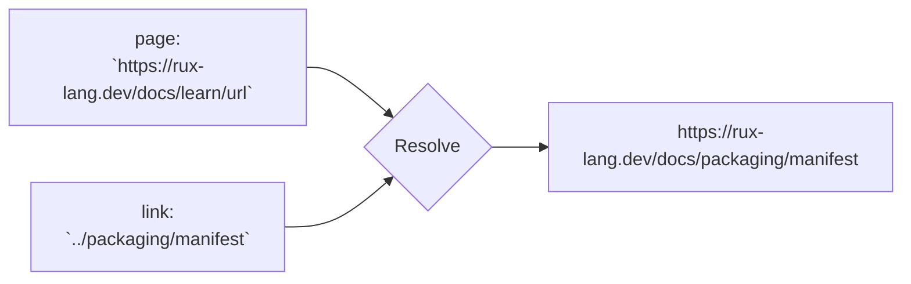

# URL

::note
<!-- sync:needs:start -->

**You'll need**: [Base64 and friends](/docs/learn/base-encoding), [Allocator](/docs/learn/allocator), [Coalesce](/docs/learn/coalesce), [Propagate](/docs/learn/propagate), [Fallible main](/docs/learn/fallible-main)
<!-- sync:needs:end -->

::

A URL looks like a string you could take apart with a few searches for `/` and `?`. It is not. A host is not case-sensitive but a path is; `..` in a path climbs a level; `%C3%A9` is an escaped `é`; `:443` on an `https` URL says nothing at all; and a link such as `../guide` means something only next to the page it appears on. The `Url` package reads URLs by RFC 3986, the standard browsers follow, so you do not have to:

```rux
import Url::{ Decode, Pairs, QueryBuilder, Url, UrlError };
```

## The parts of a URL

```text
https://rux-lang.dev:443/docs/learn/url?q=caf%C3%A9&page=2#install
└─┬─┘   └────┬─────┘ └┬┘ └─────┬──────┘ └───────┬──────┘ └──┬──┘
scheme     host     port     path            query       fragment
```

`Url::Parse` takes an [allocator](/docs/learn/allocator), since the URL keeps its own copy of the text, and returns `Url ! UrlError`. Each component then comes from an accessor:

| Accessor          | Returns      | For the URL above    |
| ----------------- | ------------ | -------------------- |
| `Scheme()`        | `char8[..]`  | `https`              |
| `Host()`          | `char8[..]?` | `rux-lang.dev`       |
| `Port()`          | `uint16?`    | none — not written   |
| `PortOrDefault()` | `uint16?`    | `443`                |
| `Path()`          | `char8[..]`  | `/docs/learn/url`    |
| `Query()`         | `char8[..]?` | `q=caf%C3%A9&page=2` |
| `Fragment()`      | `char8[..]?` | `install`            |
| `Text()`          | `char8[..]`  | the whole URL        |

The optional ones are [optional](/docs/learn/optional) because a URL may simply not have that part — `mailto:info@rux-lang.dev` has no host, and most URLs have no fragment. `?? ""` treats a missing part as an empty one, which is what this program wants. Every accessor is a view into the URL's own text, so nothing is copied.

## Normal form

`Parse` does more than split. It puts the URL in **normal form**, so that two URLs that mean the same thing come out as the same text:

```rux
let page = Url::Parse(allocator,
    "HTTPS://Rux-Lang.DEV:443/docs/./learn/../learn/url?q=caf%c3%a9&page=2#install")?;
```

| In the text                  | Normalized to           | Because                           |
| ---------------------------- | ----------------------- | --------------------------------- |
| `HTTPS`, `Rux-Lang.DEV`      | `https`, `rux-lang.dev` | scheme and host ignore case       |
| `:443`                       | nothing                 | it is `https`'s default port      |
| `/docs/./learn/../learn/url` | `/docs/learn/url`       | `.` and `..` segments are removed |
| `%c3%a9`                     | `%C3%A9`                | escapes use upper-case hex        |

So comparing two parsed URLs is comparing their text, and `Equals` does just that.

## Resolving links

A page's links are usually **relative references**: `guide`, `/blog`, `?page=3`. `Resolve` turns one into a full URL against the page, exactly as a browser does when you click it:

```rux
for link in links {
    let target = page.Resolve(link)?;
    PrintLine("  {:<22} -> {}", link, target.Text());
}
```



| Reference               | Replaces                                   |
| ----------------------- | ------------------------------------------ |
| `guide`                 | the last path segment                      |
| `../packaging/manifest` | the last segment, after climbing one level |
| `/blog`                 | the whole path                             |
| `?page=3`               | the query, keeping the path                |
| `#run-it`               | only the fragment                          |
| `//github.com/rux-lang` | everything but the scheme                  |

## The query

A query is `name=value` pairs joined by `&`, still percent-encoded. `Pairs` walks them without allocating, and `Decode` turns an encoded value into a `String`. Its last argument, `true`, reads `+` as a space, the way an HTML form writes one:

```rux
for pair in Pairs(page.Query() ?? "") {
    let value = Decode(allocator, pair.value, true)?;
    PrintLine("  {} = {}", pair.name, value);
}
```

Going the other way, never paste text into a query yourself. `QueryBuilder` escapes each name and value, so that an `&` or `=` inside a value cannot end the pair early, and `SetQuery` puts the result into a URL:

```rux
var query = QueryBuilder(allocator);
query.Append("q", "fish & chips")?;
query.Append("sort", "price=asc")?;
var search = Url::Parse(allocator, "https://example.com/search")?;
search.SetQuery(query.Text())?;
```

That gives `?q=fish+%26+chips&sort=price%3Dasc`. For a single path segment, the `PercentEncode` you met in [Base64 and friends](/docs/learn/base-encoding) does the job, with the `Component` set: it escapes `/` as well, so `Kyiv 2026/10.txt` stays one segment, `Kyiv%202026%2F10.txt`.

## What is refused

`UrlError` says why text is not a URL. The one to know is `MissingScheme`: `rux-lang.dev/docs` has no `https:`, so it is a _relative_ reference, and the only thing to do with it is `Resolve` it against a URL that has one.

## The program

The whole lesson is one package in the [Examples repository](https://github.com/rux-lang/Examples/tree/main/DataFormats/Url). Its comments explain every step.

<!-- sync:program:start -->

```rux [Src/Main.rux]
// A URL names something on a network and says how to reach it:
//
//     https://rux-lang.dev:443/docs/learn/url?q=caf%C3%A9&page=2#install
//     scheme   host         port path            query            fragment
//
// Splitting that by hand looks easy and is not: `%C3%A9` is an escaped `é`, a host is not case
// sensitive but a path is, and `..` in a path climbs a level. `Url::Parse` reads a URL by RFC 3986
// and keeps it in one normalized form, so each component is a view of that text, and two URLs
// that mean the same thing come out as the same text.
//
// A link on a page is often relative, such as `../guide` or `?page=3`. `Resolve` turns it into a
// full URL against the page it appears on, exactly as a browser does.
//
// Components stay percent-encoded. `Pairs` walks a query's `name=value` pairs, `Decode` turns one
// into text, and `QueryBuilder` goes the other way, escaping text into a query.
import Allocator::{ Allocator, SystemAllocator };
import Encoding::{ PercentEncode, PercentSet };
import Io::PrintLine;
import Url::{ Decode, Pairs, QueryBuilder, Url, UrlError };

func Reason(error: UrlError) -> char8[..] {
    return match error {
        UrlError::MissingScheme => "no scheme: a relative reference",
        UrlError::InvalidScheme => "not a scheme",
        UrlError::InvalidHost => "not a host",
        UrlError::InvalidPort => "not a port",
        UrlError::InvalidPercentEncoding => "a % without two hexadecimal digits",
        UrlError::OutOfMemory => "out of memory",
        UrlError::InvalidText => "not UTF-8 text"
    };
}

func Check(allocator: Allocator, text: char8[..]) {
    match Url::Parse(allocator, text) {
        .Success(url) => PrintLine("  {:<28} -> {}", text, url.Text()),
        .Failure(error) => PrintLine("  {:<28} -> {}", text, Reason(error))
    }
}

func Main() -> ! UrlError {
    var system = SystemAllocator();
    let allocator: Allocator = system;

    // Parsing normalizes: the scheme and host are lower-cased, the default port is dropped, the
    // dot segments are removed from the path, and escapes use upper-case hexadecimal.
    let page = Url::Parse(allocator,
        "HTTPS://Rux-Lang.DEV:443/docs/./learn/../learn/url?q=caf%c3%a9&page=2#install")?;
    PrintLine("url       {}", page.Text());
    PrintLine("scheme    {}", page.Scheme());
    PrintLine("host      {}", page.Host() ?? "");
    PrintLine("port      {} (not written, the default for https)", page.PortOrDefault() ?? 0);
    PrintLine("path      {}", page.Path());
    PrintLine("query     {}", page.Query() ?? "");
    PrintLine("fragment  {}", page.Fragment() ?? "");

    // The query, pair by pair. `Decode` turns `caf%C3%A9` back into `café`; `true` reads `+` as a
    // space, as a query from an HTML form writes it.
    //
    // A URL may have no query at all, so `Query()` returns `char8[..]?`, and `?? ""` treats a
    // missing query as an empty one. Without it:
    //
    //     for pair in Pairs(page.Query()) { }
    //         error: argument 1 to 'Pairs' has type 'char8[..]?', but parameter 'query' requires
    //                'char8[..]'
    for pair in Pairs(page.Query() ?? "") {
        let value = Decode(allocator, pair.value, true)?;
        PrintLine("  {} = {}", pair.name, value);
    }

    // Relative references, resolved against the page.
    PrintLine("links on the page:");
    let links: char8[..][6] = ["guide", "../packaging/manifest", "/blog", "?page=3", "#run-it",
        "//github.com/rux-lang"];
    for link in links {
        let target = page.Resolve(link)?;
        PrintLine("  {:<22} -> {}", link, target.Text());
    }

    // Building a query. Each name and value is escaped as HTML forms do it: a space becomes `+`,
    // and `&` or `=` inside a value becomes `%26` or `%3D`, so it cannot end the pair early.
    var query = QueryBuilder(allocator);
    query.Append("q", "fish & chips")?;
    query.Append("sort", "price=asc")?;
    var search = Url::Parse(allocator, "https://example.com/search")?;
    search.SetQuery(query.Text())?;
    PrintLine("search    {}", search.Text());

    // One path segment from arbitrary text. The Encoding package's `PercentEncode` with the
    // `Component` set escapes everything but letters, digits and `-._~`, the `/` included, so the
    // text stays one segment.
    var segment: char8[64];
    let length = PercentEncode("Kyiv 2026/10.txt", segment[..], PercentSet::Component) catch {
        else => 0
    };
    PrintLine("segment   {}", segment[..length]);

    // Text that is not a URL.
    PrintLine("refused:");
    Check(allocator, "rux-lang.dev/docs");
    Check(allocator, "https://rux lang.dev/");
    Check(allocator, "https://rux-lang.dev:99999/");
    Check(allocator, "https://rux-lang.dev/caf%c");
}
```

Besides `Io`, its `Rux.toml` lists `Allocator`, `Encoding` and `Url` under `[Dependencies]`.
<!-- sync:program:end -->

## Run it

```sh
cd Examples/DataFormats/Url
rux run
```

<!-- sync:output:start -->

```
url       https://rux-lang.dev/docs/learn/url?q=caf%C3%A9&page=2#install
scheme    https
host      rux-lang.dev
port      443 (not written, the default for https)
path      /docs/learn/url
query     q=caf%C3%A9&page=2
fragment  install
  q = café
  page = 2
links on the page:
  guide                  -> https://rux-lang.dev/docs/learn/guide
  ../packaging/manifest  -> https://rux-lang.dev/docs/packaging/manifest
  /blog                  -> https://rux-lang.dev/blog
  ?page=3                -> https://rux-lang.dev/docs/learn/url?page=3
  #run-it                -> https://rux-lang.dev/docs/learn/url?q=caf%C3%A9&page=2#run-it
  //github.com/rux-lang  -> https://github.com/rux-lang
search    https://example.com/search?q=fish+%26+chips&sort=price%3Dasc
segment   Kyiv%202026%2F10.txt
refused:
  rux-lang.dev/docs            -> no scheme: a relative reference
  https://rux lang.dev/        -> not a host
  https://rux-lang.dev:99999/  -> not a port
  https://rux-lang.dev/caf%c   -> a % without two hexadecimal digits
```

<!-- sync:output:end -->

## Common mistakes

::mistake
**Treating an optional part as text.**\
`let host: char8[..] = page.Host();` fails with:

```text
error: cannot assign 'char8[..]?' to 'char8[..]'
```

A URL may have no host, query or fragment. Decide what a missing one means, with `??` or a `match`.
::

::mistake
**Building a query by pasting text.**\
Written by hand, `q=fish & chips&sort=price` reads back as three pairs — `q` is `fish `, then a pair named ` chips` with no value, then `sort`. Use `QueryBuilder`, which escapes the `&`.
::

::mistake
**Parsing a link on its own.**\
`Url::Parse(allocator, "../guide")` fails with `MissingScheme`. A relative reference is not a URL until it is resolved against the page it came from.
::

::mistake
**Comparing URLs as you received them.**\
`HTTPS://Rux-Lang.DEV:443` and `https://rux-lang.dev/` are the same address. Parse both, then compare with `Equals`.
::

## Try it yourself

1. Resolve `"../../../../x"` against the page. Can a reference climb above the root?
2. Walk the page's path with `for segment in page.PathSegments()`.
3. Parse `http://localhost:8080/v1/playground/run`. What do `Port()` and `PortOrDefault()` return?
4. `Decode` the segment the program printed, `Kyiv%202026%2F10.txt`, and check that you get the original text back.

## Learn more

- [Url API](/docs/api/url) — every accessor, `SetPath`, `SetFragment` and `HostKind`
- [Encoding API](/docs/api/encoding) — `PercentEncode`, `PercentDecode` and the `Component`, `Path` and `Form` sets
- [Base64 and friends](/docs/learn/base-encoding) — the other base encodings, in caller-provided buffers
- [Coalesce](/docs/learn/coalesce) — `??` for a part the URL may not have
- [Propagate](/docs/learn/propagate) — `?`, which hands each `UrlError` to `Main`
- [Optionals](/docs/lang/optionals/overview) and [Error handling](/docs/lang/errors/handling) in the Rux Reference
