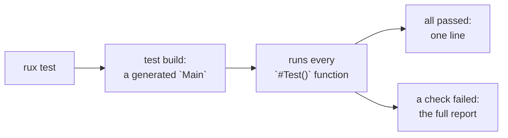

# Unit tests

::note
<!-- sync:needs:start -->

**You'll need**: [Source library](/docs/learn/source-library), [Tooling](/docs/learn/tooling), [Module](/docs/learn/module), [Presence](/docs/learn/presence), [Propagate](/docs/learn/propagate)
<!-- sync:needs:end -->

::

[Tooling](/docs/learn/tooling) tested a library from the outside: a separate package under `Tests/` whose `Main` called `Assert`, and stopped at the first check that failed. That works, but each test is a whole program, and the first failure hides every check after it.

A **unit test** is smaller: one function that calls your code with input whose answer you know, and checks that the answer comes back. Rux marks such a function with `#Test()`, and `rux test` finds every one, runs them all, and reports each by name. This lesson tests three small temperature functions — a conversion, a parser and a description:

```rux
import Test::{ ExpectNear, ExpectText, TestFailure };
```

## A test is a function

A test takes nothing and returns `! TestFailure`. Every check of the `Test` package returns `! TestFailure` as well, so a test hands a failed check on with [`?`](/docs/learn/propagate), and stops there:

```rux
#Test()
func FixedPoints() -> ! TestFailure {
    ExpectNear(ToFahrenheit(0.0), 32.0, 0.000001)?;
    ExpectNear(ToFahrenheit(100.0), 212.0, 0.000001)?;
    ExpectNear(ToFahrenheit(-40.0), -40.0, 0.000001)?;
}
```

A test passes when it returns, and fails when a check fails. A failed check ends only its own test; the others still run.

| Check                                     | Passes when                       | Its failure says                         |
| ----------------------------------------- | --------------------------------- | ---------------------------------------- |
| `Expect(condition, message)`              | the condition holds               | the message                              |
| `ExpectEqual(actual, expected)`           | the two are equal                 | `expected 2, but got 1`                  |
| `ExpectNotEqual(actual, unexpected)`      | they differ                       | `expected anything but 5`                |
| `ExpectNear(actual, expected, tolerance)` | two floats are within a tolerance | `expected 2.0 within 0.5, but got 1.0`   |
| `ExpectText(actual, expected)`            | two texts are equal               | the byte where they part, and both texts |
| `ExpectSome(optional, message)`           | there is a value — and returns it | the message                              |
| `ExpectNone(optional, message)`           | there is none                     | the message                              |
| `ExpectSuccess` / `ExpectFailure`         | an outcome succeeded / failed     | the message                              |

`ExpectSome` is the one to notice: it does not just check, it hands back the value inside, so a second check can look at it:

```rux
ExpectEqual(ExpectSome(ParseDegrees("21"), "21 is a temperature")?, 21)?;
```

## Where tests live

Tests sit **beside the code they test**, in the same package and here in the same file, so they can call functions that are not `pub` too. When `rux test` builds a package in test mode, it generates a `Main` that runs every `#Test()` function. So the package must not have a `Main` of its own — which is why this lesson's package is a [source library](/docs/learn/source-library). An application keeps its `Main` in an executable and its tested code in a library it depends on.



The generated `Main` calls the `Test` package's runner, so the package lists `Test` under `[Dependencies]`, as its `Rux.toml` shows.

A test inside a `module` is named after it, so the three parser tests are `Parse::Positive`, `Parse::Negative` and `Parse::Rejects`. A module imports for itself, which is why `Parse` has its own `import Test::…` line.

## Running them

`rux test` runs every test. Arguments after `--` go to the runner: a plain word is a filter that a test's name must contain, `--exact` makes it match the whole name, and `--skip` leaves matching tests out:

| Command                               | Runs                                                   |
| ------------------------------------- | ------------------------------------------------------ |
| `rux test`                            | all five tests                                         |
| `rux test -- Parse`                   | `Parse::Positive`, `Parse::Negative`, `Parse::Rejects` |
| `rux test -- --exact Parse::Negative` | that one test                                          |
| `rux test -- --skip Words`            | every test but `Words`                                 |

When every test passes, `rux test` reports the package in one line. The report worth reading comes when something breaks. Change `Describe`'s `celsius < 15` to `celsius <= 15` — an easy slip at a boundary — and run the tests again:

```text
Testing UnitTest v0.1.0 (Debug, Windows x86-64)
Running 1 test
Failed UnitTest in 444 ms
  note: test 'UnitTest' exited with code 1
  Output:
    running 5 of 5 tests
    test FixedPoints ... ok (0.014 ms)
    test Words ... FAILED
      texts differ at byte 0 (expected 4 bytes, got 4)
      expected "mild"
      but got  "cold"
    test Parse::Positive ... ok (0.014 ms)
    test Parse::Negative ... ok (0.005 ms)
    test Parse::Rejects ... ok (0.01 ms)

    failed:
      Words

    result: FAILED. 4 passed, 1 failed, 0 skipped, 0 filtered out; finished in 0.397 ms
Failed 1 test in 451 ms (0 passed, 1 failed)
```

The failed check names what it expected and what it got, and the other four tests still ran. `rux test -- Parse` passes at this point, because the broken function is not among the tests it chose.

## The program

The whole lesson is one package in the [Examples repository](https://github.com/rux-lang/Examples/tree/main/Packages/UnitTest). Its comments explain every step.

<!-- sync:program:start -->

::code-tree{defaultValue="Src/Temperature.rux"}

```toml [Rux.toml]
[Manifest]
Version = 1
MinRux = "0.4.0"

[Package]
Name = "UnitTest"
Version = "0.1.0"
Type = "SourceLibrary"
Description = "Write `#Test()` functions with `Expect` checks and run them with `rux test`"
Authors = ["Rux Contributors <info@rux-lang.dev>"]

[Dependencies]
Test = { Namespace = "Rux", Version = "*" }
```

```rux [Src/Temperature.rux]
// A unit test calls a small piece of your code with input whose answer you know, and checks that
// the answer comes back. Run them after every change, and a change that breaks something says so
// at once, naming the check that failed.
//
// In Rux a test is a function marked `#Test()` that takes nothing and returns `! TestFailure`.
// The checks of the `Test` package, `ExpectEqual`, `ExpectText`, `ExpectNear` and the rest, each
// return `! TestFailure` too, so a test hands a failed check on with `?` and stops there.
//
// `rux test` builds the package in test mode, generates a `Main` that runs every `#Test()`
// function, and runs it. That is why this package is a library: an executable has a `Main` of
// its own and cannot hold tests. The tests sit beside the code, in the same file, so they can call
// functions that are not `pub` as well. Run them with
//
//     rux test                 every test
//     rux test -- Parse        only the tests whose names contain "Parse"
//
// A package with tests must depend on `Test`, whose runner the generated `Main` calls; without it:
//
//     error: package 'UnitTest' has '#Test()' functions but does not depend on 'Test'
import Test::{ ExpectNear, ExpectText, TestFailure };

/// Converts degrees Celsius to degrees Fahrenheit.
/// @param celsius the temperature in degrees Celsius
/// @returns the same temperature in degrees Fahrenheit
pub func ToFahrenheit(celsius: float64) -> float64 {
    return celsius * 9.0 / 5.0 + 32.0;
}

/// Reads a whole number of degrees with an optional minus sign, such as `21` or `-5`.
/// @param text the text to read
/// @returns the degrees, or none for anything else, or for more than three digits
pub func ParseDegrees(text: char8[..]) -> int32? {
    let negative = text.length > 0 && text[0] == '-';
    let start: uint = negative ? 1 : 0;
    if text.length == start || text.length - start > 3 { return none; }
    var value: int32 = 0;
    for i in start..text.length {
        let c = text[i];
        if c < '0' || c > '9' { return none; }
        value = value * 10 + (c as int32 - 48);
    }
    return negative ? -value : value;
}

/// One word for how a temperature feels.
/// @param celsius the temperature in degrees Celsius
/// @returns `freezing`, `cold`, `mild` or `hot`
pub func Describe(celsius: int32) -> char8[..] {
    if celsius <= 0 { return "freezing"; }
    if celsius < 15 { return "cold"; }
    if celsius < 25 { return "mild"; }
    return "hot";
}

// Floating-point arithmetic rounds, so two floats are compared within a tolerance, never with
// `==`. These three points are the ones everybody knows.
#Test()
func FixedPoints() -> ! TestFailure {
    ExpectNear(ToFahrenheit(0.0), 32.0, 0.000001)?;
    ExpectNear(ToFahrenheit(100.0), 212.0, 0.000001)?;
    ExpectNear(ToFahrenheit(-40.0), -40.0, 0.000001)?;
}

// Boundaries are where mistakes hide, so test each side of each one. A failed `ExpectText` shows
// both texts and the byte where they part.
#Test()
func Words() -> ! TestFailure {
    ExpectText(Describe(0), "freezing")?;
    ExpectText(Describe(1), "cold")?;
    ExpectText(Describe(14), "cold")?;
    ExpectText(Describe(15), "mild")?;
    ExpectText(Describe(24), "mild")?;
    ExpectText(Describe(25), "hot")?;
}

// Tests in a module are named after it: `Parse::Positive`, `Parse::Negative`, `Parse::Rejects`.
// So `rux test -- Parse` runs just these three. A module imports for itself.
module Parse {
    import Test::{ ExpectEqual, ExpectNone, ExpectSome, TestFailure };

    // `ExpectSome` fails with its message when the optional is empty, and otherwise hands back
    // the value inside for the next check.
    #Test()
    func Positive() -> ! TestFailure {
        ExpectEqual(ExpectSome(ParseDegrees("21"), "21 is a temperature")?, 21)?;
        ExpectEqual(ExpectSome(ParseDegrees("0"), "0 is a temperature")?, 0)?;
    }

    #Test()
    func Negative() -> ! TestFailure {
        ExpectEqual(ExpectSome(ParseDegrees("-5"), "-5 is a temperature")?, -5)?;
    }

    // What a function refuses matters as much as what it accepts.
    #Test()
    func Rejects() -> ! TestFailure {
        ExpectNone(ParseDegrees(""), "empty text")?;
        ExpectNone(ParseDegrees("-"), "a sign alone")?;
        ExpectNone(ParseDegrees("12C"), "a unit after the digits")?;
        ExpectNone(ParseDegrees("1000"), "four digits")?;
    }
}
```

::
<!-- sync:program:end -->

## Run it

```sh
cd Examples/Packages/UnitTest
rux test
```

<!-- sync:output:start -->

```
Testing UnitTest v0.1.0 (Debug, Windows x86-64)
Running 1 test
Passed UnitTest in 431 ms
Passed 1 test in 437 ms (1 passed, 0 failed)
```

The platform and the times vary. `rux test` counts test packages, so `1 test` is this package with
its five tests. A passing package is reported in one line; when a check fails, `rux test` prints
the runner's report instead, naming each test and what the failed check expected and got.
<!-- sync:output:end -->

## Common mistakes

::mistake
**Tests in a package with a `Main`.**\
Add a `Main` to this package, make it an `Executable`, and `rux test` reports:

```text
error: package 'UnitTest' declares 'Main' and '#Test()' functions; a test build generates its own 'Main'
```

Keep the tested code in a library, and the `Main` in an executable that depends on it.
::

::mistake
**A check without `?`.**\
`ExpectNear(ToFahrenheit(0.0), 33.0, 0.000001);` on its own line fails to compile with:

```text
error: fallible result of type '! TestFailure' is discarded
```

That is a mercy: a check whose failure is dropped could never fail the test.
::

::mistake
**Comparing floats exactly.**\
`ExpectEqual(0.1 + 0.2, 0.3)?;` fails with `expected 0.3, but got 0.30000000000000004`. Floating-point arithmetic rounds; compare with `ExpectNear` and a tolerance.
::

::mistake
**A filter that matches nothing.**\
`rux test -- --exact Negative` runs no test at all — the test is called `Parse::Negative` — and a run of no tests passes. Check the spelling of a filter that suddenly makes everything pass.
::

## Try it yourself

1. Break `Describe` as above, run `rux test`, then fix it and run again.
2. Add a test that `ParseDegrees("+5")` gives `5`. It fails; change `ParseDegrees` to accept a plus sign until it passes.
3. Add a check to `Rejects` that `ParseDegrees("2 1")` is none, and run only that test with `--exact`.
4. Test that `ToFahrenheit(37.0)` is about `98.6`. What tolerance does it need?

## Learn more

- [Test API](/docs/api/test) — every check, `TestFailure`, and the runner's options
- [#Test](/docs/lang/attributes/test) in the Rux Reference — what a test function may look like, and every error for misuse
- [rux test](/docs/cli/test) — the command and its options
- [Tooling](/docs/learn/tooling) — test packages under `Tests/`, and the other `rux` commands
- [Benchmark](/docs/learn/benchmark) — the `Test` package's other half: measuring how long code takes
