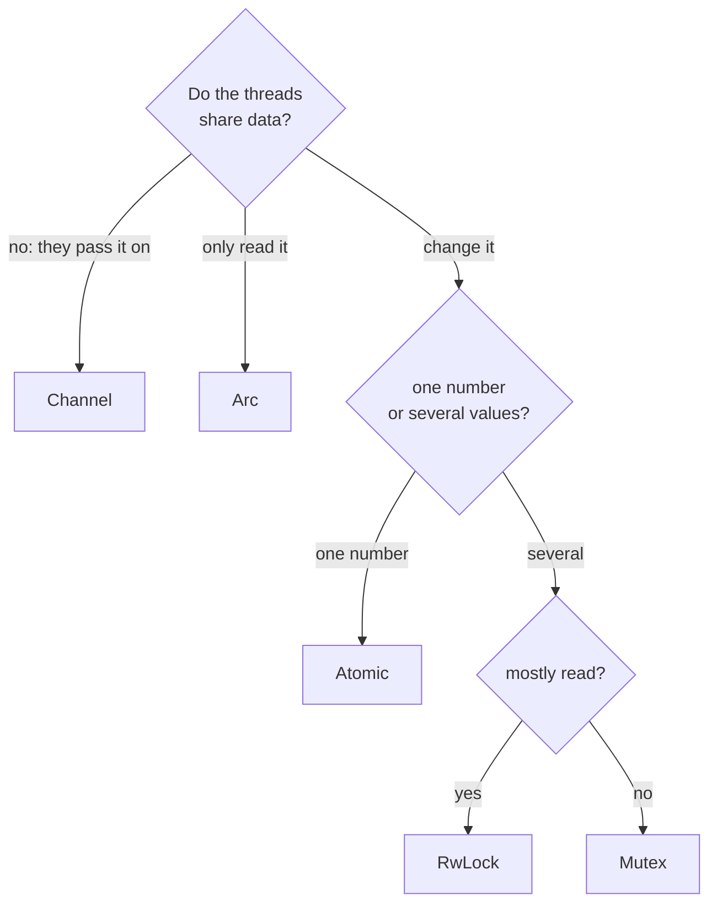

# Part 25: Concurrency

Every program so far has done one thing at a time. A computer can do several: its processor has a number of cores, and each can run its own line of execution — its own **thread** — at the same moment as the others. Splitting work across threads makes it finish sooner, and lets a program wait for one thing while it gets on with another.

The difficulty is not starting threads but letting them share. Two threads that change the same memory at once can each undo the other's work, and the result changes from one run to the next. This part starts with threads themselves and then works through the standard tools that keep them out of each other's way: the `Thread` package starts and joins them, `Atomic` changes one value safely, and `Sync` provides the locks, channels and counters, with `Arc` from `Allocator` to share ownership.

## What you will learn

- Starting a thread with `Spawn`, passing it a context, and collecting its result with `Join`.
- What a data race is, and why output from several threads comes out in a different order every run.
- Changing one shared value in indivisible steps with `Atomic<T>`, the `CompareExchange` retry loop, and memory orders.
- Keeping several values consistent under a `Mutex<T>`, whose guard releases the lock for you.
- Sharing ownership of one value between threads with `Arc<T>`.
- Passing values from thread to thread through a bounded `Channel<T>`, and ending the stream with `Close`.
- Waiting for a group of detached workers with `WaitGroup`, and the `Semaphore` and `Barrier` beside it.
- One-time initialization with `Once`, and a `thread var` that every thread has its own copy of.
- Letting many readers in at once with `RwLock<T>`.

## Which tool when



Two more questions are about time rather than data. To wait until a group of threads has finished, use a `WaitGroup` — or simply `Join` each one. To do something exactly once, whichever thread asks first, use a `Once`.

## Lessons

<!-- sync:lessons:start -->

|      | Lesson                                 | What you will learn                                                   |
| ---- | -------------------------------------- | --------------------------------------------------------------------- |
| 25.1 | [Thread](/docs/learn/thread)           | start a thread, wait for its result, and ask how many can run at once |
| 25.2 | [Atomic](/docs/learn/atomic)           | count across threads without a lock                                   |
| 25.3 | [Mutex](/docs/learn/mutex)             | guard shared data with a lock that only one thread holds at a time    |
| 25.4 | [Arc](/docs/learn/arc)                 | share ownership of one value between threads                          |
| 25.5 | [Channel](/docs/learn/channel)         | send values from one thread to another                                |
| 25.6 | [Wait group](/docs/learn/wait-group)   | wait until a group of threads has finished                            |
| 25.7 | [Once](/docs/learn/once)               | run initialization exactly once, whichever thread gets there first    |
| 25.8 | [Read-write lock](/docs/learn/rw-lock) | many readers at once, or one writer alone                             |

<!-- sync:lessons:end -->

## Before you start

Threads are given their work as a function and a context value, so this part leans on [Callback](/docs/learn/callback), [Struct](/docs/learn/struct) and [Move](/docs/learn/move). Starting a thread can fail, which brings back the outcomes of [Part 9: Errors](/docs/learn/errors). Locks hand out their value through a [pointer](/docs/learn/pointer) and release themselves through a [destructor](/docs/learn/destructor), and the Arc lesson builds on [Rc](/docs/learn/rc) from [Part 15: Memory](/docs/learn/memory). Each lesson's package is in the Examples repository's `Concurrency/` folder:

```sh
cd Examples/Concurrency/Thread
rux run
```

Threads run in an order nobody chooses, yet every program in this part prints the same lines on every run. Each one prints from a single thread, after the others have finished — a habit worth keeping.

## After this part

[Part 26: Systems](/docs/learn/systems) turns outward, to the world around the program: environment variables, child processes, the command line, logs and the network.

For the rules underneath, see [Atomics](/docs/lang/memory/atomics) and [Module variables](/docs/lang/bindings/module-variables) in the Rux Reference, and the [Thread](/docs/api/thread), [Atomic](/docs/api/atomic) and [Sync](/docs/api/sync) packages in the API reference.
