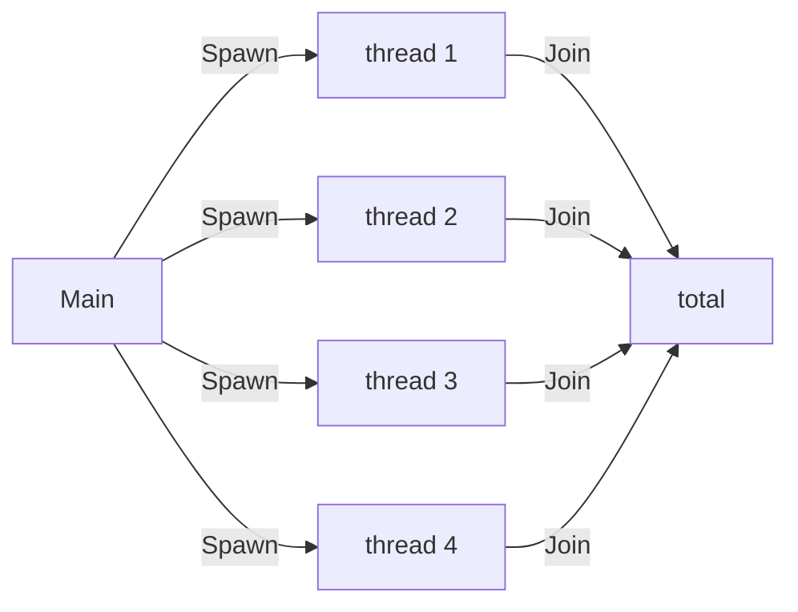

# Thread

::note
<!-- sync:needs:start -->

**You'll need**: [Struct](/docs/learn/struct), [Variant match](/docs/learn/variant-match), [Outcome](/docs/learn/outcome), [Catch fallback](/docs/learn/catch-fallback), [Move](/docs/learn/move)
<!-- sync:needs:end -->

::

Every program so far has done one thing at a time: each statement waits for the one before it. A modern processor has several cores, and all but one of them sat idle. A **thread** is a second line of execution inside the same program. It runs at the same time as `Main` — on another core when one is free — and shares the program's memory.

Work that splits into independent pieces finishes sooner when each piece gets its own thread. This lesson sums the numbers from 1 to a million in four pieces at once, then collects the four answers:

```rux
import Thread::{
    AvailableParallelism, CurrentId, JoinHandle, Spawn, SpawnWith, ThreadError, ThreadOptions
};
```

## Starting a thread

Rux has no closures, so a thread cannot capture the variables around the line that started it. Instead, `Spawn` takes two things: a function, and one value to call it with — the **context**. Whatever the thread needs travels in that one value, usually a struct:

```rux
struct Span {
    first: uint64;
    last: uint64;
}

func SumSpan(span: Span) -> uint64 {
    var total: uint64 = 0;
    for value in span.first..=span.last {
        total = total + value;
    }
    return total;
}
```

`Spawn(SumSpan, Span { first: 1, last: 250000 })` starts a new thread that calls `SumSpan` on that span. The context [moves](/docs/learn/move) to the new thread, so `Main` keeps no copy of it. `Spawn` returns at once, without waiting for the sum, and the new thread runs on beside `Main`.

| `Spawn<T, R>(entry, context)` | Is                                                       |
| ----------------------------- | -------------------------------------------------------- |
| `entry: func(T) -> R`         | the function the thread runs — one parameter, one result |
| `context: T`                  | the value it is called with, moved to the new thread     |
| returns `JoinHandle<R>`       | the handle that collects the result later                |
| or fails with `ThreadError`   | when the system could not start a thread                 |

Starting a thread can fail — the system may have no memory or no thread to spare — so the handle comes back as an [outcome](/docs/learn/outcome). The program starts four threads and gives up with a [`catch`](/docs/learn/catch-fallback) if any one cannot start:

```rux
var handles: JoinHandle<uint64>[4] = [
    Spawn(SumSpan, Span { first: 1, last: 250000 }) catch { else => return 1 },
    Spawn(SumSpan, Span { first: 250001, last: 500000 }) catch { else => return 1 },
    Spawn(SumSpan, Span { first: 500001, last: 750000 }) catch { else => return 1 },
    Spawn(SumSpan, Span { first: 750001, last: 1000000 }) catch { else => return 1 }
];
```

## Waiting for the result

`Join` waits for the thread to finish and hands back what its function returned. A thread that finished early has nothing to do but wait to be asked:

```rux
for index in 0..4 {
    let part = handles[index].Join();
    PrintLine("thread {} summed       {:>12}", index + 1, part);
    total = total + part;
}
```



Joining is more than waiting. Everything the thread wrote before it finished is visible to the thread that joined it, so after `Join` the result — and anything else the thread changed — can be read safely.

A handle is joined once. After that `IsJoinable` is `false`, and a second `Join` is a program error.

## Printing in order

Notice that the threads print nothing. Threads run in whatever order the system schedules them, and that order changes from run to run. Had each thread printed its own line, the four lines would come out shuffled differently each time. Printing only from `Main`, after each `Join`, keeps the output in one fixed order however the threads ran. Every lesson in this part follows that rule.

## Options and identity

`SpawnWith` takes a `ThreadOptions` first. Its one setting is the stack size, for a thread that needs more room than the system's default — or, as here, less:

```rux
let options = ThreadOptions().WithStackSize(65536u);
match SpawnWith(options, Identify, 0u8) {
```

The `Identify` thread returns `CurrentId()`, the system's number for the thread it runs on, and `Main` compares it with its own. No two live threads share an identifier. The failure arm names the reason with a `match` on `ThreadError`:

| `ThreadError`      | Means                                                 |
| ------------------ | ----------------------------------------------------- |
| `Exhausted`        | the system had no memory, or no thread, to spare      |
| `InvalidStackSize` | the system refused the stack size, usually too small  |
| `Failed`           | the system reported a failure with no name of its own |

`Identify` takes a `uint8` it never uses: every thread function takes exactly one parameter, so a thread that needs nothing is given a placeholder.

## Letting a thread go

`Detach` gives up the handle: the thread runs on, nobody can join it, and its result is thrown away when it finishes. Simply dropping a handle does the same. Use it for work whose result nobody needs — and remember that when `Main` returns the program ends, taking any detached thread still running with it. When something must wait for detached threads, a [wait group](/docs/learn/wait-group) is the tool.

## How many at once

`AvailableParallelism()` says how many threads can truly run at the same time: the number of processors online, and never zero. Starting more threads than that is allowed — they take turns — but beyond it, the work no longer finishes any sooner.

## The program

The whole lesson is one package in the [Examples repository](https://github.com/rux-lang/Examples/tree/main/Concurrency/Thread). Its comments explain every step.

<!-- sync:program:start -->

```rux [Src/Main.rux]
// A thread is a second line of execution inside the same program: it runs at the same time as
// `Main`, on another processor when one is free, and shares the program's memory. Work that splits
// into independent pieces finishes sooner when each piece gets its own thread.
//
// Rux has no closures, so a thread cannot capture the variables around it. `Spawn(entry, context)`
// takes a function and one value to call it with; the value moves to the new thread, and the
// function's result waits there until someone collects it. Starting a thread can fail when the
// system has none to spare, so `Spawn` returns `JoinHandle<R> ! ThreadError`.
//
// `Join` on the handle waits for the thread to finish and hands back its result. Printing only
// after joining keeps the output in a fixed order, however the threads were scheduled.
import Io::PrintLine;
import Thread::{
    AvailableParallelism, CurrentId, JoinHandle, Spawn, SpawnWith, ThreadError, ThreadOptions
};

// Everything a thread needs travels in its one context value.
struct Span {
    first: uint64;
    last: uint64;
}

// The function each thread runs: it takes the context and returns a result.
func SumSpan(span: Span) -> uint64 {
    var total: uint64 = 0;
    for value in span.first..=span.last {
        total = total + value;
    }
    return total;
}

func Identify(unused: uint8) -> uint64 {
    return CurrentId();
}

func Describe(error: ThreadError) -> char8[..] {
    return match error {
        .Exhausted => "the system has no thread to spare",
        .InvalidStackSize => "the stack size was refused",
        .Failed => "the system could not start it"
    };
}

func Main() -> int {
    // Four threads, each summing a quarter of 1..=1000000. They start at once and run side by side.
    // `Spawn` returns an outcome rather than a handle, so the failure is dealt with first; calling
    // `Join` on the outcome itself is refused:
    //
    //     error: type 'JoinHandle<uint64> ! ThreadError' has no field 'Join'
    var handles: JoinHandle<uint64>[4] = [
        Spawn(SumSpan, Span { first: 1, last: 250000 }) catch { else => return 1 },
        Spawn(SumSpan, Span { first: 250001, last: 500000 }) catch { else => return 1 },
        Spawn(SumSpan, Span { first: 500001, last: 750000 }) catch { else => return 1 },
        Spawn(SumSpan, Span { first: 750001, last: 1000000 }) catch { else => return 1 }
    ];

    // `Join` waits for each thread in turn. A thread that finished early simply waits to be asked.
    var total: uint64 = 0;
    for index in 0..4 {
        let part = handles[index].Join();
        PrintLine("thread {} summed       {:>12}", index + 1, part);
        total = total + part;
    }
    PrintLine("total                 {:>12}", total);
    PrintLine("joinable after join   {}", handles[0].IsJoinable());

    // `SpawnWith` takes options too: here, a 64 KiB stack instead of the system's default. Every
    // thread has its own identifier, and this one hands its own back to compare.
    let options = ThreadOptions().WithStackSize(65536u);
    match SpawnWith(options, Identify, 0u8) {
        .Success(handle) => {
            // A handle is moved, never copied, so `var other = handle;` is refused:
            //
            //     error: move-only value 'handle' requires an explicit '<-' in initialization
            var other <- handle;
            PrintLine("a different id        {}", other.Join() != CurrentId());
        },
        .Failure(error) => PrintLine("no thread: {}", Describe(error))
    }

    // A handle that is detached, or simply dropped, lets its thread run on unwatched. Nothing can
    // join it any more, so nothing can see its result.
    var background = Spawn(SumSpan, Span { first: 1, last: 10 }) catch { else => return 1 };
    background.Detach();
    PrintLine("joinable after detach {}", background.IsJoinable());

    // How many threads can usefully run at once: the processors online, never zero.
    PrintLine("processors            {}", AvailableParallelism());
    return 0;
}
```

Besides `Io`, its `Rux.toml` lists `Thread` under `[Dependencies]`.
<!-- sync:program:end -->

## Run it

```sh
cd Examples/Concurrency/Thread
rux run
```

<!-- sync:output:start -->

```
thread 1 summed        31250125000
thread 2 summed        93750125000
thread 3 summed       156250125000
thread 4 summed       218750125000
total                 500000500000
joinable after join   false
a different id        true
joinable after detach false
processors            16
```

Every line is the same on each run except the last, which is the number of processors on the machine
running it.
<!-- sync:output:end -->

## Common mistakes

::mistake
**Using the outcome as a handle.**\
`var handle = Spawn(SumSpan, span);` followed by `handle.Join()` fails with:

```text
error: type 'JoinHandle<uint64> ! ThreadError' has no field 'Join'
```

Deal with the failure first, with `catch` or a `match`.
::

::mistake
**A thread function with two parameters.**\
`Spawn(Add, 12u64)` with `func Add(a: uint64, b: uint64) -> uint64` fails with:

```text
error: argument 1 to 'Spawn' has type 'func(uint64, uint64) -> uint64', but parameter 'entry' requires 'func(T) -> R'
```

A thread function takes exactly one value. Gather what it needs into a struct, as `Span` does.
::

::mistake
**Joining twice.**\
A second `Join` on the same handle stops the program:

```text
Panic: the thread was already joined or detached
```

Keep the result of the first `Join` instead.
::

::note
**A thread that returns nothing.**\
A thread function that returns nothing may leave its result type out, `func Work(value: uint64) {}`, or write `-> ()`; either way `Join` hands nothing back. The two are different types, though, so the handles of one and the other cannot share an array.

::

::mistake
**Printing from several threads.**\
Lines printed by different threads come out in a different order on every run. Return the results and print them from one thread, after `Join`.
::

## Try it yourself

1. Split the sum across eight threads instead of four. Does the total change?
2. Make `SumSpan` return a struct holding both the sum and how many numbers it added, and print both.
3. Time the whole sum with a `Stopwatch` from [Stopwatch](/docs/learn/stopwatch), once with four threads and once with a single thread summing all of it.

## Learn more

- [Thread](/docs/api/thread) — the package in the API reference
- [Function types](/docs/lang/functions/function-types) — passing a function as a value, as `Spawn` takes it
- [Copy and move](/docs/lang/ownership/copy-and-move) — why a handle moves and is never copied
- [Callback](/docs/learn/callback) — functions passed as values, the same idea on one thread
- [Atomic](/docs/learn/atomic) — the next lesson: threads that change the same value
