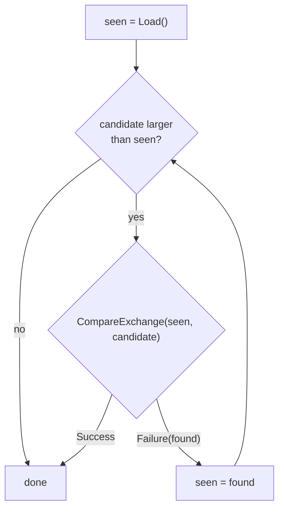

# Atomic

::note
<!-- sync:needs:start -->

**You'll need**: [Generic type](/docs/learn/generic-type), [Pointer](/docs/learn/pointer), [Thread](/docs/learn/thread)
<!-- sync:needs:end -->

::

In [Thread](/docs/learn/thread) every thread kept to its own numbers and handed back a result. Often threads must change the _same_ value — a count of requests served, the best answer found so far. That is where the trouble starts.

## The race

`total = total + 1` looks like one step. The processor does it in three: read `total`, add one, write it back. Run it on two threads at once and nothing stops the steps from interleaving:

| Step | Thread A  | Thread B  | `total` |
| ---- | --------- | --------- | ------- |
| 1    | reads 41  |           | 41      |
| 2    |           | reads 41  | 41      |
| 3    | writes 42 |           | 42      |
| 4    |           | writes 42 | 42      |

Two increments, and `total` went up by one. This is a **data race**: two threads touch the same memory at once and at least one of them writes. The result depends on how the threads happened to be scheduled, so a program with a race can pass every test and then lose a count in production. Rux does not check memory that threads share through a pointer — keeping them apart is your job, and this part's tools are how.

## An atomic value

An `Atomic<T>` holds one integer, `bool` or pointer and changes it only in **indivisible** steps. `FetchAdd` reads, adds and writes as one indivisible step — a single instruction on most processors — so no other thread can slip in between, and no increment is ever lost. No lock is taken: the hardware keeps the threads apart.

```rux
import Atomic::Atomic;
import Core::MemoryOrder;
```

The program's four workers share two atomics, kept together in a struct that lives in `Main`. Each worker is given its address as a read-only [pointer](/docs/learn/pointer), `*Shared`:

```rux
struct Shared {
    checked: Atomic<uint64>;
    longest: Atomic<uint64>;
}

struct Span {
    first: uint64;
    last: uint64;
    shared: *Shared;
}
```

A read-only pointer is enough, because every method of `Atomic<T>` takes the atomic by shared reference — changing it from many places at once is the whole point. What makes the pointer safe is that `Main` joins every worker before `shared` goes away. The [Arc](/docs/learn/arc) lesson shows a way to share that does not depend on it.

| Method                               | Does, as one step                           | Returns            |
| ------------------------------------ | ------------------------------------------- | ------------------ |
| `Load()`                             | reads the value                             | the value          |
| `Store(value)`                       | writes `value`                              | nothing            |
| `Exchange(value)`                    | writes `value`                              | the value replaced |
| `CompareExchange(expected, desired)` | writes `desired` if the value is `expected` | `T ! T`, see below |
| `FetchAdd(n)`, `FetchSub(n)`         | adds or subtracts, wrapping on overflow     | the value before   |
| `FetchAnd`, `FetchOr`, `FetchXor`    | combines bitwise                            | the value before   |

## Counting

Each worker walks its quarter of 1 to 100000 and counts every number it looks at in the one shared counter:

```rux
span.shared.checked.FetchAddWith(1, MemoryOrder::Relaxed);
```

`FetchAddWith` is `FetchAdd` with a memory order, which [comes below](#memory-orders). Four threads add to `checked` a hundred thousand times between them, and after the joins it reads exactly 100000. Swap the atomic for a plain `uint64` changed through a pointer and the total could come out short, by a different amount from run to run.

## Compare and exchange

The second atomic keeps the longest Collatz chain any worker has found — the most steps any number takes to reach 1 when an even number is halved and an odd one tripled plus one. There is no `FetchMax`, and a `Load` followed by a `Store` would be the race all over again: another thread could store a longer chain between the two. `CompareExchange(expected, desired)` closes that gap. It writes `desired` only if the value is still `expected`, and reports which happened:

```rux
func RaiseTo(longest: &Atomic<uint64>, candidate: uint64) {
    var seen = longest.Load();
    while candidate > seen {
        match longest.CompareExchange(seen, candidate) {
            .Success(_) => return,
            .Failure(found) => seen = found
        }
    }
}
```

It returns `T ! T`. Success carries the value it replaced, which was `expected`. Failure means another thread got there first, and carries the value really there now — so the loop tries again from that, and stops as soon as the candidate is no longer larger. This **retry loop** is how every atomic update that is not built in gets written.



`CompareExchange` never fails spuriously: a failure always means the value was different.

## Memory orders

An atomic operation also decides what the _other_ memory around it looks like to other threads. Compilers and processors reorder ordinary reads and writes when one thread could not tell the difference, and another thread can. A **memory order** says how much reordering is allowed across the operation.

The plain methods — `Load`, `Store`, `FetchAdd` and the rest — use `SequentiallyConsistent`, the strongest order: every thread agrees on one order of all such operations. It is never wrong, and it is the right default. `Load`, `Store`, `FetchAdd`, `FetchSub` and `CompareExchange` also have a `With` form that takes a weaker `MemoryOrder`, for code that has worked out it is enough:

| Order                    | Use it for                                                                 |
| ------------------------ | -------------------------------------------------------------------------- |
| `Relaxed`                | a count nothing else depends on — only the operation itself is indivisible |
| `Release`                | a store that publishes the writes made before it                           |
| `Acquire`                | a load that sees everything published by the matching release              |
| `AcquireRelease`         | a read-modify-write that does both                                         |
| `SequentiallyConsistent` | everything else, and whenever in doubt                                     |

The counter here is `Relaxed`: nothing is read on the strength of it, and the final value is read after the joins, which make every write visible anyway. Release and acquire come in pairs, to hand ordinary data from one thread to another:

```rux
struct Mailbox {
    value: uint64;
    ready: Atomic<bool>;
}

func Deliver(box: *var Mailbox) -> () {
    box.value = 42;
    box.ready.StoreWith(true, MemoryOrder::Release);
}
```

A thread that sees `ready` with an acquiring load — `box.ready.LoadWith(MemoryOrder::Acquire)` — is guaranteed to see `value` as 42. With `Relaxed` on both sides it could see `true` and still read the old `value`. An order an operation cannot have is strengthened to the nearest one it can, so `LoadWith(MemoryOrder::Release)` loads with `Acquire`.

## The rest

After the joins, `Main` has the atomics to itself and tries the remaining operations: `Store` replaces the value, `Exchange` replaces it and hands back the old one, and a `CompareExchange` that expects the wrong value changes nothing and fails with what it found.

## The program

The whole lesson is one package in the [Examples repository](https://github.com/rux-lang/Examples/tree/main/Concurrency/Atomic). Its comments explain every step.

<!-- sync:program:start -->

```rux [Src/Main.rux]
// `total = total + 1` looks like one step, but the processor does it in three: read `total`,
// add one, write it back. When two threads run it at once, both can read the same old value and
// both write the same new one, and one of the two increments is lost. That is a data race, and
// the result depends on how the threads happened to be scheduled.
//
// An `Atomic<T>` holds one integer, `bool` or pointer and changes it only in indivisible steps.
// `FetchAdd` reads, adds and writes as one indivisible step, so no other thread can slip in
// between, and no increment is ever lost. No lock is taken: the hardware keeps the threads apart.
//
// `CompareExchange(expected, desired)` is the building block for everything else: it writes
// `desired` only if the value is still `expected`. It succeeds with the old value, or fails with
// the value it found instead, and a loop tries again from there.
import Atomic::Atomic;
import Core::MemoryOrder;
import Io::PrintLine;
import Thread::{ JoinHandle, Spawn };

// The two atomics every worker shares. They live in `Main`, which outlives every worker. An atomic
// holds an integer, a `bool` or a pointer and nothing else; `FetchAdd` on an `Atomic<float64>` is
// refused:
//
//     error: 'AtomicFetchAdd' cannot act on type 'float64'
//     note: its type argument must be an integer of 8 to 64 bits
struct Shared {
    checked: Atomic<uint64>;
    longest: Atomic<uint64>;
}

// One worker's share of the numbers, and the address of what it shares with the others.
struct Span {
    first: uint64;
    last: uint64;
    shared: *Shared;
}

// How many steps of the Collatz rule take `value` down to 1: halve it when even, otherwise
// triple it and add one.
func Steps(value: uint64) -> uint64 {
    var current = value;
    var steps: uint64 = 0;
    while current != 1 {
        current = current % 2 == 0 ? current / 2 : current * 3 + 1;
        steps = steps + 1;
    }
    return steps;
}

// Raises `longest` to `candidate` if that is larger. Another thread may change it between the
// read and the write, so the exchange is retried from whatever value it actually found.
func RaiseTo(longest: &Atomic<uint64>, candidate: uint64) {
    var seen = longest.Load();
    while candidate > seen {
        match longest.CompareExchange(seen, candidate) {
            .Success(_) => return,
            .Failure(found) => seen = found
        }
    }
}

// Each worker counts every number in its span and offers each chain length as a new longest.
func Walk(span: Span) -> () {
    for value in span.first..=span.last {
        // A plain count that nothing else depends on, so the cheapest order is enough.
        span.shared.checked.FetchAddWith(1, MemoryOrder::Relaxed);
        RaiseTo(span.shared.longest, Steps(value));
    }
}

func Main() -> int {
    let shared = Shared { checked: Atomic<uint64>(0), longest: Atomic<uint64>(0) };

    // Four threads explore a quarter of 1..=100000 each, all updating the same two atomics.
    var workers: JoinHandle<()>[4] = [
        Spawn(Walk, Span { first: 1, last: 25000, shared: @shared }) catch { else => return 1 },
        Spawn(Walk, Span { first: 25001, last: 50000, shared: @shared }) catch { else => return 1 },
        Spawn(Walk, Span { first: 50001, last: 75000, shared: @shared }) catch { else => return 1 },
        Spawn(Walk, Span { first: 75001, last: 100000, shared: @shared }) catch { else => return 1 }
    ];
    for index in 0..4 {
        workers[index].Join();
    }

    // Every worker has finished, so these are the final values: not one update was lost.
    PrintLine("numbers checked  {}", shared.checked.Load());
    PrintLine("longest chain    {} steps", shared.longest.Load());

    // `Store` replaces the value; `Exchange` replaces it and hands back what was there.
    shared.checked.Store(10);
    let before = shared.checked.Exchange(20);
    PrintLine("exchange         {} -> {}", before, shared.checked.Load());

    // A compare-exchange that expects the wrong value changes nothing and reports what it found.
    match shared.checked.CompareExchange(10, 30) {
        .Success(previous) => PrintLine("replaced {}", previous),
        .Failure(found) => PrintLine("not replaced     found {}", found)
    }
    return 0;
}
```

Besides `Io`, its `Rux.toml` lists `Atomic`, `Core` and `Thread` under `[Dependencies]`.
<!-- sync:program:end -->

## Run it

```sh
cd Examples/Concurrency/Atomic
rux run
```

<!-- sync:output:start -->

```
numbers checked  100000
longest chain    350 steps
exchange         10 -> 20
not replaced     found 20
```

<!-- sync:output:end -->

## Common mistakes

::mistake
**Giving each thread a copy.**\
A thread function that takes the atomic itself, `func Work(counter: Atomic<uint64>) -> ()`, compiles — and each thread gets its own copy. Copying an `Atomic` copies its current value into a new, unrelated one, so `Main`'s counter is never touched and still reads `0` after the joins. Share the one atomic through a pointer, or an [Arc](/docs/learn/arc).
::

::mistake
**A load and then a store.**\
`counter.Store(counter.Load() + 1)` is two atomic steps with a gap between them, and is the race from the top of this page again. Use the one-step `FetchAdd`, or a `CompareExchange` loop for an update that has no method of its own.
::

::mistake
**An atomic of the wrong type.**\
An `Atomic<T>` holds an integer of 8 to 64 bits, a `bool` or a pointer. `FetchAdd` on an `Atomic<float64>` fails with:

```text
error: 'AtomicFetchAdd' cannot act on type 'float64'
  note: its type argument must be an integer of 8 to 64 bits
```

::

::mistake
**A pointer that outlives the atomic.**\
The workers reach `shared` through a raw pointer, which the compiler does not follow. If `Main` returned before joining them, they would go on writing to memory that is no longer `shared`. Join every thread that holds the address before the atomic goes out of scope.
::

## Try it yourself

1. Count the even numbers too: add a third atomic to `Shared` and `FetchAdd` to it from `Walk`.
2. Write `LowerTo`, the mirror image of `RaiseTo`, and keep the shortest chain among the numbers above 1.
3. Make `RaiseTo` record _which_ number has the longest chain as well: pack both into one `uint64`, the steps in the upper 32 bits and the number in the lower, so one `CompareExchange` updates both.

## Learn more

- [Atomic](/docs/api/atomic) — the package in the API reference
- [Atomics](/docs/lang/memory/atomics) — the `Core` operations underneath, and every memory order in detail
- [Pointer](/docs/learn/pointer) — the addresses the workers share
- [Mutex](/docs/learn/mutex) — the next lesson: when more than one value must change at once
