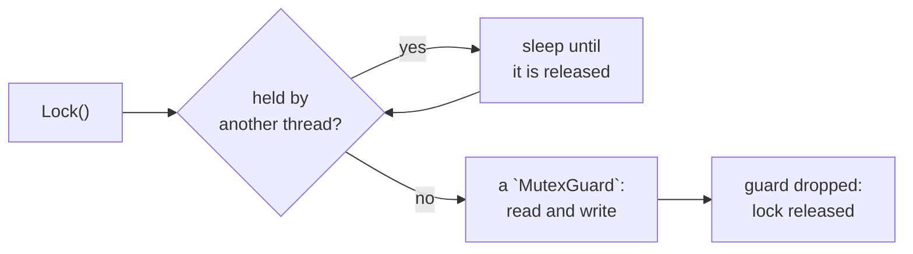

# Mutex

::note
<!-- sync:needs:start -->

**You'll need**: [Destructor](/docs/learn/destructor), [Pointer](/docs/learn/pointer), [Thread](/docs/learn/thread), [Atomic](/docs/learn/atomic)
<!-- sync:needs:end -->

::

An [atomic](/docs/learn/atomic) keeps one number safe. Most shared data is more than one number, and its parts must change together. Money moved between two accounts leaves one and arrives in the other, and no thread may ever see it in neither: two atomics, each changed safely on its own, still leave a moment between the two changes.

A **lock** closes that moment. While one thread holds it, no other thread can take it, so the whole group of changes made under the lock looks to everyone else like a single step. A `Mutex<T>` — short for _mutual exclusion_ — is a lock with the value it guards inside:

```rux
import Sync::Mutex;
```

## Locking

`Lock` waits until no other thread holds the lock, takes it, and returns a `MutexGuard<T>`. The guard is the only way to reach the value: its `Get` returns a `*var T`, the value's address, through which the fields are read and written as through any [pointer](/docs/learn/pointer):

```rux
func Transfer(accounts: &Mutex<Accounts>, amount: int64) {
    let guard = accounts.Lock();
    let book = guard.Get();
    book.checking = book.checking - amount;
    book.savings = book.savings + amount;
    book.transfers = book.transfers + 1;
}
```

There is no `Unlock` call at the end. The guard's [destructor](/docs/learn/destructor) releases the lock when the guard is dropped — here, as `Transfer` returns — so a lock cannot be forgotten, not even on an early `return`.



A thread waiting for the lock sleeps rather than spinning, so it costs nothing while it waits. Taking a lock nobody holds is one atomic instruction.

## One value, many handles

A `Mutex<T>` is a **handle**. The value and its lock live in storage that every handle to them shares, and `Clone` makes another handle to the same storage. Each thread is given its own:

```rux
var tellers: JoinHandle<()>[4] = [
    Spawn(Work, Teller { amount: 3, accounts: accounts.Clone() }) catch { else => return 1 },
    Spawn(Work, Teller { amount: 2, accounts: accounts.Clone() }) catch { else => return 1 },
    Spawn(Work, Teller { amount: -1, accounts: accounts.Clone() }) catch { else => return 1 },
    Spawn(Work, Teller { amount: -2, accounts: accounts.Clone() }) catch { else => return 1 }
];
```

| Type            | Is                                                               |
| --------------- | ---------------------------------------------------------------- |
| `Mutex<T>`      | a handle to the value and its lock; `Clone` makes another        |
| `MutexGuard<T>` | the lock, held; `Get` reaches the value; dropping it releases it |

The value is destroyed when the last handle and the last guard are gone, so it does not matter which thread finishes last. Unlike the pointer in [Atomic](/docs/learn/atomic), no handle can outlive the value.

Four tellers make 4000 transfers between them, moving money in both directions, and `Report` — which takes the lock too — shows the total still at 10000. Every thread saw either all of a transfer or none of it.

## Without waiting

`TryLock` takes the lock only if nobody holds it, and returns `MutexGuard<T>?` — none rather than waiting. A guard can also give the lock back early with `Unlock`, before it is dropped:

```rux
var held = accounts.Lock();
PrintLine("try while held:     {}", accounts.TryLock() != none);
held.Unlock();
PrintLine("try after unlock:   {}", accounts.TryLock() != none);
```

The first `TryLock` fails although it is the same thread that holds the lock. A `Mutex` is not **reentrant**: it does not remember who holds it, and a thread that calls `Lock` again while holding it waits for itself forever.

## Holding a lock briefly

While one thread holds the lock every other thread that wants it is stopped, so do as little as possible under it: change the value and let go. Work out what to write first, and print, sleep or wait for anything else after the guard is gone.

Two more tools live beside `Mutex` in the `Sync` package. `Lock` is a bare lock that guards no value — whatever the code between its `Acquire` and `Release` touches. `Condition` lets a thread holding a guard sleep until another thread signals that something it waits for has changed, releasing the lock while it sleeps.

## The program

The whole lesson is one package in the [Examples repository](https://github.com/rux-lang/Examples/tree/main/Concurrency/Mutex). Its comments explain every step.

<!-- sync:program:start -->

```rux [Src/Main.rux]
// An atomic keeps one number safe. Most shared data is more than one number, and its parts must
// change together: money moved between two accounts leaves one and arrives in the other, and
// nobody may see it in neither. A lock makes a group of changes look like one.
//
// A `Mutex<T>` holds a value that only one thread at a time may reach. `Lock` waits until no
// other thread holds the lock, takes it, and returns a `MutexGuard<T>`. The guard is the only way
// to the value, and when it is dropped, at the end of its block, the lock is released for the
// next thread. Forgetting to unlock is therefore impossible.
//
// A `Mutex<T>` is a handle: the value lives in storage that every handle shares. `Clone` makes
// another handle for another thread, and the value is destroyed when the last handle is gone.
import Io::PrintLine;
import Sync::Mutex;
import Thread::{ JoinHandle, Spawn };

// Two balances that must always add up to the same total.
struct Accounts {
    checking: int64;
    savings: int64;
    transfers: uint64;
}

// A teller moves `amount` from checking to savings, a thousand times over.
struct Teller {
    amount: int64;
    accounts: Mutex<Accounts>;
}

func Transfer(accounts: &Mutex<Accounts>, amount: int64) {
    // The guard holds the lock from here to the end of the function. While it does, no other
    // thread can see the money half moved.
    let guard = accounts.Lock();
    let book = guard.Get();
    book.checking = book.checking - amount;
    book.savings = book.savings + amount;
    book.transfers = book.transfers + 1;
}

func Work(teller: Teller) -> () {
    for round in 0..1000 {
        Transfer(teller.accounts, teller.amount);
    }
}

func Report(accounts: &Mutex<Accounts>) {
    let guard = accounts.Lock();
    let book = guard.Get();
    PrintLine("checking {}  savings {}  total {}  transfers {}", book.checking, book.savings,
        book.checking + book.savings, book.transfers);
}

func Main() -> int {
    let accounts = Mutex<Accounts>(Accounts { checking: 10000, savings: 0, transfers: 0 });
    Report(accounts);

    // Each teller gets its own handle to the same accounts. A negative amount moves money back.
    // A handle is never copied, so `accounts: accounts` is refused; `Clone` is the way to share:
    //
    //     error: move-only value 'accounts' requires an explicit '<-' in aggregate
    var tellers: JoinHandle<()>[4] = [
        Spawn(Work, Teller { amount: 3, accounts: accounts.Clone() }) catch { else => return 1 },
        Spawn(Work, Teller { amount: 2, accounts: accounts.Clone() }) catch { else => return 1 },
        Spawn(Work, Teller { amount: -1, accounts: accounts.Clone() }) catch { else => return 1 },
        Spawn(Work, Teller { amount: -2, accounts: accounts.Clone() }) catch { else => return 1 }
    ];
    for index in 0..4 {
        tellers[index].Join();
    }
    Report(accounts);

    // `TryLock` never waits: it returns none while the lock is held, even by this same thread.
    var held = accounts.Lock();
    PrintLine("try while held:     {}", accounts.TryLock() != none);
    held.Unlock();
    PrintLine("try after unlock:   {}", accounts.TryLock() != none);
    return 0;
}
```

Besides `Io`, its `Rux.toml` lists `Sync` and `Thread` under `[Dependencies]`.
<!-- sync:program:end -->

## Run it

```sh
cd Examples/Concurrency/Mutex
rux run
```

<!-- sync:output:start -->

```
checking 10000  savings 0  total 10000  transfers 0
checking 8000  savings 2000  total 10000  transfers 4000
try while held:     false
try after unlock:   true
```

<!-- sync:output:end -->

## Common mistakes

::mistake
**Copying the handle.**\
`Teller { amount: 3, accounts: accounts }` fails with:

```text
error: move-only value 'accounts' requires an explicit '<-' in aggregate
```

Moving the handle with `<-` would leave `Main` without one. `Clone` gives the teller a handle of its own.
::

::mistake
**Assigning to the address.**\
`Get` returns a pointer, not the value. `guard.Get() = 0;` on a `Mutex<int64>` fails with:

```text
error: operator '=' requires an assignable target, but its left operand has type '*var int64'
```

Write through the pointer: `*guard.Get() = 0;`, or `book.checking = 0;` for a field.
::

::mistake
**Locking twice on one thread.**\
`Lock` while the same thread already holds a guard on that mutex never returns: the thread waits for a lock only it can release. Pass the guard, or the value it reaches, to whatever needs it instead of locking again.
::

::mistake
**Keeping the address after the guard.**\
The pointer from `Get` is valid only while the guard holds the lock. Kept past that — stored in a variable that outlives the guard — it reaches the value with no lock at all, and the compiler does not notice. Copy out what you need while the guard lives.
::

## Try it yourself

1. Add a fifth teller moving 4 at a time. What should the balances be?
2. Add a `largest: int64` field to `Accounts`, and have `Transfer` record the largest amount moved.
3. Make `Report` use `TryLock` and print `busy` instead of waiting when it fails. Call it while `held` is held.

## Learn more

- [Sync](/docs/api/sync) — the package in the API reference, with `Lock` and `Condition`
- [Destructors](/docs/lang/ownership/destructors) — how a guard releases its lock when dropped
- [Atomic](/docs/learn/atomic) — one value changed without a lock
- [Read-write lock](/docs/learn/rw-lock) — a lock that lets many readers in at once
