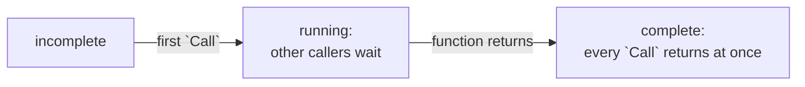

# Once

::note
<!-- sync:needs:start -->

**You'll need**: [Callback](/docs/learn/callback), [Thread](/docs/learn/thread)
<!-- sync:needs:end -->

::

Some work should happen once and only once: building a lookup table, reading a configuration file, opening a log. The simplest place for it is `Main`, before any thread starts. Sometimes that is not possible — a library cannot know when its first caller arrives, or on which thread — and the work must be done by whoever needs it first.

```rux
import Sync::Once;
```

## The race

The obvious way is a flag:

```rux
if !Built {
    Build();
    Built = true;
}
```

On one thread that is fine. On several it is the [race](/docs/learn/atomic) again: two threads can both read `Built` as `false` before either sets it, and both build. Worse, a third thread may see `Built` become `true` before it sees what `Build` wrote, and read a half-built table.

## Once

A `Once` settles both problems. Its `Call` takes a function with no parameters and no result:

```rux
func IsPrime(value: uint) -> bool {
    Setup.Call(BuildTable);
    Lookups = Lookups + 1;
    return !Composite[value];
}
```

- The **first** `Call` runs `BuildTable`.
- Any thread that calls **while it runs** waits until it has finished.
- Every **later** call returns at once — one atomic load, so a `Call` on every lookup costs next to nothing.

Everything `BuildTable` wrote is visible to every thread that `Call` returns on, so the table may then be read without any further locking. `IsCompleted` says whether the work has been done.



## A module variable

A `Once` lives where it is declared and needs no destroying, so — unlike a `Mutex` — it can be a **module variable**, which every thread names directly with no handle to pass around. A module variable starts from a compile-time value, and `Once::Incomplete` is a constant for exactly that:

```rux
var Composite: bool[1001] = [false; 1001];
var Builds: uint64 = 0;
```

```rux
var Setup: Once = Once::Incomplete;
```

`Composite` and `Builds` are plain module variables too. They are written only inside `BuildTable`, by one thread, and read only after `Call` has returned, so they need no lock of their own. The program counts the builds to show that four threads asking at once built the table once.

`Lock` in the `Sync` package works the same way: a bare lock that can be a module variable, starting as `Lock::Unlocked`.

## Each thread's own

Next to them is a different kind of module variable:

```rux
thread var Lookups: uint64 = 0;
```

A `thread var` gives **every thread its own copy**. Each copy starts at the initial value, whether its thread is `Main` or one started later, and a thread only ever sees its own. So each worker counts its own 250 lookups without any atomic or lock — nobody else touches its copy — and `Main`'s copy is still 0 at the end.

| Declaration              | Copies               | Sharing it between threads needs |
| ------------------------ | -------------------- | -------------------------------- |
| `var Name: T = …`        | one, for the program | an atomic, a lock or a `Once`    |
| `thread var Name: T = …` | one per thread       | nothing — it is never shared     |

## The program

The whole lesson is one package in the [Examples repository](https://github.com/rux-lang/Examples/tree/main/Concurrency/Once). Its comments explain every step.

<!-- sync:program:start -->

```rux [Src/Main.rux]
// Some work should happen once and only once: building a lookup table, reading a configuration
// file, opening a log. Doing it in `Main` before any thread starts is simplest. When that is not
// possible, because the first user may be any thread at any time, a check like
// `if !Built { Build(); }` is a race: two threads can both see `false` and both build.
//
// A `Once` settles it. The first `Call` runs its function; any other thread that calls meanwhile
// waits until that has finished, and every later call returns at once. Everything the function
// wrote is visible to every thread that `Call` returns on.
//
// A `Once` needs no destroying, so it can be a module variable, starting as `Once::Incomplete`,
// which every thread names directly. Next to it is a `thread var`: a module variable of which
// every thread has its own copy.
import Io::PrintLine;
import Sync::Once;
import Thread::{ JoinHandle, Spawn };

const Limit: uint = 1000;

// The table every thread reads, built on first use, and how many times it was built.
var Composite: bool[1001] = [false; 1001];
var Builds: uint64 = 0;

// What guards the building. A module variable starts from a compile-time value, which is why
// `Once::Incomplete` is a constant; `var Setup: Once = Once();` is refused:
//
//     error: call to 'Once' is not a compile-time value
var Setup: Once = Once::Incomplete;

// Each thread's own count of the lookups it made. Every thread's copy starts at 0.
thread var Lookups: uint64 = 0;

// The sieve of Eratosthenes: cross out every multiple of each prime.
func BuildTable() {
    Builds = Builds + 1;
    Composite[0] = true;
    Composite[1] = true;
    for value in 2..=Limit {
        if Composite[value] { continue; }
        var multiple = value * value;
        while multiple <= Limit {
            Composite[multiple] = true;
            multiple = multiple + value;
        }
    }
}

func IsPrime(value: uint) -> bool {
    // Whichever thread gets here first builds the table; the others wait for it.
    Setup.Call(BuildTable);
    Lookups = Lookups + 1;
    return !Composite[value];
}

struct Span {
    first: uint;
    last: uint;
}

struct Report {
    primes: uint;
    lookups: uint64;
}

func CountPrimes(span: Span) -> Report {
    var primes: uint = 0;
    for value in span.first..=span.last {
        if IsPrime(value) { primes = primes + 1; }
    }
    return Report { primes: primes, lookups: Lookups };
}

func Main() -> int {
    // Four threads all need the table at once, and none of them builds it in advance.
    var counters: JoinHandle<Report>[4] = [
        Spawn(CountPrimes, Span { first: 1, last: 250 }) catch { else => return 1 },
        Spawn(CountPrimes, Span { first: 251, last: 500 }) catch { else => return 1 },
        Spawn(CountPrimes, Span { first: 501, last: 750 }) catch { else => return 1 },
        Spawn(CountPrimes, Span { first: 751, last: 1000 }) catch { else => return 1 }
    ];
    var total: uint = 0;
    for index in 0..4 {
        let report = counters[index].Join();
        PrintLine("thread {}: {} primes in {} lookups", index + 1, report.primes, report.lookups);
        total = total + report.primes;
    }
    PrintLine("primes up to {}:  {}", Limit, total);
    PrintLine("table built:        {} time", Builds);
    PrintLine("completed:          {}", Setup.IsCompleted());

    // `Main` made no lookups, so its own copy of `Lookups` is untouched.
    PrintLine("lookups in Main:    {}", Lookups);
    return 0;
}
```

Besides `Io`, its `Rux.toml` lists `Sync` and `Thread` under `[Dependencies]`.
<!-- sync:program:end -->

## Run it

```sh
cd Examples/Concurrency/Once
rux run
```

<!-- sync:output:start -->

```
thread 1: 53 primes in 250 lookups
thread 2: 42 primes in 250 lookups
thread 3: 37 primes in 250 lookups
thread 4: 36 primes in 250 lookups
primes up to 1000:  168
table built:        1 time
completed:          true
lookups in Main:    0
```

<!-- sync:output:end -->

## Common mistakes

::mistake
**Making the `Once` with a call.**\
`var Setup: Once = Once();` fails with:

```text
error: call to 'Once' is not a compile-time value
  help: initialize 'Setup' from literals, operators, casts, and constants, and assign it from a function at run time
```

Start it as the constant `Once::Incomplete`.
::

::mistake
**An initializer with parameters.**\
`Call` takes a `func()`: no parameters and no result. A function such as `Build(limit: uint)` is refused. Put what it needs in module variables or constants, as `Limit` is here.
::

::mistake
**A flag instead of a `Once`.**\
`if !Built { Build(); Built = true; }` compiles and usually works — until two threads arrive together. Then the table is built twice, or read half built. The bug appears rarely and never on demand, which is what makes it expensive.
::

::mistake
**Expecting a `thread var` to be shared.**\
Each thread changes only its own copy. A count kept in a `thread var` is that thread's count; to add up all of them, return each one, as `CountPrimes` does in its `Report`.
::

## Try it yourself

1. Call `IsPrime` once in `Main` before starting the threads. What changes in the output, and what does not?
2. Add a second `Once` that fills a table of squares, used by a second function.
3. Remove `Setup.Call` and call `BuildTable` from `Main` before starting the threads instead. Why is that also correct?

## Learn more

- [Sync](/docs/api/sync) — the package in the API reference, with `Once` and `Lock`
- [Module variables](/docs/lang/bindings/module-variables) — `var` and `thread var` at module level, and their initial values
- [Callback](/docs/learn/callback) — passing `BuildTable` as a value
- [Read-write lock](/docs/learn/rw-lock) — the next lesson: many readers or one writer
