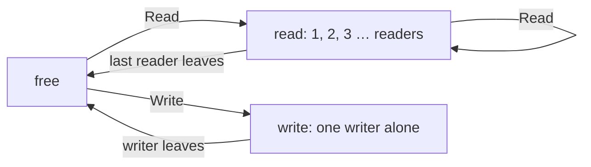

# Read-write lock

::note
<!-- sync:needs:start -->

**You'll need**: [Mutex](/docs/learn/mutex)
<!-- sync:needs:end -->

::

Many shared values are read far more often than they change: a configuration, a price list, a routing table, a cache. A [`Mutex<T>`](/docs/learn/mutex) makes every reader wait for every other reader — yet readers alone could never disturb each other. Only a writer can.

A **read-write lock** tells the two apart. Any number of threads may read at the same time; a writer waits until nobody is reading and then has the value to itself.

```rux
import Sync::RwLock;
```

## Two kinds of guard

| Method    | Returns         | `Get` gives | Shared with                 |
| --------- | --------------- | ----------- | --------------------------- |
| `Read()`  | `ReadGuard<T>`  | `*T`        | any number of other readers |
| `Write()` | `WriteGuard<T>` | `*var T`    | nobody                      |

`Read` waits only while a writer holds the lock. `Write` waits until no reader and no writer holds it. Either guard releases its hold when it is dropped, as a `MutexGuard` does.

A read guard's `Get` returns a read-only `*T`, so a reader cannot write by mistake: the compiler refuses it. The writer moves stock from one warehouse to the other under a write guard:

```rux
let guard = stock.Write();
let bins = guard.Get();
bins.north = bins.north - 1;
bins.south = bins.south + 1;
```

and each reader checks the total under a read guard:

```rux
let guard = stock.Read();
let bins = guard.Get();
if bins.north + bins.south == 1000 { correct = correct + 1; }
```



## What it buys

One writer and three readers run at once. The readers never wait for each other, and between them they look at the total 6000 times while the writer moves 500 items — and every single look sees 1000, because no reader can hold the lock while the writer is halfway through a move.

At the end, `Main` takes two read guards on the same lock at once, which a `Mutex` could never give:

```rux
let first = stock.Read();
let second = stock.Read();
```

Like `Mutex<T>`, an `RwLock<T>` is a handle: `Clone` gives each thread its own, and the value lives until the last handle and the last guard are gone.

## Choosing between them

An `RwLock` does more bookkeeping than a `Mutex`, so it pays off only when reads are frequent, take a while, and far outnumber writes. It also queues nobody: a steady stream of readers can keep a writer waiting for a long time. For short, balanced access, a `Mutex` is simpler and usually just as fast.

A thread that must wait under a lock until some condition holds — until a queue is non-empty, until a flag is set — wants a `Condition` from the same package. It is used with a `Mutex<T>`: `Wait` releases the guard's lock while the thread sleeps and takes it back before returning, and another thread calls `NotifyOne` or `NotifyAll` after changing the value. A wait can return without a notification, so it is always written in a loop that checks the condition.

## The program

The whole lesson is one package in the [Examples repository](https://github.com/rux-lang/Examples/tree/main/Concurrency/RwLock). Its comments explain every step.

<!-- sync:program:start -->

```rux [Src/Main.rux]
// Many shared values are read far more often than they change: a configuration, a price list, a
// routing table. A `Mutex<T>` makes every reader wait for every other reader, although readers
// alone could never disturb each other.
//
// An `RwLock<T>` tells the two apart. `Read` returns a `ReadGuard<T>`, and any number of threads
// may hold one at the same time. `Write` returns a `WriteGuard<T>`, which waits until nobody holds
// the lock at all and then keeps everyone else out until it is dropped. A read guard's `Get` gives
// a `*T`, so a reader cannot write by mistake; only a write guard gives a `*var T`.
//
// Like `Mutex<T>`, an `RwLock<T>` is a handle: `Clone` gives each thread its own, and the value
// lives until the last handle and the last guard are gone.
import Io::PrintLine;
import Sync::RwLock;
import Thread::{ JoinHandle, Spawn };

// Stock in two warehouses. Moving stock changes both, and the total must never look different.
struct Stock {
    north: int64;
    south: int64;
}

// The writer moves one item at a time from north to south, 500 times.
func Move(stock: RwLock<Stock>) -> uint64 {
    var moves: uint64 = 0;
    for round in 0..500 {
        let guard = stock.Write();
        let bins = guard.Get();
        bins.north = bins.north - 1;
        bins.south = bins.south + 1;
        moves = moves + 1;
    }
    return moves;
}

// A reader looks at the total over and over, and counts how often it saw the right one. Its guard
// gives a read-only `*Stock`, so `bins.north = 0;` here is refused:
//
//     error: cannot modify data through read-only pointer '*Stock'
func Audit(stock: RwLock<Stock>) -> uint64 {
    var correct: uint64 = 0;
    for round in 0..2000 {
        let guard = stock.Read();
        let bins = guard.Get();
        if bins.north + bins.south == 1000 { correct = correct + 1; }
    }
    return correct;
}

func Main() -> int {
    let stock = RwLock<Stock>(Stock { north: 1000, south: 0 });

    // One writer and three readers, all at once. The readers share the lock with each other, and
    // wait only while the writer holds it.
    var writer = Spawn(Move, stock.Clone()) catch { else => return 1 };
    var readers: JoinHandle<uint64>[3] = [
        Spawn(Audit, stock.Clone()) catch { else => return 1 },
        Spawn(Audit, stock.Clone()) catch { else => return 1 },
        Spawn(Audit, stock.Clone()) catch { else => return 1 }
    ];
    PrintLine("writer moved     {} items", writer.Join());
    for index in 0..3 {
        PrintLine("reader {} saw     {} of 2000 totals right", index + 1, readers[index].Join());
    }

    // Two read guards on one lock at the same time: reading is shared.
    let first = stock.Read();
    let second = stock.Read();
    PrintLine("north {}  south {}  (read twice: {})", first.Get().north, first.Get().south,
        second.Get().north == first.Get().north);
    return 0;
}
```

Besides `Io`, its `Rux.toml` lists `Sync` and `Thread` under `[Dependencies]`.
<!-- sync:program:end -->

## Run it

```sh
cd Examples/Concurrency/RwLock
rux run
```

<!-- sync:output:start -->

```
writer moved     500 items
reader 1 saw     2000 of 2000 totals right
reader 2 saw     2000 of 2000 totals right
reader 3 saw     2000 of 2000 totals right
north 500  south 500  (read twice: true)
```

<!-- sync:output:end -->

## Common mistakes

::mistake
**Writing through a read guard.**\
`bins.north = 0;` in `Audit` fails with:

```text
error: cannot modify data through read-only pointer '*Stock'
```

Take a write guard to change the value.
::

::mistake
**Upgrading on one thread.**\
Calling `Write` while the same thread still holds a read guard never returns: the writer waits for every reader to leave, and one of them is itself. Drop the read guard first — and since another thread may write in between, read the value again under the write guard.
::

::mistake
**Holding a read guard for long.**\
While any reader holds the lock, no writer gets in. A reader that keeps its guard while it does slow work — prints, sleeps, waits for something — holds every writer up. Copy out what you need and let the guard go.
::

## Try it yourself

1. Add a second writer that moves stock back from south to north. Do the readers still always see 1000?
2. Make `Audit` also return the smallest `north` it saw. Is it the same on every run?
3. Change `RwLock` to `Mutex` throughout, with `Lock` in place of `Read` and `Write`. What still works, and what does the last part of `Main` do now? Be ready to stop the program with Ctrl+C.

## Learn more

- [Sync](/docs/api/sync) — the package in the API reference, with `RwLock` and `Condition`
- [Mutex](/docs/learn/mutex) — the lock with one kind of guard
- [Arc](/docs/learn/arc) — sharing a value that nobody changes, with no lock at all
- [Concurrency](/docs/learn/concurrency) — the part overview, to choose between all of these
