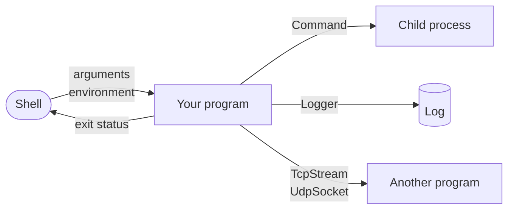

# Part 26: Systems

So far every program has been a world of its own: it computed, read a file or two, and printed. Real programs live among others. They are started by a shell with arguments and an environment, and they answer with an exit status. They start programs of their own. They are driven by options typed on a command line, they keep a log for whoever has to find out later what happened, and they talk to other programs over the network.

This part covers that boundary, with four standard packages: `Process` for the program's own arguments, environment and exit, and for child processes; `CommandLine` for options and help text; `Log` for structured records; and `Net` for addresses, TCP and UDP. Everything in it runs on one machine — the network lessons use the loopback address, which never leaves it — so every program prints the same on every run.

## What you will learn

- Reading the arguments and environment a program was started with, as native text, and ending it early with `Exit`.
- Starting another program with a `Command`: waiting for its exit status, capturing what it prints, giving it an environment, and talking to it through pipes.
- Describing a command's options, positional arguments and subcommands once, and getting parsing, error messages and `--help` from that one description.
- Writing log records with a level and typed fields, as text for people or JSON lines for tools, and keeping log files from growing without end.
- Reading, writing and classifying IPv4, IPv6 and socket addresses.
- A TCP server and client exchanging lines over a stream, and the framing a stream needs.
- UDP datagrams, which keep their boundaries but promise nothing, and a timeout for an answer that never comes.

## The part at a glance



| Package       | Lessons                                                                                | What it is for                             |
| ------------- | -------------------------------------------------------------------------------------- | ------------------------------------------ |
| `Process`     | [Environment](/docs/learn/environment), [Child process](/docs/learn/child-process)     | this process, and the processes it starts  |
| `CommandLine` | [Command line](/docs/learn/command-line)                                               | options, positionals, subcommands and help |
| `Log`         | [Log](/docs/learn/log)                                                                 | records with levels and typed fields       |
| `Net`         | [IP addresses](/docs/learn/ip-address), [TCP](/docs/learn/tcp), [UDP](/docs/learn/udp) | addresses, streams and datagrams           |

## Lessons

<!-- sync:lessons:start -->

|      | Lesson                                     | What you will learn                                            |
| ---- | ------------------------------------------ | -------------------------------------------------------------- |
| 26.1 | [Environment](/docs/learn/environment)     | the program's arguments, environment variables and exit status |
| 26.2 | [Child process](/docs/learn/child-process) | run another program and capture its output                     |
| 26.3 | [Command line](/docs/learn/command-line)   | declare options and arguments, and get the help text for free  |
| 26.4 | [Log](/docs/learn/log)                     | structured log records with levels and typed fields            |
| 26.5 | [IP addresses](/docs/learn/ip-address)     | IPv4 and IPv6 addresses, and socket addresses with a port      |
| 26.6 | [TCP](/docs/learn/tcp)                     | a TCP server and client talking over the loopback interface    |
| 26.7 | [UDP](/docs/learn/udp)                     | datagrams between two UDP sockets                              |

<!-- sync:lessons:end -->

## Before you start

Arguments, environment values and file names are all native text, so this part starts from [Path](/docs/learn/path) in [Part 19: Files](/docs/learn/files), and its streams — pipes and sockets — are the same readers and writers as files, read with [Input](/docs/learn/input)'s `ReadLineFrom`. Almost every call can fail, which brings back [Part 9: Errors](/docs/learn/errors). The TCP lesson runs its client on a [thread](/docs/learn/thread) from [Part 25: Concurrency](/docs/learn/concurrency). Each lesson's package is in the Examples repository's `Systems/` folder:

```sh
cd Examples/Systems/Environment
rux run
```

Two lessons are best tried with arguments of your own as well, given after `--`:

```sh
rux run -- --quit
```

Only one line in the whole part changes between runs — the process identifier in Environment — and its page says so.

## After this part

Try the checkpoint project: [Grep](/docs/learn/grep) is a small version of the Unix tool that prints the lines of files matching a regular expression, with options read by the CommandLine package and an exit status that scripts can rely on.

Then go on to [Part 27: Projects](/docs/learn/projects), the complete programs that close the course — each one a checkpoint for an earlier part.

For the rules underneath, see [The `Main` function](/docs/lang/functions/main) and [Conditional compilation](/docs/lang/comptime/conditional) in the Rux Reference, and the [Process](/docs/api/process), [CommandLine](/docs/api/commandline), [Log](/docs/api/log) and [Net](/docs/api/net) packages in the API reference.
