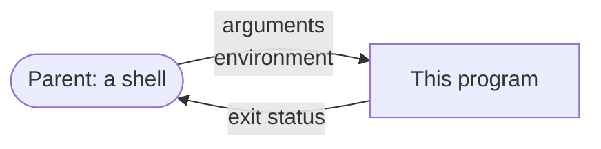

# Environment

::note
<!-- sync:needs:start -->

**You'll need**: [Optional](/docs/learn/optional), [Guard](/docs/learn/guard), [Error sum](/docs/learn/error-sum), [Path](/docs/learn/path)
<!-- sync:needs:end -->

::

Every program is started by another one — a shell, an editor, a service manager — and it is handed two lists on the way in. The **arguments** are the words typed after the program's name: `--verbose`, a file to open, a port. The **environment** is a set of `NAME=value` pairs, such as `PATH` and `HOME`, inherited from the parent and passed on to every child. On the way out the program hands back one number, its **exit status**: zero for success, anything else for a failure.

This lesson reads and changes all three with the `Process` package:

```rux
import Process::{
    Argument, ArgumentCount, Arguments, CurrentId, Environment, Exit, RemoveVariable, SetVariable,
    Variable
};
```



## Native text, not strings

An argument looks like text, and usually is — but nothing promises it. On Linux and macOS an argument is bytes, on Windows it is 16-bit units, and neither has to be valid UTF-8 or UTF-16. So every argument and every environment value is an `OsStringView`, the same view of native units that names files in [Path](/docs/learn/path):

| You want to…                    | Use                                                |
| ------------------------------- | -------------------------------------------------- |
| print it                        | `{}` — anything that is not text shows as `�`      |
| turn it into a `String`         | `ToText(allocator)`, which can fail                |
| compare it with a word you know | `Equals`, against `OsString::FromText` of the word |
| use it as a path                | `Path::FromView`, with no conversion at all        |

Reading allocates nothing. Every view borrows storage the process owns for its whole life, so a view can be kept as long as you like.

## Arguments

`ArgumentCount()` counts the arguments, and `Argument(index)` returns one as an optional — `none` past the end. Argument zero is the program itself, as the parent spelled it: a bare name, a relative path or an absolute one. That differs from machine to machine, so the program prints only its stem:

```rux
PrintLine("arguments     {}", ArgumentCount() - 1);
let program = Path::FromView(Argument(0) ?? OsStringView());
PrintLine("program       {}", program.Stem() ?? OsStringView());
var index: uint = 1;
for argument in Arguments().Skip(1) {
    PrintLine("argument {}    {}", index, argument);
    index = index + 1;
}
```

`Arguments()` walks them all in order; `Skip(1)` leaves out the program's own name. To give a program arguments under `rux run`, put them after `--`:

```sh
rux run -- --quit two
```

```text
arguments     2
program       Environment
argument 1    --quit
argument 2    two
leaving early with status 3
```

## Comparing with a word

An argument cannot be compared with a string literal directly — one is native units, the other UTF-8. `OsString::FromText` turns the literal into this system's units, and `Equals` compares the two:

```rux
var quit = OsString::FromText(allocator, "--quit")?;
let wanted = quit.View();
let first = Argument(1) ?? OsStringView();
if first.Equals(wanted) {
    PrintLine("leaving early with status 3");
    Exit(3);
}
```

`Equals` takes a reference, which is why the view gets a name of its own first. For more than a word or two, the next lesson's [Command line](/docs/learn/command-line) package does all of this from a description.

## Environment variables

`Variable(name)` looks a variable up by its UTF-8 name and returns `OsStringView?`. A missing variable is `none`; a variable set to the empty string is present, with an empty value — the two are different:

```rux
func Show(name: char8[..]) {
    match Variable(name) {
        value? => PrintLine("{:<13} = \"{}\"", name, value),
        none => PrintLine("{:<13} is not set", name)
    }
}
```

`SetVariable` and `RemoveVariable` change the environment, and both return `! IoError`: a name that is empty or contains `=` is refused as `InvalidInput`. A change is seen by this process and by every child it starts from now on — never by the parent that started it. `Environment()` walks every variable as an `EnvironmentVariable`, a pair of `name` and `value`.

Names are matched the way each system matches them: exactly on Linux and macOS, without regard to ASCII case on Windows, where `Path` and `PATH` are the same variable.

## Exit status

There are two ways to end a program with a status:

| How                | Status                               | What happens on the way out                       |
| ------------------ | ------------------------------------ | ------------------------------------------------- |
| return from `Main` | `0`, or `1` for a failure from `! E` | an ordinary return: destructors run               |
| `Exit(code)`       | `code`                               | every thread stops at once; nothing is cleaned up |

Returning from `Main` is the ordinary way — see [Fallible main](/docs/learn/fallible-main). `Exit` is for leaving from deep inside a program, and its `code` is an `int32`; Linux and macOS pass only its low eight bits to the parent. `CurrentId()` is the number the system gave this run of the program, different every time.

## The program

The whole lesson is one package in the [Examples repository](https://github.com/rux-lang/Examples/tree/main/Systems/Environment). Its comments explain every step.

<!-- sync:program:start -->

```rux [Src/Main.rux]
// Every program starts with two lists handed to it by whoever started it. The arguments are the
// words typed after the program's name, such as `--verbose` or a file to open. The environment
// is a set of `NAME=value` pairs, such as `PATH` or `HOME`, inherited from the parent process and
// passed on to every child. When the program ends it hands one number back: its exit status,
// zero for success.
//
// The `Process` package reads both lists. Neither is guaranteed to be text: on Linux and macOS
// an argument is bytes, on Windows it is 16-bit units, and nothing obliges either to be valid
// UTF-8 or UTF-16. So every argument and value is an `OsStringView`, a view of the native units
// the system handed over, which `{}` prints and `ToText` converts when real text is needed.
//
// Reading allocates nothing: every view borrows storage the process owns for its whole life.
import Allocator::{ Allocator, SystemAllocator };
import Io::{ IoError, IoErrorKind, PrintLine };
import Path::{ OsString, OsStringView, Path };
import Process::{
    Argument, ArgumentCount, Arguments, CurrentId, Environment, Exit, RemoveVariable, SetVariable,
    Variable
};
import Text::TextError;

// `Variable` returns an optional: a variable that is not set is `none`, which is different
// from one set to the empty string.
func Show(name: char8[..]) {
    match Variable(name) {
        value? => PrintLine("{:<13} = \"{}\"", name, value),
        none => PrintLine("{:<13} is not set", name)
    }
}

func Main() -> ! (IoError | TextError) {
    var system = SystemAllocator();
    let allocator: Allocator = system;

    // Argument zero is the program itself, as it was started: a name or a path the parent chose,
    // so it differs from one machine to the next. The real arguments start at one.
    PrintLine("arguments     {}", ArgumentCount() - 1);
    let program = Path::FromView(Argument(0) ?? OsStringView());
    PrintLine("program       {}", program.Stem() ?? OsStringView());
    var index: uint = 1;
    for argument in Arguments().Skip(1) {
        PrintLine("argument {}    {}", index, argument);
        index = index + 1;
    }

    // An argument is native text, so it is compared with native text: `OsString::FromText`
    // turns a literal into the units this system uses. Run `rux run -- --quit` to take this
    // branch. `Exit` ends the process at once with a status; nothing after it runs.
    var quit = OsString::FromText(allocator, "--quit")?;
    let wanted = quit.View();
    let first = Argument(1) ?? OsStringView();
    if first.Equals(wanted) {
        PrintLine("leaving early with status 3");
        Exit(3);
    }

    // A variable this program sets itself, so the output is the same on every machine. The
    // change is seen by this process and by every child it starts from now on, never by the
    // parent that started it.
    Show("LESSON_COLOUR");
    SetVariable("LESSON_COLOUR", "teal")?;
    Show("LESSON_COLOUR");
    SetVariable("LESSON_COLOUR", "")?;
    Show("LESSON_COLOUR");

    // `Environment` walks every variable, as `EnvironmentVariable` pairs of name and value.
    var found = false;
    var count: uint = 0;
    var holder = OsString::FromText(allocator, "LESSON_COLOUR")?;
    let name = holder.View();
    for variable in Environment() {
        count = count + 1;
        if variable.name.Equals(name) {
            found = true;
        }
    }
    PrintLine("found in walk {}", found);
    PrintLine("any at all    {}", count > 0);

    RemoveVariable("LESSON_COLOUR")?;
    Show("LESSON_COLOUR");

    // A name may not contain `=`, since `=` is what ends a name in the environment.
    match SetVariable("LESSON=COLOUR", "teal") {
        .Success(_) => PrintLine("a name with = was accepted?"),
        .Failure(error) if error.kind == IoErrorKind::InvalidInput =>
            PrintLine("LESSON=COLOUR refused as invalid input"),
        .Failure(error) => fail error
    }

    // The process identifier is the system's number for this run, and changes every time.
    PrintLine("process id    {}", CurrentId());

    // Returning from `Main` is the ordinary way to finish: a success here is exit status 0, and
    // a failure passed out with `?` is status 1.
    //
    //     let home: OsStringView = Variable("HOME");
    //         error: cannot assign 'OsStringView?' to 'OsStringView'
}
```

Besides `Io`, its `Rux.toml` lists `Allocator`, `Path`, `Process` and `Text` under `[Dependencies]`.
<!-- sync:program:end -->

## Run it

```sh
cd Examples/Systems/Environment
rux run
```

<!-- sync:output:start -->

```
arguments     0
program       Environment
LESSON_COLOUR is not set
LESSON_COLOUR = "teal"
LESSON_COLOUR = ""
found in walk true
any at all    true
LESSON_COLOUR is not set
LESSON=COLOUR refused as invalid input
process id    14624
```

The process id on the last line is different on every run. Run `rux run -- --quit` to see the
program list its arguments and end early with exit status 3.
<!-- sync:output:end -->

## Common mistakes

::mistake
**Treating a variable as always set.**\
`Variable` returns an optional, so `let home: OsStringView = Variable("HOME");` is refused:

```text
error: cannot assign 'OsStringView?' to 'OsStringView'
```

Match it, or give a fallback with `??`. `HOME` in particular is usually not set at all on Windows, which keeps the same folder in `USERPROFILE`.

::

::mistake
**Comparing an optional view with `none`.**\
`Argument(1) == none` does not compile, because views have no `==`. On Windows the message is:

```text
error: structural equality for 'OsStringView?' is unavailable because element type 'uint16[..]' has no '==' operator
```

The element type it names is the native unit, so it differs on Linux and macOS. Use `match`, or `ArgumentCount()`.

::

::mistake
**Passing a temporary where a reference is wanted.**\
`first.Equals(quit.View())` is refused:

```text
error: argument 1 to 'Equals' has type 'OsStringView', but parameter 'other' requires '&OsStringView'
```

Name the view first — `let wanted = quit.View();` — and pass `wanted`.

::

::mistake
**Expecting the parent to see a change.**\
`SetVariable` changes this process's environment and its future children's. The shell that ran `rux run` never sees it: when the program ends, the change ends with it.
::

## Try it yourself

1. Run `rux run -- "two words" x` and count the arguments. How does the shell decide where one ends?
2. Print the value of `PATH`, or say that it is not set. Run the program on Windows and Linux if you can: is the separator between directories the same?
3. Count how many environment variables have a name starting with `RUX`.
4. Make `--quit` take a number, so that `rux run -- --quit 5` exits with status 5. Check the status with `echo $?`.

## Learn more

- [Process API](/docs/api/process) — every function in the package
- [Path](/docs/learn/path) — `OsStringView` and the other native-text types
- [Fallible main](/docs/learn/fallible-main) — the exit status of a `Main` that can fail
- [The `Main` function](/docs/lang/functions/main) in the Rux Reference
- Next: [Child process](/docs/learn/child-process), which starts another program and hands it arguments and an environment
