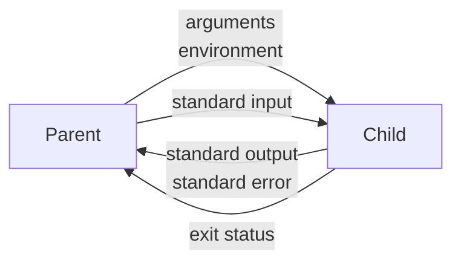

# Child process

::note
<!-- sync:needs:start -->

**You'll need**: [Environment](/docs/learn/environment), [Move](/docs/learn/move), [Input](/docs/learn/input), [Catch](/docs/learn/catch)
<!-- sync:needs:end -->

::

Sooner or later a program needs another program: a build tool runs the compiler, an editor runs a formatter, a test runner runs every test in a fresh process so that one crash cannot take down the rest. The program started is a **child process**. It runs on its own, with its own memory, and the two can talk only through what the system connects between them: arguments and an environment on the way in, three standard streams while it runs, and an exit status at the end.



The `Process` package starts one with a `Command`:

```rux
import Process::{ Argument, ArgumentCount, Command, Exit, Stdio, Variable };
```

## A program that is its own child

A lesson that runs `ls` or `dir` would print something different on every system and every machine. So this program starts _itself_. [Argument zero](/docs/learn/environment) is how it was started, and a `Command` built from it starts the same executable again. An extra argument — the **role** — tells the second copy which part to play:

```rux
func Myself(allocator: Allocator, role: char8[..]) -> Command {
    var command = Command::FromNative(allocator, Argument(0) ?? OsStringView());
    command.Argument(role);
    return <-command;
}
```

`Command(allocator, program)` takes a UTF-8 name and looks it up through `PATH` when it names no directory; `Command::FromNative` takes native text as it is, which suits a value that came from the system. `Argument` adds one argument — it arrives in the child exactly as given, spaces and quotes included, with no shell in between. A `Command` owns its parts and is not copied, so `Myself` hands it back with `<-`.

`Main` then starts by asking which copy it is:

```rux
if ArgumentCount() > 1 {
    Exit(RunChild(Argument(1) ?? OsStringView()));
}
```

## Three ways to start it

| Method    | Waits for the child? | Returns                    | Use it when                  |
| --------- | -------------------- | -------------------------- | ---------------------------- |
| `Run`     | yes                  | `ExitStatus ! IoError`     | only the outcome matters     |
| `Capture` | yes                  | `CapturedOutput ! IoError` | you want what it printed     |
| `Spawn`   | no                   | `Child ! IoError`          | you talk to it while it runs |

All three fail with an `IoError` when the program cannot be started at all — a missing program is `NotFound`, not a child that exits with an error code.

An `ExitStatus` says how the child finished. `Success()` is true only for exit code zero. `Code()` is an optional, because on Linux and macOS a child ended by a signal has no code — `Signal()` gives the signal instead:

```rux
let failing = Myself(allocator, "fail");
let status = failing.Run()?;
PrintLine("fail:   success {}, code {}", status.Success(), status.Code() ?? -1);
```

`Capture` keeps both output streams whole, reading standard error on a second thread while it reads standard output, so a child that fills one pipe while the other is being read cannot get stuck. `Output()` and `Error()` are the bytes, which a careful program does not assume are text:

```rux
let greeting = Myself(allocator, "greet");
let captured = greeting.Capture(allocator)?;
PrintLine("greet:  success {}", captured.Status().Success());
PrintLine("        output [{}]", captured.Output());
PrintLine("        error  [{}]", captured.Error());
```

## An environment for one child

`SetVariable` on a command, unlike the process-wide one from the last lesson, changes only that child's environment. `RemoveVariable` and `ClearEnvironment` take variables away from it, and `Directory` sets the folder it starts in:

```rux
var colour = Myself(allocator, "colour");
colour.SetVariable("LESSON_COLOUR", "teal");
let painted = colour.Capture(allocator)?;
```

The child sees `teal`; this process still has no such variable.

## Pipes

`Stdio` says what each of the child's streams is connected to: `Inherit`, this process's own (the default), `Null`, nothing at all, or `Pipe`, a new pipe whose other end this process takes from the `Child`:

```rux
var shout = Myself(allocator, "shout");
shout.StandardInput(Stdio::Pipe);
shout.StandardOutput(Stdio::Pipe);
var child = shout.Spawn()?;
var input = child.TakeInput() ?? fail IoError::Of(IoErrorKind::Other);
var output = child.TakeOutput() ?? fail IoError::Of(IoErrorKind::Other);
WriteAll(input, "quiet words\nstill quiet\n")?;
input.Close();
```

The ends are ordinary `Io` streams — a `PipeWriter` and a `PipeReader` — so `WriteAll` and `ReadLineFrom` work on them as on a file. `TakeInput` returns an optional because there is only a pipe to take when one was asked for, and only once. Closing the input is how the child learns that no more is coming: its `ReadLine` then reports the end, and it exits.

## Waiting, and not waiting

`Wait` blocks until the child finishes. `TryWait` only asks: it returns `ExitStatus?`, `none` while the child is still running. `Kill` ends a child that would otherwise never finish:

```rux
var waiting = Myself(allocator, "wait");
waiting.StandardInput(Stdio::Pipe);
var sleeper = waiting.Spawn()?;
PrintLine("wait:   finished yet? {}", sleeper.TryWait()? != none);
sleeper.Kill()?;
PrintLine("        killed, success {}", sleeper.Wait()?.Success());
```

Always `Wait` for a child you `Spawn`. A child dropped without waiting keeps running, and on Linux and macOS its status lingers with the system until this process ends.

## The program

The whole lesson is one package in the [Examples repository](https://github.com/rux-lang/Examples/tree/main/Systems/ChildProcess). Its comments explain every step.

<!-- sync:program:start -->

```rux [Src/Main.rux]
// A program can start another program: a child process. The child runs on its own, with its own
// memory, and the two can talk only through what the system connects between them — the child's
// arguments and environment on the way in, its three standard streams while it runs, and its
// exit status at the end.
//
// `Command` describes the child: the program, its arguments, environment changes and where each
// stream goes. `Run` starts it and waits, `Spawn` starts it and hands back a `Child` to talk to,
// and `Capture` starts it and keeps everything it writes. Starting a program can fail — it may
// not exist — so each returns a fallible with an `IoError`.
//
// To read the same on Windows, Linux and macOS, this program is its own child. Argument zero is
// how it was started, so a `Command` built from it starts this executable again; an extra
// argument tells that second copy which part to play.
import Allocator::{ Allocator, SystemAllocator };
import Io::{ IoError, IoErrorKind, Print, PrintLine, ReadLine, ReadLineFrom, StandardError, WriteAll };
import Path::{ OsString, OsStringView };
import Process::{ Argument, ArgumentCount, Command, Exit, Stdio, Variable };
import Text::{ StringBuilder, ToAsciiUpper };

// Whether a native argument is the ASCII word `text`.
func Is(argument: OsStringView, text: char8[..]) -> bool {
    var holder = OsString::FromText(SystemAllocator(), text) catch { else => return false };
    let wanted = holder.View();
    return argument.Equals(wanted);
}

// The child's side. Each part is a few lines of an ordinary program.
func RunChild(role: OsStringView) -> int32 {
    if Is(role, "greet") {
        Print("hello from the child");
        var errors = StandardError::Acquire();
        WriteAll(errors, "and a note on standard error") catch { else => return 2 };
        return 0;
    }
    if Is(role, "fail") { return 7; }
    if Is(role, "colour") {
        Print("{}", Variable("LESSON_COLOUR") ?? OsStringView());
        return 0;
    }
    if Is(role, "shout") {
        // Reads lines until its input ends, and writes each back in capitals.
        var line = StringBuilder(SystemAllocator());
        while true {
            ReadLine(line) catch { else => return 0 };
            let loud = ToAsciiUpper(SystemAllocator(), line.View()) catch { else => return 3 };
            PrintLine("{}", loud);
            line.Clear();
        }
    }
    if Is(role, "wait") {
        // Waits for a line that never comes, until it is killed.
        var line = StringBuilder(SystemAllocator());
        ReadLine(line) catch { else => return 0 };
    }
    return 99;
}

// A command that starts this same program in `role`.
func Myself(allocator: Allocator, role: char8[..]) -> Command {
    var command = Command::FromNative(allocator, Argument(0) ?? OsStringView());
    command.Argument(role);
    return <-command;
}

func Main() -> ! IoError {
    if ArgumentCount() > 1 {
        Exit(RunChild(Argument(1) ?? OsStringView()));
    }
    var system = SystemAllocator();
    let allocator: Allocator = system;

    // `Run` waits for the child and returns how it finished. A status is a success only for
    // exit code zero; `Code` is optional because a child ended by a signal has none.
    let failing = Myself(allocator, "fail");
    let status = failing.Run()?;
    PrintLine("fail:   success {}, code {}", status.Success(), status.Code() ?? -1);

    // `Capture` keeps both output streams and the status. The bytes are only bytes: a child may
    // write anything, so they are shown, not trusted to be text.
    let greeting = Myself(allocator, "greet");
    let captured = greeting.Capture(allocator)?;
    PrintLine("greet:  success {}", captured.Status().Success());
    PrintLine("        output [{}]", captured.Output());
    PrintLine("        error  [{}]", captured.Error());

    // Environment changes made on the command reach only that child.
    var colour = Myself(allocator, "colour");
    colour.SetVariable("LESSON_COLOUR", "teal");
    let painted = colour.Capture(allocator)?;
    PrintLine("colour: the child saw [{}]", painted.Output());
    PrintLine("        this process sees [{}]", Variable("LESSON_COLOUR") ?? OsStringView());

    // Pipes: the parent writes to the child's input and reads its output while it runs.
    // Closing the input is how the child learns that no more is coming.
    var shout = Myself(allocator, "shout");
    shout.StandardInput(Stdio::Pipe);
    shout.StandardOutput(Stdio::Pipe);
    var child = shout.Spawn()?;
    var input = child.TakeInput() ?? fail IoError::Of(IoErrorKind::Other);
    var output = child.TakeOutput() ?? fail IoError::Of(IoErrorKind::Other);
    WriteAll(input, "quiet words\nstill quiet\n")?;
    input.Close();
    var line = StringBuilder(allocator);
    while true {
        ReadLineFrom(output, line) catch { error if error.IsEnd() => break, error => fail error };
        PrintLine("shout:  {}", line.View());
        line.Clear();
    }
    PrintLine("        success {}", child.Wait()?.Success());

    // `TryWait` asks without waiting; `Kill` ends a child that would never finish.
    var waiting = Myself(allocator, "wait");
    waiting.StandardInput(Stdio::Pipe);
    var sleeper = waiting.Spawn()?;
    PrintLine("wait:   finished yet? {}", sleeper.TryWait()? != none);
    sleeper.Kill()?;
    PrintLine("        killed, success {}", sleeper.Wait()?.Success());

    // A program that does not exist fails to start; it is not a child that exits.
    let missing = Command(allocator, "no-such-program-anywhere");
    match missing.Run() {
        .Success(_) => PrintLine("missing: it ran?"),
        .Failure(error) => PrintLine("missing: not found? {}", error.kind == IoErrorKind::NotFound)
    }

    // Starting a child can fail, so its status is only reachable through the fallible:
    //
    //     let status = failing.Run();
    //     PrintLine("{}", status.Success());
    //         error: type 'ExitStatus ! IoError' has no field 'Success'
    //
    // And an exit status is an `int32`, the width every system reports:
    //
    //     func RunChild(role: OsStringView) -> int { ... }
    //     Exit(RunChild(role));
    //         error: argument 1 to 'Exit' has type 'int', but parameter 'code' requires 'int32'
}
```

Besides `Io`, its `Rux.toml` lists `Allocator`, `Path`, `Process` and `Text` under `[Dependencies]`.
<!-- sync:program:end -->

## Run it

```sh
cd Examples/Systems/ChildProcess
rux run
```

<!-- sync:output:start -->

```
fail:   success false, code 7
greet:  success true
        output [hello from the child]
        error  [and a note on standard error]
colour: the child saw [teal]
        this process sees []
shout:  QUIET WORDS
shout:  STILL QUIET
        success true
wait:   finished yet? false
        killed, success false
missing: not found? true
```

<!-- sync:output:end -->

Every line is the same on every system. The child writes its greeting and its note without a final newline, which is why the brackets close on the same line.

## Common mistakes

::mistake
**Reading the status of a start that may have failed.**\
`Run` returns `ExitStatus ! IoError`, so `let status = failing.Run();` followed by `status.Success()` is refused:

```text
error: type 'ExitStatus ! IoError' has no field 'Success'
```

Handle the failure to start first, with `?` or a `match`.

::

::mistake
**Exiting with an `int`.**\
An exit status is an `int32` on every system. With `RunChild` declared `-> int`, `Exit(RunChild(role))` fails with:

```text
error: argument 1 to 'Exit' has type 'int', but parameter 'code' requires 'int32'
```

::

::mistake
**Copying a command.**\
A `Command` owns its parts, so `let again = command;` is refused:

```text
error: move-only value 'command' requires an explicit '<-' in initialization
```

A command can be started more than once, so there is rarely a need for a second one: call `Run` on it again.

::

::mistake
**Forgetting to close the input.**\
A child that reads until its input ends will wait forever while the parent keeps the `PipeWriter` open — and a parent reading the child's output waits with it. Call `Close` on the writer once everything is written. `Wait` closes it too, but only if the writer was never taken.
::

## Try it yourself

1. Add a role that prints its arguments, and start it with an argument containing spaces and quotes, such as `say "hi"`. Does it arrive whole?
2. Give the `greet` child `StandardError(Stdio::Null)` and `Run` it instead of capturing it. What appears on the screen?
3. Start a real program found through `PATH` — `git --version` if you have Git — and print its captured output. What happens on a machine without it?
4. Make the `shout` child exit with status 1 when a line is empty, and report the status in the parent.

## Learn more

- [Process API](/docs/api/process) — `Command`, `Child`, `ExitStatus` and `CapturedOutput`
- [Environment](/docs/learn/environment) — the arguments and environment a child receives
- [Input](/docs/learn/input) — `ReadLine`, which the child uses on its standard input
- [Move](/docs/learn/move) — why a `Command` is returned with `<-`
- [Thread](/docs/learn/thread) — a second line of work inside one process, instead of a second process
