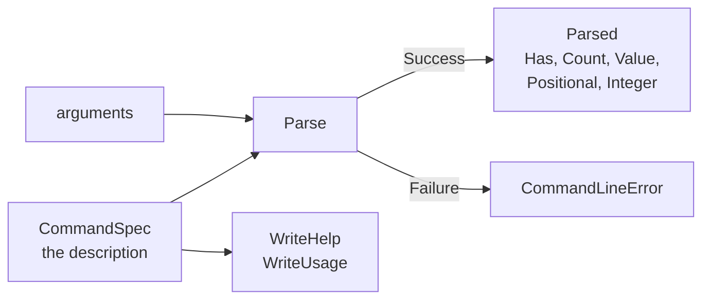

# Command line

::note
<!-- sync:needs:start -->

**You'll need**: [Environment](/docs/learn/environment), [Pointer](/docs/learn/pointer), [Writable slice](/docs/learn/writable-slice), [Interface parameter](/docs/learn/interface-parameter)
<!-- sync:needs:end -->

::

The [Environment](/docs/learn/environment) lesson read arguments one at a time. That is fine for one flag, and a chore for a real tool: `-v` and `--verbose` must mean the same, `-vv` must mean "more verbose", `--priority=1`, `--priority 1`, `-p 1` and `-p1` must all give `1`, `--` must end the options — and every mistake deserves a message that names the argument at fault, plus a `--help` that lists everything.

The `CommandLine` package does all of that from a **description** of what the command accepts. You describe; it parses, checks, and writes the help:

```rux
import CommandLine::{
    Command, CommandSpec, Flag, OptionSpec, Optional, Parse, Parsed, ParseProcess, PositionalSpec,
    Remaining, Required, ValueOption, WriteUsage
};
```



## Describing a command

A command is a `CommandSpec`: a name, a one-line summary, and then — each added with a `With` method — a version, options, positional arguments and subcommands. Options and positionals are made by small functions:

| Function                             | Accepts                                    | Help shows       |
| ------------------------------------ | ------------------------------------------ | ---------------- |
| `Flag(name, short, help)`            | `--all`, `-a`, present or absent           | `-a, --all`      |
| `ValueOption(name, short, value, …)` | `--priority 1`, `--priority=1`, `-p1`      | `--priority <N>` |
| `Required(name, help)`               | exactly one positional argument            | `<title>`        |
| `Optional(name, help)`               | at most one                                | `[filter]`       |
| `Remaining(name, help)`              | every positional argument left, maybe none | `[tags...]`      |

The lesson's command is a little to-do tool with two subcommands, each with options and positionals of its own:

```rux
let addOptions: OptionSpec[1] = [ValueOption("priority", 'p', "N", "How urgent, 1 to 5")];
let addPositionals: PositionalSpec[2] = [
    Required("title", "What to do"), Remaining("tags", "Words to file it under")
];
let listOptions: OptionSpec[1] = [Flag("all", 'a', "Include finished items")];
let listPositionals: PositionalSpec[1] = [Optional("filter", "Only items with this tag")];
let commands: CommandSpec[2] = [
    Command("add", "Add an item").WithOptions(addOptions[..]).WithPositionals(addPositionals[..]),
    Command("list", "Show the items").WithOptions(listOptions[..])
        .WithPositionals(listPositionals[..])
];
let options: OptionSpec[1] = [Flag("verbose", 'v', "Say more; repeat for even more")];
let todo = Command("todo", "Keeps a to-do list").WithVersion("1.0.0")
    .WithOptions(options[..]).WithCommands(commands[..]);
```

Nothing here allocates. A spec only **borrows** its arrays and text, so the arrays are locals that must live as long as the spec and every parse made from it. Every command also understands `-h` and `--help`, and one with a version `-V` and `--version`, without declaring them.

## Parsing

`Parse(@spec, arguments)` checks a list of `OsStringView` arguments — without the program's name — and returns `Parsed ! CommandLineError`. `ParseProcess(@spec)` does the same with the program's own arguments. Both take the spec by pointer, because the parse keeps pointing at it.

To print the same thing on every run, the lesson parses fixed lines rather than real ones. `Split` cuts a line at its spaces into native views — a crude shell, enough for words without quotes:

```rux
match Parse(spec, words[..count]) {
    .Success(parsed) => Describe(parsed, screen)?,
    .Failure(error) => PrintLine("  error: {}", error)
}
```

A `CommandLineError` describes itself through `Display`, in lower case and naming the argument as it was typed — `unknown option '-x'`, `missing argument <title>` — ready to follow a program's own `error: `.

## Asking the parse

A `Parsed` holds nothing but where the arguments are, and each question walks them again:

| Question              | Returns                     | Answers                                           |
| --------------------- | --------------------------- | ------------------------------------------------- |
| `Has("all")`          | `bool`                      | was the option given at all?                      |
| `Count("verbose")`    | `uint`                      | how many times — `-vv` is 2                       |
| `Value("priority")`   | `OsStringView?`             | the option's value; the last one when repeated    |
| `Positional("title")` | `OsStringView?`             | the positional argument                           |
| `Positionals("tags")` | an iterator                 | every argument a `Remaining` positional took      |
| `Integer("priority")` | `int64? ! CommandLineError` | the value as a number — `none` if not given       |
| `Subcommand()`        | `Parsed?`                   | the parse of everything after the subcommand name |

`Integer` is the one question that can fail: `todo add -p high milk` is a valid command line — `-p` has a value — but `high` is not a number, so the error appears only when the program asks for one:

```rux
match sub.Integer("priority") {
    .Success(priority) => PrintLine("  add [{}] priority {}, verbosity {}",
        sub.Positional("title") ?? OsStringView(), priority ?? 3, verbose),
    .Failure(error) => PrintLine("  error: {}", error)
}
```

## Subcommands

A command with subcommands takes its first positional argument as the subcommand's name, and everything after the name belongs to the subcommand. So in `-vv add --priority=1 milk shop home`, `-vv` is the top-level `todo`'s option and `--priority` is `add`'s. `CommandName()` names the subcommand chosen, and `Subcommand()` is its own `Parsed`, already checked with the first.

A slice has no `==`, so `IsCommand` compares the name as two `StringView`s:

```rux
func IsCommand(parsed: &Parsed, word: char8[..]) -> bool {
    let name = StringView::FromValidated(parsed.CommandName() ?? "");
    let wanted = StringView::FromValidated(word);
    return name.Equals(wanted);
}
```

## Help for free

Asking for help is a successful parse: `HelpRequested()` says so, and succeeds even when a required argument is missing. `WriteHelp` writes the help from the description into any `TextWriter`; `ConsoleWriter` is the one over standard output. On a subcommand's parse, the usage line names the command above it — `todo add [options] <title> [tags...]`. `WriteUsage` writes only the usage line, the conventional reply to a mistake:

```rux
match ParseProcess(@todo) {
    .Success(parsed) => Describe(parsed, screen)?,
    .Failure(error) => {
        PrintLine("error: {}", error);
        WriteUsage(todo, screen)?;
    }
}
```

Give the program real arguments to see it take the first branch:

```sh
rux run -- -v add --priority 2 "buy milk" home
```

The last lines then read `add [buy milk] priority 2, verbosity 1` and `tag home`: the shell kept `buy milk` together.

## The program

The whole lesson is one package in the [Examples repository](https://github.com/rux-lang/Examples/tree/main/Systems/CommandLine). Its comments explain every step.

<!-- sync:program:start -->

```rux [Src/Main.rux]
// Reading arguments one by one, as the Environment lesson did, gets tedious quickly: options
// in any order, `-v` and `--verbose` meaning the same, `--jobs=4` and `--jobs 4` too, and a
// helpful message for every mistake. The `CommandLine` package does it from a description.
//
// A program describes what it accepts as plain values: a `CommandSpec` with its options —
// `Flag`s that are present or not, `ValueOption`s that take a value — its positional
// arguments — `Required`, `Optional` or `Remaining` — and its subcommands. `Parse` checks a
// list of arguments against that description and returns `Parsed ! CommandLineError`; the
// parse then answers questions such as `Has`, `Count`, `Value` and `Positional`. The same
// description writes the help text, so the two can never disagree.
//
// `ParseProcess` reads the program's own arguments. To print the same thing on every run, this
// lesson mostly parses fixed lists instead, written as one string and split at the spaces.
import Allocator::{ Allocator, SystemAllocator };
import CommandLine::{
    Command, CommandSpec, Flag, OptionSpec, Optional, Parse, Parsed, ParseProcess, PositionalSpec,
    Remaining, Required, ValueOption, WriteUsage
};
import Io::{ ConsoleWriter, IoError, PrintLine };
import Path::{ OsString, OsStringView };
import Text::{ FormatError, StringView, TextError, TextWriter };

// Splits native text at its spaces, the way a shell splits what you type, into `words`.
func Split(text: OsStringView, words: var OsStringView[..]) -> uint {
    let units = text.Units();
    var count: uint = 0;
    var start: uint = 0;
    for at in 0..=units.length {
        if at == units.length || units[at] as uint32 == 0x20 {
            if at > start && count < words.length {
                words[count] = OsStringView::FromUnits(units[start..at]);
                count = count + 1;
            }
            start = at + 1;
        }
    }
    return count;
}

func IsCommand(parsed: &Parsed, word: char8[..]) -> bool {
    let name = StringView::FromValidated(parsed.CommandName() ?? "");
    let wanted = StringView::FromValidated(word);
    return name.Equals(wanted);
}

// What the program would do with a successful parse. Asking for help is a successful parse too,
// and `WriteHelp` on a subcommand's parse names the command above it.
func Describe(parsed: &Parsed, screen: &var TextWriter) -> ! FormatError {
    if parsed.HelpRequested() {
        parsed.WriteHelp(screen)?;
        return;
    }
    let verbose = parsed.Count("verbose");
    let sub = parsed.Subcommand() ?? return;
    if sub.HelpRequested() {
        sub.WriteHelp(screen)?;
        return;
    }
    if IsCommand(parsed, "add") {
        // `Integer` reads a value as a number, and fails when it is not one.
        match sub.Integer("priority") {
            .Success(priority) => PrintLine("  add [{}] priority {}, verbosity {}",
                sub.Positional("title") ?? OsStringView(), priority ?? 3, verbose),
            .Failure(error) => PrintLine("  error: {}", error)
        }
        for tag in sub.Positionals("tags") {
            PrintLine("  tag {}", tag);
        }
    } else if IsCommand(parsed, "list") {
        PrintLine("  list, all {}, filter [{}]", sub.Has("all"),
            sub.Positional("filter") ?? OsStringView());
    }
}

func Try(spec: *CommandSpec, allocator: Allocator, line: char8[..]) -> ! (TextError | FormatError) {
    PrintLine("$ todo {}", line);
    var holder = OsString::FromText(allocator, line)?;
    var words: OsStringView[8] = [OsStringView(); 8];
    let count = Split(holder.View(), words[..]);

    // `ConsoleWriter` is a `TextWriter` over standard output, for the help text.
    var failure: IoError? = none;
    var console = ConsoleWriter(@failure);
    let screen: &var TextWriter = console;
    match Parse(spec, words[..count]) {
        .Success(parsed) => Describe(parsed, screen)?,
        .Failure(error) => PrintLine("  error: {}", error)
    }
}

func Main() -> ! (TextError | FormatError) {
    var system = SystemAllocator();
    let allocator: Allocator = system;

    // The description: two subcommands, each with its own options and positionals.
    let addOptions: OptionSpec[1] = [ValueOption("priority", 'p', "N", "How urgent, 1 to 5")];
    let addPositionals: PositionalSpec[2] = [
        Required("title", "What to do"), Remaining("tags", "Words to file it under")
    ];
    let listOptions: OptionSpec[1] = [Flag("all", 'a', "Include finished items")];
    let listPositionals: PositionalSpec[1] = [Optional("filter", "Only items with this tag")];
    let commands: CommandSpec[2] = [
        Command("add", "Add an item").WithOptions(addOptions[..]).WithPositionals(addPositionals[..]),
        Command("list", "Show the items").WithOptions(listOptions[..])
            .WithPositionals(listPositionals[..])
    ];
    let options: OptionSpec[1] = [Flag("verbose", 'v', "Say more; repeat for even more")];
    let todo = Command("todo", "Keeps a to-do list").WithVersion("1.0.0")
        .WithOptions(options[..]).WithCommands(commands[..]);

    // Lines that parse, and lines that do not.
    Try(@todo, allocator, "add milk")?;
    Try(@todo, allocator, "-vv add --priority=1 milk shop home")?;
    Try(@todo, allocator, "list -a home")?;
    Try(@todo, allocator, "add -p high milk")?;
    Try(@todo, allocator, "add")?;
    Try(@todo, allocator, "add -x milk")?;
    Try(@todo, allocator, "remove milk")?;
    Try(@todo, allocator, "list home work")?;

    // The help text, written from the same description, for the program and for a subcommand.
    Try(@todo, allocator, "--help")?;
    Try(@todo, allocator, "add -h")?;

    // And this run's own arguments. `rux run` passes none, and a command is required, so this
    // ends the way a real program would: the reason, then the usage line.
    PrintLine("$ todo");
    var failure: IoError? = none;
    var console = ConsoleWriter(@failure);
    let screen: &var TextWriter = console;
    match ParseProcess(@todo) {
        .Success(parsed) => Describe(parsed, screen)?,
        .Failure(error) => {
            PrintLine("error: {}", error);
            WriteUsage(todo, screen)?;
        }
    }

    // A slice cannot be compared with `==`, which is why `IsCommand` compares `StringView`s:
    //
    //     let name = parsed.CommandName() ?? "";
    //     if name == "add" { ... }
    //         error: operator '==' is not defined for slice type 'char8[..]'
}
```

Besides `Io`, its `Rux.toml` lists `Allocator`, `CommandLine`, `Path` and `Text` under `[Dependencies]`.
<!-- sync:program:end -->

## Run it

```sh
cd Examples/Systems/CommandLine
rux run
```

<!-- sync:output:start -->

```
$ todo add milk
  add [milk] priority 3, verbosity 0
$ todo -vv add --priority=1 milk shop home
  add [milk] priority 1, verbosity 2
  tag shop
  tag home
$ todo list -a home
  list, all true, filter [home]
$ todo add -p high milk
  error: invalid value 'high' for 'priority'
$ todo add
  error: missing argument <title>
$ todo add -x milk
  error: unknown option '-x'
$ todo remove milk
  error: unknown command 'remove'
$ todo list home work
  error: unexpected argument 'work'
$ todo --help
Keeps a to-do list

Usage: todo [options] <command>

Options:
  -v, --verbose  Say more; repeat for even more
  -h, --help     Print this help
  -V, --version  Print the version

Commands:
  add   Add an item
  list  Show the items
$ todo add -h
Add an item

Usage: todo add [options] <title> [tags...]

Arguments:
  <title>    What to do
  [tags...]  Words to file it under

Options:
  -p, --priority <N>  How urgent, 1 to 5
  -h, --help          Print this help
$ todo
error: a command is required
Usage: todo [options] <command>
```

<!-- sync:output:end -->

## Common mistakes

::mistake
**Passing the spec by value.**\
`ParseProcess(todo)` is refused:

```text
error: argument 1 to 'ParseProcess' has type 'CommandSpec', but parameter 'spec' requires '*CommandSpec'
```

The parse keeps a pointer to the spec, so pass its address: `ParseProcess(@todo)`.

::

::mistake
**Comparing a subcommand's name with `==`.**\
`let name = parsed.CommandName() ?? "";` followed by `if name == "add"` fails with:

```text
error: operator '==' is not defined for slice type 'char8[..]'
```

Comparing two slices would compare where they are, not what they hold. Compare `StringView`s with `Equals`, as `IsCommand` does.

::

::mistake
**A spec that outlives its arrays.**\
`WithOptions(options[..])` borrows the array; it does not copy it. Build the arrays in a function, return only the `CommandSpec`, and the spec points at memory that is gone — which compiles without a word. Keep the arrays and the spec in the same scope, as `Main` does here.
::

::mistake
**Treating a parse as proof that a value is valid.**\
`Parse` checks the shape — an option has its value, a required argument is there — but not what the values mean. `-p high` parses; only `Integer` notices it is not a number. Check values when you read them.
::

## Try it yourself

1. Run `rux run -- --version`. Nothing is printed: make `Describe` notice `VersionRequested()` and print `todo 1.0.0` with `WriteVersion`.
2. Give `add` a `--due DATE` option, and print it when it is given. What does the help look like now?
3. Make `add` refuse a priority outside 1 to 5 with a message of your own.
4. Add a third subcommand, `done <number>`, that reads its number with `Integer`.

## Learn more

- [CommandLine API](/docs/api/commandline) — every builder, query and error case
- [Environment](/docs/learn/environment) — the raw arguments this package reads
- [Pointer](/docs/learn/pointer) — why `Parse` takes `@todo`
- [Interface parameter](/docs/learn/interface-parameter) — the `&var TextWriter` the help is written to
- [Grep](/docs/learn/grep) — the checkpoint project, a command-line tool built on this package
