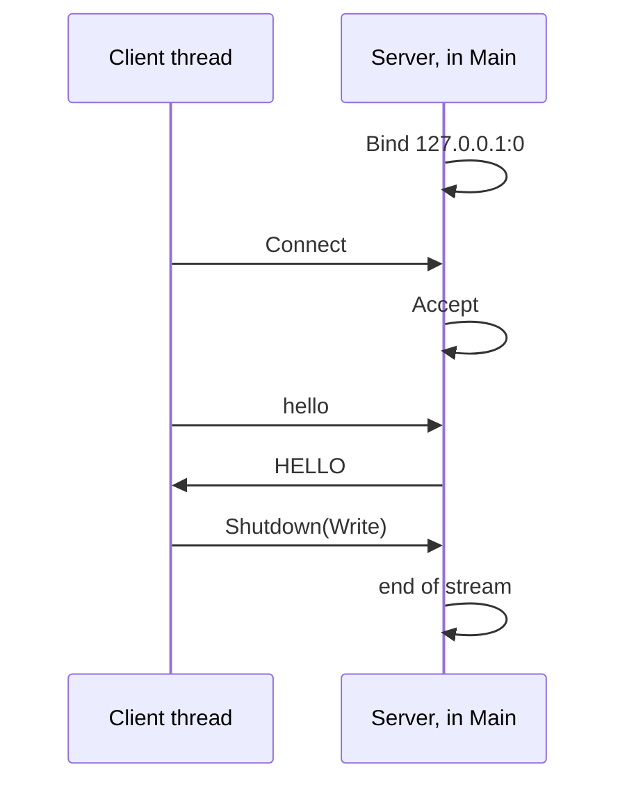

# TCP

::note
<!-- sync:needs:start -->

**You'll need**: [IP addresses](/docs/learn/ip-address), [Thread](/docs/learn/thread), [Input](/docs/learn/input), [Catch](/docs/learn/catch)
<!-- sync:needs:end -->

::

**TCP** is how most programs talk over a network: a browser and a web server, a database and its clients, `git` and the forge it pushes to. One side **listens** on a port. The other **connects** to it. From then on each side has a **stream** — it writes bytes in, and the other side reads them out, all of them, in the order they were written. Lost packets are resent and shuffled ones put back in order before your program sees anything.

This lesson runs both sides in one program, on the loopback address, which never leaves the machine:

```rux
import Net::{ IpAddress, Ipv4Address, ShutdownDirection, SocketAddress, TcpListener, TcpStream };
```



## Listening

`TcpListener::Bind` takes the [socket address](/docs/learn/ip-address) to listen at. Port 0 asks the system for any free port, and `LocalAddress` says which one it chose — a different one on each run, which is why this program never prints it:

```rux
let loopback = IpAddress::FromIpv4(Ipv4Address::Localhost());
let listener = TcpListener::Bind(SocketAddress::New(loopback, 0))?;
let address = listener.LocalAddress()?;
```

A real server binds a fixed port, such as 8080, and `0.0.0.0` instead of `127.0.0.1` to accept connections from other machines too. Binding a port that is already taken fails with `AddressInUse`.

## Two sides, two threads

A server waits; so does a client. In one program, each needs its own line of execution, so the client runs on a [thread](/docs/learn/thread). `Spawn` passes it the address to connect to:

```rux
var client = Spawn(Client, address) catch { else => fail IoError::Of(IoErrorKind::Other) };
```

The client prints nothing — two threads printing at once would mix their lines in an order that changes from run to run. It returns how many replies it read, and `Main` prints that after `Join`.

## Accepting and connecting

`Accept` waits until a client connects, and returns a `TcpStream` for that one connection. The listener goes on listening, and a server that serves many clients calls `Accept` in a loop. On the other side, `TcpStream::Connect` makes the connection:

```rux
var stream = listener.Accept()?;
let peer = stream.PeerAddress()?;
```

`PeerAddress` is the other end's socket address — `127.0.0.1` and a port the system picked for the client.

## A stream is a reader and a writer

A `TcpStream` is an `Io` `Reader` and `Writer`, so everything from the [files](/docs/learn/files) and [input](/docs/learn/input) lessons works on it: `WriteAll` to send, `ReadLineFrom` to read a line.

That matters because a stream is only bytes. TCP keeps no message boundaries: three writes may arrive as one read, or one write as three. The two sides agree on their own framing — here, one message per line:

```rux
for message in messages {
    WriteAll(stream, message) catch { else => return replies };
    ReadLineFrom(stream, reply) catch { else => return replies };
    replies = replies + 1;
    reply.Clear();
}
```

## Saying goodbye

`Shutdown(ShutdownDirection::Write)` tells the other side that nothing more is coming, while the stream stays open for reading. The server's next read then reports the end of the stream, and the loop stops:

```rux
match ReadLineFrom(stream, line) {
    .Success(_) => {},
    .Failure(error) if error.IsEnd() => break,
    .Failure(error) => fail error
}
```

Dropping a stream closes it altogether, which the other side also sees as the end. Writing to a connection the other side has closed fails with `BrokenPipe`, and connecting to a port where nobody listens with `ConnectionRefused` — on Windows only after a few seconds of retrying.

## The program

The whole lesson is one package in the [Examples repository](https://github.com/rux-lang/Examples/tree/main/Systems/Tcp). Its comments explain every step.

<!-- sync:program:start -->

```rux [Src/Main.rux]
// TCP is how most programs talk over a network: a web browser and a server, a database and its
// clients. One side listens on a port; the other connects to it; then each has a stream it can
// write bytes into and read the other side's bytes from, in order and without loss.
//
// The `Net` package gives each side a type. A `TcpListener` is bound to an address and accepts
// connections, one `TcpStream` each; a client makes its `TcpStream` with `Connect`. A stream is
// an `Io` reader and writer, so `WriteAll`, `ReadLineFrom` and everything else from the files
// lessons works on it. Every failure is an `IoError`, with kinds such as `ConnectionRefused`.
//
// A stream is only bytes: TCP keeps no message boundaries, so the two sides agree on their own.
// Here each message is one line. Both sides run in this one program — the server in `Main`, the
// client on a second thread — and talk over the loopback address, 127.0.0.1, which never leaves
// the machine.
import Allocator::SystemAllocator;
import Io::{ IoError, IoErrorKind, PrintLine, ReadLineFrom, WriteAll };
import Net::{ IpAddress, Ipv4Address, ShutdownDirection, SocketAddress, TcpListener, TcpStream };
import Text::{ StringBuilder, ToAsciiUpper };
import Thread::Spawn;

// The client: connect, send three lines, read a reply to each, then say it has finished.
// It returns how many replies it read, so it prints nothing and the output stays in order.
func Client(server: SocketAddress) -> uint {
    var stream = TcpStream::Connect(server) catch { else => return 0 };
    let messages: char8[..][3] = ["hello\n", "how are you?\n", "bye\n"];
    var reply = StringBuilder(SystemAllocator());
    var replies: uint = 0;
    for message in messages {
        WriteAll(stream, message) catch { else => return replies };
        ReadLineFrom(stream, reply) catch { else => return replies };
        replies = replies + 1;
        reply.Clear();
    }
    // Shutting down the writing half tells the server no more is coming; the stream itself
    // closes when `stream` is dropped at the end of the function.
    stream.Shutdown(ShutdownDirection::Write) catch { else => return replies };
    return replies;
}

func Main() -> ! IoError {
    // Port 0 asks the system for any free port; `LocalAddress` says which one it chose. It
    // differs between runs, so this program never prints it.
    let loopback = IpAddress::FromIpv4(Ipv4Address::Localhost());
    let listener = TcpListener::Bind(SocketAddress::New(loopback, 0))?;
    let address = listener.LocalAddress()?;
    PrintLine("server: listening on 127.0.0.1, port chosen? {}", address.port != 0);

    // The client runs on its own thread, so the server can wait for it here.
    var client = Spawn(Client, address) catch { else => fail IoError::Of(IoErrorKind::Other) };

    // `Accept` waits for a connection and hands back a stream for it.
    var stream = listener.Accept()?;
    let peer = stream.PeerAddress()?;
    PrintLine("server: a client connected from loopback? {}", peer.ip.IsLoopback());

    // Read a line, answer it, and go on until the client shuts its side down.
    var line = StringBuilder(SystemAllocator());
    while true {
        match ReadLineFrom(stream, line) {
            .Success(_) => {},
            .Failure(error) if error.IsEnd() => break,
            .Failure(error) => fail error
        }
        let loud = ToAsciiUpper(SystemAllocator(), line.View()) catch {
            else => fail IoError::Of(IoErrorKind::Other)
        };
        PrintLine("server: received [{}], replying [{}]", line.View(), loud);
        WriteAll(stream, loud.Bytes())?;
        WriteAll(stream, "\n")?;
        line.Clear();
    }
    PrintLine("server: the client has finished");
    PrintLine("client: read {} replies", client.Join());

    // A stream is a reader and a writer, but it is not copied — each one owns its connection:
    //
    //     let other = stream;
    //         error: move-only value 'stream' requires an explicit '<-' in initialization
}
```

Besides `Io`, its `Rux.toml` lists `Allocator`, `Net`, `Text` and `Thread` under `[Dependencies]`.
<!-- sync:program:end -->

## Run it

```sh
cd Examples/Systems/Tcp
rux run
```

<!-- sync:output:start -->

```
server: listening on 127.0.0.1, port chosen? true
server: a client connected from loopback? true
server: received [hello], replying [HELLO]
server: received [how are you?], replying [HOW ARE YOU?]
server: received [bye], replying [BYE]
server: the client has finished
client: read 3 replies
```

<!-- sync:output:end -->

## Common mistakes

::mistake
**Copying a stream.**\
A `TcpStream` owns its connection, so `let other = stream;` is refused:

```text
error: move-only value 'stream' requires an explicit '<-' in initialization
```

Move it with `<-`, or pass it by reference.

::

::mistake
**Treating each read as one message.**\
A `Read` returns whatever has arrived — part of a message, or several. On loopback it usually looks like one write per read, which is exactly why the bug survives testing. Frame your messages — by lines, or with a length in front — and read whole frames.
::

::mistake
**Both sides waiting.**\
If the client waits for a reply that the server only sends once the client has finished, neither moves. Here the server replies to every line at once, and the client shuts down its writing half when it has nothing more to say.
::

::mistake
**Printing from two threads.**\
Had the client printed its replies, its lines and the server's would interleave differently from one run to the next. Collect results on the thread and print them after `Join`.
::

## Try it yourself

1. Make the server count the lines and reply with the count instead of the line in capitals.
2. Accept two clients one after the other: spawn two client threads and call `Accept` twice.
3. Give the client a read timeout of 100 milliseconds with `SetReadTimeout`, and make the server sleep before replying to `bye`. What does the client see?
4. Drop the `Shutdown` call. Does the server still finish? Why?

## Learn more

- [Net API](/docs/api/net) — `TcpListener`, `TcpStream`, timeouts and non-blocking sockets
- [IP addresses](/docs/learn/ip-address) — the addresses a server binds and a client connects to
- [Thread](/docs/learn/thread) — `Spawn` and `Join`
- [Input](/docs/learn/input) — `ReadLineFrom` and the end of a stream
- Next: [UDP](/docs/learn/udp), messages without a connection
