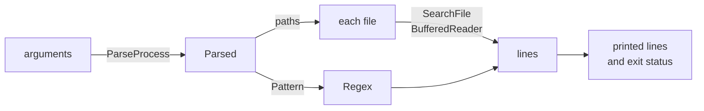

# Grep

::note
<!-- sync:needs:start -->

**You'll need**: Parts 1–26 — this project is the checkpoint for Systems, and leans on [Command line](/docs/learn/command-line), [Regular expressions](/docs/learn/regex), [File](/docs/learn/file) and [Buffered I/O](/docs/learn/buffered-io).
<!-- sync:needs:end -->

::

`grep` is one of the oldest tools on Unix and still one of the most used: give it a pattern and some files, and it prints every line that matches. This project builds a small one — a real command-line tool, with options, a help text, error messages and an exit status that scripts can rely on:

```sh
rux run -- -in "name" Rux.toml
```

It is the checkpoint for [Part 26: Systems](/docs/learn/systems), and it brings three parts of the course together: reading the command line from Part 26, regular expressions from [Part 14: Text](/docs/learn/text), and files read line by line from [Part 19: Files](/docs/learn/files).

## Try it first

Before reading on, try writing it yourself. Start with the smallest version that works — `grep <pattern> <file>`, printing matching lines — then add one option at a time: `-n` for line numbers, `-c` for a count, `-i` to ignore case, `-v` to invert the match, and more than one file. Everything you need has appeared in a lesson, and the table below says which.

## How it is put together



| Function     | Its job                                             | Lessons it uses                                                                                       |
| ------------ | --------------------------------------------------- | ----------------------------------------------------------------------------------------------------- |
| `Main`       | Describes the command and picks real or tour mode   | [Command line](/docs/learn/command-line), [Environment](/docs/learn/environment)                      |
| `Run`        | Turns one parsed command line into a search         | [Command line](/docs/learn/command-line), [Regular expressions](/docs/learn/regex)                    |
| `Pattern`    | The pattern as text, with `(?i)` in front for `-i`  | [Path](/docs/learn/path), [Move](/docs/learn/move)                                                    |
| `SearchFile` | Reads one file line by line and prints what matches | [File](/docs/learn/file), [Buffered I/O](/docs/learn/buffered-io), [Error sum](/docs/learn/error-sum) |
| `Split`      | Cuts a fixed command line into arguments            | [Writable slice](/docs/learn/writable-slice)                                                          |

## The command, described

The options and arguments are a `CommandSpec`, so the help text and the error messages come from the same place as the parsing. Four flags, a required pattern, and any number of paths:

```rux
let positionals: PositionalSpec[2] = [
    Required("pattern", "The regular expression to look for"),
    Remaining("paths", "The files to search")
];
let grep = Command("grep", "Print the lines of files that match a pattern")
    .WithOptions(options[..]).WithPositionals(positionals[..]);
```

## Two ways to run

A tool that only works with arguments would print nothing useful under a plain `rux run`. So `Main` looks at [`ArgumentCount`](/docs/learn/environment) first. With real arguments it parses them and returns `Run`'s answer as the program's exit status:

```rux
if ArgumentCount() > 1 {
    let parsed = ParseProcess(@grep) catch {
        error => {
            PrintLine("grep: {}", error);
            WriteUsage(grep, screen) catch { else => {} };
            return 2;
        }
    };
    return Run(allocator, parsed, screen) catch { else => 2 };
}
```

With none, it takes a **tour**: seven fixed command lines over the package's own files, each split at its spaces and checked with `Parse`, as the [Command line](/docs/learn/command-line) lesson did. Paths such as `Src/Main.rux` are relative, and `rux run` runs the program in the package's folder, so they are found.

## Ignoring case

The Regex package takes flags inside the pattern: `(?i)` at the front makes the whole pattern ignore case. So `-i` needs no special searching — `Pattern` just puts the flag in front of the text:

```rux
func Pattern(allocator: Allocator, parsed: &Parsed) -> String ! TextError {
    let typed = (parsed.Positional("pattern") ?? OsStringView()).ToText(allocator)?;
    if !parsed.Has("ignore-case") { return <-typed; }
    return Concat(allocator, StringView::FromValidated("(?i)"), typed.View());
}
```

The pattern arrives as native text and the Regex package wants UTF-8, so `ToText` converts it, and fails for an argument that is not text at all.

## Searching a file

`SearchFile` opens the file, wraps it in a `BufferedReader` — reading a byte at a time from the system would be slow — and reads one line at a time with `ReadTextLine`. The end of the file arrives as an error, the one that is expected:

```rux
ReadTextLine(reader, line, 65536) catch {
    error if error.IsEnd() => break,
    error => fail error
};
number += 1;
if regex.IsMatch(line.View().Bytes())? != show.invert {
```

Comparing the match with `show.invert` is the whole of `-v`: a line is selected when it matches and `-v` is off, or does not match and `-v` is on. The limit of 65536 bytes is a guard against a "line" that is really a whole binary file.

## Exit status

Scripts read a tool's exit status, not its output, so it follows the real `grep`:

| Status | Means                                                                         |
| ------ | ----------------------------------------------------------------------------- |
| 0      | at least one line was selected                                                |
| 1      | the search worked, and nothing was selected                                   |
| 2      | something went wrong: a bad pattern, a bad option, a file that cannot be read |

A file that cannot be read does not stop the search: `Run` reports it, remembers status 2, and goes on to the next file.

## The program

The whole lesson is one package in the [Examples repository](https://github.com/rux-lang/Examples/tree/main/Projects/Grep). Its comments explain every step.

<!-- sync:program:start -->

```rux [Src/Main.rux]
// Grep: print the lines of some files that match a regular expression, the way the Unix tool of
// the same name does.
//
//     grep [options] <pattern> [paths...]
//
// `-i` ignores case, `-n` puts the line number in front of each line, `-c` prints only how many
// lines matched, `-v` turns the search around to select the lines that do not match, and `--help`
// prints the help. The exit status follows the real tool: 0 when a line was selected, 1 when none
// was, and 2 when something went wrong — a bad pattern, a file that cannot be read.
//
// Three packages do the work. `CommandLine` reads the options, `Regex` decides which lines match,
// and `FileSystem` opens each file, which a `BufferedReader` then reads line by line.
//
// Given no arguments at all, as `rux run` gives it, the program searches its own source with a
// few fixed command lines instead, so that a first run shows everything it can do.
import Allocator::{ Allocator, SystemAllocator };
import CommandLine::{
    Command, Flag, OptionSpec, Parse, Parsed, ParseProcess, PositionalSpec, Remaining, Required,
    WriteUsage
};
import FileSystem::{ File, OpenOptions };
import Io::{ BufferedReader, ConsoleWriter, IoError, Print, PrintLine, ReadTextLine };
import Path::{ OsString, OsStringView, Path };
import Process::ArgumentCount;
import Regex::{ Regex, RegexError };
import Text::{ Concat, FormatError, String, StringBuilder, StringView, TextError, TextWriter };

// How the selected lines of a file are shown.
struct Show {
    numbers: bool;
    countOnly: bool;
    invert: bool;
    // Whether to put the file's name in front, which only helps when there are several files.
    names: bool;
}

// Searches one file and returns how many of its lines were selected.
func SearchFile(allocator: Allocator, regex: &Regex, path: OsStringView, show: Show)
    -> uint ! (IoError | RegexError) {
    var file = File::Open(allocator, Path::FromView(path), OpenOptions::Reading())?;
    var reader = BufferedReader::New(allocator, file.Stream(), 0)?;
    var line = StringBuilder(allocator);
    var number: uint = 0;
    var selected: uint = 0;
    loop {
        // The end of the file is the one failure that is expected: it ends the loop.
        ReadTextLine(reader, line, 65536) catch {
            error if error.IsEnd() => break,
            error => fail error
        };
        number += 1;
        if regex.IsMatch(line.View().Bytes())? != show.invert {
            selected += 1;
            if !show.countOnly {
                if show.names { Print("{}:", path); }
                if show.numbers { Print("{}:", number); }
                PrintLine("{}", line.View());
            }
        }
        line.Clear();
    }
    if show.countOnly {
        if show.names { Print("{}:", path); }
        PrintLine("{}", selected);
    }
    return selected;
}

// The pattern as typed, with `(?i)` in front when case is to be ignored.
func Pattern(allocator: Allocator, parsed: &Parsed) -> String ! TextError {
    let typed = (parsed.Positional("pattern") ?? OsStringView()).ToText(allocator)?;
    if !parsed.Has("ignore-case") { return <-typed; }
    return Concat(allocator, StringView::FromValidated("(?i)"), typed.View());
}

// Does what a parsed command line asks, and returns the exit status.
func Run(allocator: Allocator, parsed: &Parsed, screen: &var TextWriter) -> int ! FormatError {
    if parsed.HelpRequested() {
        parsed.WriteHelp(screen)?;
        return 0;
    }
    let pattern = Pattern(allocator, parsed) catch {
        else => {
            PrintLine("grep: the pattern is not valid text");
            return 2;
        }
    };
    // A compiled `Regex` owns memory, so it is moved out of the match, not copied. Without the
    // arrow, `.Success(compiled) => compiled` is refused:
    //
    //     error: move-only value 'compiled' requires an explicit '<-' in conditional-arm
    let regex = match Regex::New(allocator, pattern.Bytes()) {
        .Success(compiled) => <-compiled,
        .Failure(error) => {
            PrintLine("grep: bad pattern '{}' at byte {}", pattern, error.offset);
            return 2;
        }
    };
    var files: uint = 0;
    for _ in parsed.Positionals("paths") {
        files += 1;
    }
    if files == 0 {
        PrintLine("grep: name at least one file to search");
        return 2;
    }
    let show = Show {
        numbers: parsed.Has("line-number"), countOnly: parsed.Has("count"),
        invert: parsed.Has("invert-match"), names: files > 1
    };
    // A file that cannot be read is reported and skipped; the others are still searched.
    var status = 1;
    for path in parsed.Positionals("paths") {
        match SearchFile(allocator, regex, path, show) {
            .Success(selected) => {
                if selected > 0 && status == 1 { status = 0; }
            },
            .Failure(_) => {
                PrintLine("grep: {}: cannot be read", path);
                status = 2;
            }
        }
    }
    return status;
}

// Splits native text at its spaces into `words`, as the CommandLine lesson did.
func Split(text: OsStringView, words: var OsStringView[..]) -> uint {
    let units = text.Units();
    var count: uint = 0;
    var start: uint = 0;
    for at in 0..=units.length {
        if at == units.length || units[at] as uint32 == 0x20 {
            if at > start && count < words.length {
                words[count] = OsStringView::FromUnits(units[start..at]);
                count += 1;
            }
            start = at + 1;
        }
    }
    return count;
}

func Main() -> int {
    var system = SystemAllocator();
    let allocator: Allocator = system;
    var failure: IoError? = none;
    var console = ConsoleWriter(@failure);
    let screen: &var TextWriter = console;

    let options: OptionSpec[4] = [
        Flag("ignore-case", 'i', "Ignore the difference between upper and lower case"),
        Flag("line-number", 'n', "Put each line's number in front of it"),
        Flag("count", 'c', "Print only how many lines were selected"),
        Flag("invert-match", 'v', "Select the lines that do not match")
    ];
    let positionals: PositionalSpec[2] = [
        Required("pattern", "The regular expression to look for"),
        Remaining("paths", "The files to search")
    ];
    let grep = Command("grep", "Print the lines of files that match a pattern")
        .WithOptions(options[..]).WithPositionals(positionals[..]);

    // Real arguments: one search, and its status is the program's.
    if ArgumentCount() > 1 {
        let parsed = ParseProcess(@grep) catch {
            error => {
                PrintLine("grep: {}", error);
                WriteUsage(grep, screen) catch { else => {} };
                return 2;
            }
        };
        return Run(allocator, parsed, screen) catch { else => 2 };
    }

    // No arguments: a tour of fixed command lines over this package's own files.
    let tour: char8[..][7] = [
        "-n ^func Src/Main.rux",
        "-c -i regex Src/Main.rux Rux.toml",
        "-v -c ^\\s*// Src/Main.rux",
        "-n (unclosed Src/Main.rux",
        "-x fn Src/Main.rux",
        "nothing Src/Missing.rux",
        "--help"
    ];
    for line in tour {
        PrintLine("$ grep {}", line);
        var holder = OsString::FromText(allocator, line) catch { else => return 2 };
        var words: OsStringView[8] = [OsStringView(); 8];
        let count = Split(holder.View(), words[..]);
        match Parse(@grep, words[..count]) {
            .Success(parsed) => {
                let status = Run(allocator, parsed, screen) catch { else => 2 };
                PrintLine("(exit status {})", status);
            },
            .Failure(error) => PrintLine("grep: {}", error)
        }
    }
    return 0;
}
```

Besides `Io`, its `Rux.toml` lists `Allocator`, `CommandLine`, `FileSystem`, `Path`, `Process`, `Regex` and `Text` under `[Dependencies]`.
<!-- sync:program:end -->

## Run it

```sh
cd Examples/Projects/Grep
rux run
```

<!-- sync:output:start -->

```
$ grep -n ^func Src/Main.rux
38:func SearchFile(allocator: Allocator, regex: &Regex, path: OsStringView, show: Show)
70:func Pattern(allocator: Allocator, parsed: &Parsed) -> String ! TextError {
77:func Run(allocator: Allocator, parsed: &Parsed, screen: &var TextWriter) -> int ! FormatError {
128:func Split(text: OsStringView, words: var OsStringView[..]) -> uint {
144:func Main() -> int {
(exit status 0)
$ grep -c -i regex Src/Main.rux Rux.toml
Src/Main.rux:9
Rux.toml:1
(exit status 0)
$ grep -v -c ^\s*// Src/Main.rux
171
(exit status 0)
$ grep -n (unclosed Src/Main.rux
grep: bad pattern '(unclosed' at byte 0
(exit status 2)
$ grep -x fn Src/Main.rux
grep: unknown option '-x'
$ grep nothing Src/Missing.rux
grep: Src/Missing.rux: cannot be read
(exit status 2)
$ grep --help
Print the lines of files that match a pattern

Usage: grep [options] <pattern> [paths...]

Arguments:
  <pattern>   The regular expression to look for
  [paths...]  The files to search

Options:
  -i, --ignore-case   Ignore the difference between upper and lower case
  -n, --line-number   Put each line's number in front of it
  -c, --count         Print only how many lines were selected
  -v, --invert-match  Select the lines that do not match
  -h, --help          Print this help
(exit status 0)
```

Pass arguments after `--` to search for real, for example `rux run -- -in "name" Rux.toml`.
<!-- sync:output:end -->

The tour searches the program's own source, so the line numbers and counts change whenever `Src/Main.rux` does.

## Common mistakes

::mistake
**Returning a move-only value from a `match` arm.**\
A compiled `Regex` owns memory. Writing `.Success(compiled) => compiled` in the `match` that builds it is refused:

```text
error: move-only value 'compiled' requires an explicit '<-' in conditional-arm
```

Move it out with `<-compiled`.

::

::mistake
**Running from the wrong folder.**\
The tour's paths are relative to the current folder. `rux run` starts the program in the package's folder; run the built executable from anywhere else and every search in the tour reports that `Src/Main.rux` cannot be read.
::

::mistake
**Patterns the shell rewrites.**\
`rux run -- ^func Src/*.rux` may have `*` expanded by the shell before `grep` sees it, and a pattern with spaces or `|` must be quoted. Put the pattern in quotes: `rux run -- -n "^func" Src/Main.rux`.
::

## Try it yourself

1. Run `rux run -- -i "(unclosed" Rux.toml`. The message shows the `(?i)` the program added, and a byte offset four too far. Fix both.
2. Add `-w`, which selects only whole-word matches. Hint: `\b` in a pattern matches at a word boundary.
3. With no paths at all, the real `grep` reads its standard input. Make yours do the same, with a `BufferedReader` over `StandardIn::Acquire()`.
4. Accept a directory as a path, and search every file in it with `ReadDirectory`.

## Learn more

- [Command line](/docs/learn/command-line) — the options, the help and the errors
- [Regular expressions](/docs/learn/regex) — the pattern syntax, flags included
- [Buffered I/O](/docs/learn/buffered-io) — why a file is read through a buffer
- [Regex API](/docs/api/regex) and [CommandLine API](/docs/api/commandline)
- [Projects](/docs/learn/projects) — every checkpoint project in the course
