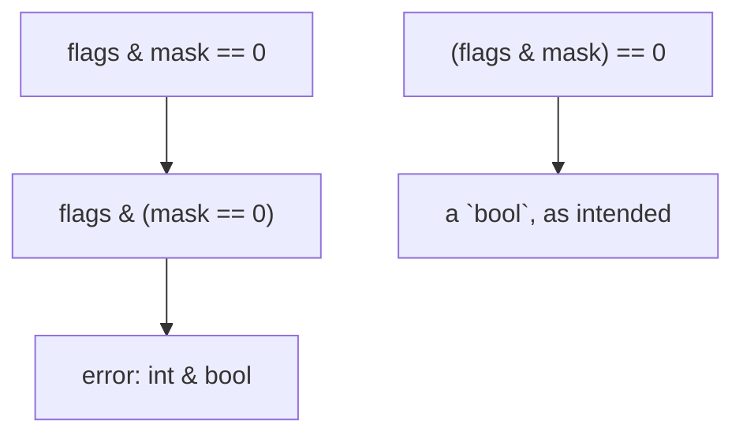

# Expressions

An _expression_ computes a value: a literal, a name, a call, or operators applied to other expressions. This chapter covers the operators; the values they work on are described with their [types](/docs/lang/types/overview).

```rux
let total = price * quantity + shipping;
let ready = count > 0 && !paused;
let label = if n % 2 == 0 { "even" } else { "odd" };
```

## Operators

| Kind                                                                  | Operators                                                |
| --------------------------------------------------------------------- | -------------------------------------------------------- |
| [Arithmetic](/docs/lang/expressions/arithmetic)                       | `+` `-` `*` `/` `%`, unary `-`, `+%` `-%` `*%`           |
| [Comparison](/docs/lang/expressions/comparison)                       | `==` `!=` `<` `<=` `>` `>=`                              |
| [Logical](/docs/lang/expressions/logical)                             | `&&` `\|\|` `!`                                          |
| [Bitwise](/docs/lang/expressions/bitwise)                             | `&` `\|` `^` `~`                                         |
| [Shift](/docs/lang/expressions/shift)                                 | `<<` `>>` `>>>`                                          |
| [Assignment](/docs/lang/expressions/assignment)                       | `=` `+=` `-=` … `>>>=`, `++` `--`                        |
| [Conditional values](/docs/lang/expressions/conditional)              | `if c { a } else { b }`                                  |
| [Value blocks](/docs/lang/expressions/conditional#plain-value-blocks) | `{ statements; value }`                                  |
| [Casts](/docs/lang/expressions/casts)                                 | `as`                                                     |
| [Type and pattern tests](/docs/lang/sums/type-tests)                  | `is`                                                     |
| [Ranges](/docs/lang/ranges/overview)                                  | `..` `..=`                                               |
| [Coalescing](/docs/lang/optionals/coalescing)                         | `??`                                                     |
| [Propagation](/docs/lang/optionals/propagation)                       | postfix `?`                                              |
| [Error forms](/docs/lang/errors/fallible-values)                      | postfix `!`, `x !! fallback`, `x !!;`, `x catch { … }`   |
| [Loans](/docs/lang/references/overview)                               | prefix `&` (lend for reading), `&var` (lend for writing) |
| [Pointers](/docs/lang/pointers/overview)                              | `@` (address of), unary `*` (dereference)                |

There is no unary `+` and no power operator; [Arithmetic](/docs/lang/expressions/arithmetic#no-power-operator) explains what `**` means instead.

## Precedence

When an expression mixes operators, _precedence_ decides how it groups: an operator on a higher level takes its operands before one on a lower level. Parentheses override precedence everywhere. Rux has 16 levels:

| Level | Operators                                                                                            | Associativity  |
| ----- | ---------------------------------------------------------------------------------------------------- | -------------- |
| 16    | postfix: `.field` `.0` `.Method()` `::Name` `Type { … }` `f<T>()` `f()` `a[i]` `x?` `x!` `x++` `x--` | left to right  |
| 15    | prefix: `!` `-` `~` `*` `@` `&` `&var` `++` `--`                                                     | right to left  |
| 14    | `as` `is`                                                                                            | left to right  |
| 13    | `*` `/` `%` `*%`                                                                                     | left to right  |
| 12    | `+` `-` `+%` `-%`                                                                                    | left to right  |
| 11    | `<<` `>>` `>>>`                                                                                      | left to right  |
| 10    | `<` `<=` `>` `>=`                                                                                    | left to right  |
| 9     | `==` `!=`                                                                                            | left to right  |
| 8     | `&`                                                                                                  | left to right  |
| 7     | `^`                                                                                                  | left to right  |
| 6     | `\|`                                                                                                 | left to right  |
| 5     | `&&`                                                                                                 | left to right  |
| 4     | `\|\|`                                                                                               | left to right  |
| 3     | `??`, `!!`, `catch { … }`                                                                            | right to left  |
| 2     | `a..b` `a..=b` `..b` `..=b` `a..` `..`                                                               | does not chain |
| 1     | `=` `+=` `-=` `*=` `/=` `%=` `+%=` `-%=` `*%=` `&=` `\|=` `^=` `<<=` `>>=` `>>>=`                    | right to left  |

Operators on one level group from the left where the table says so: `100 / 10 / 5` is `(100 / 10) / 5`, which is 2. `??` groups from the right, so `a ?? b ?? c` is `a ?? (b ?? c)`, and a chain `a !! b !! c` tries each in turn. A range does not chain: `0..1..2` does not parse.

A few entries need a word:

- **Postfix `?` and `!`.** A `?` written directly after an expression, with no space before it, is postfix [propagation](/docs/lang/optionals/propagation) of an optional's absence. A `!` written the same way passes the error of a call that can fail on, out of the function, and the expression continues with the success: `ReadDigit(t)! * 10 + ReadDigit(u)!` passes on each error in turn, and `Make()!.Read()!` continues on each success. Neither stands for the other: `ReadDigit(c)?` is `error: '?' does not propagate errors`, with `help: write '!' to pass the error on`. A `?` with whitespace before it would open the conditional operator `c ? a : b`, which Rux does not have; write an [`if` value](/docs/lang/expressions/conditional).
- **`!!` and `catch` take everything to their left.** They bind as loosely as `??`, so `base + ReadDigit(c) !! 0` is `(base + ReadDigit(c)) !! 0`, which adds a fallible to an `int` and is refused. Write `base + (ReadDigit(c) !! 0)`. Only the spaced `!!` replaces an error; `x!!` with no space is two postfix `!`. Mixed with `??`, one of them is parenthesized: `x !! none ?? 0` is `error: '!!' and '??' are mixed without parentheses`, with `help: group one of them, as in '(x !! none) ?? fallback'`. See [Fallible values](/docs/lang/errors/fallible-values).
- **Casts and tests take a type.** The right side of `as` is a type, not an expression, and so is the right side of `is` unless it starts as only a pattern can. It ends before `..` and `|`, so a sum target is grouped: `value is (A | B)`.
- **A fallback may leave.** The right side of `??` and of `!!` may be `throw`, `return`, `break`, `continue` or a call to `Panic` instead of a value; see [Coalescing](/docs/lang/optionals/coalescing).
- **Prefix `&` lends.** `&x` lends the place `x` for reading and `&var x` lends it for writing, as in `Bump(&var counter)` or `let alias = &counter;`. A loan never copies or moves the place, and it takes no address: a raw pointer comes from `@`. `&var` and `@` need a place: `&var Make()` is `'&var' lends a place for writing, but this is a temporary value`, and `@10` is `'@' takes the address of a place, but this is a temporary value`, while `&Make()` may lend a temporary to a call for reading. When a loan has to be written is described in [References](/docs/lang/references/overview).

## Consequences

Most of the order matches ordinary arithmetic and needs no thought: `2 + 3 * 4` is 14, and `age >= 18 && age < 65` compares before it combines. A few places are worth knowing by heart.

**Bitwise operators bind more loosely than comparisons.** `x & 1 == 0` is `x & (1 == 0)`, an integer and a `bool`:

```
error: operator '&' cannot combine left operand 'int32' with right operand 'bool8'
```

Write `(x & 1) == 0`.

**`as` binds more tightly than arithmetic.** It converts only the operand next to it, so `a as float64 / b as float64` converts both operands before dividing, and `(a / b) as float64` divides integers first. A prefix operator binds more tightly still: `-x as int64` is `(-x) as int64`.

**Shifts bind more loosely than `+` and `-`.** `1 << 2 + 1` is `1 << 3`, which is 8.

**`==` binds more tightly than `??`.** `value ?? 0 == 0` is `value ?? (0 == 0)`. Write `(value ?? 0) == 0`.

**`!!` reaches past `+`.** `total + Parse(text) !! 0` replaces the error of the whole sum, not of the call, and the sum of an `int` and a fallible is refused. Write `total + (Parse(text) !! 0)`, and `(Parse(text) !! none) ?? 0` to replace an error and an absence together.



## Evaluation order

Operands are evaluated from left to right, and so are the arguments of a call: in `Note(1) + Note(2) * Note(3)`, the three calls run in the order they are written, even though the multiplication happens first. `&&`, `||` and `??` evaluate their right side only when it is needed, and an `if` value evaluates only the branch its condition selects; see [Logical](/docs/lang/expressions/logical#short-circuit-evaluation) and [Conditional values](/docs/lang/expressions/conditional). Evaluation stops at the first `x!` whose operand fails: nothing to its right runs.

## Operand types

Rux never changes a value's type behind your back. The operands of a binary operator must agree on a type, by these rules:

| Operands                                         | Result                                      |
| ------------------------------------------------ | ------------------------------------------- |
| two values of one type                           | that type                                   |
| an unsuffixed integer literal and an integer     | the integer's type; the literal must fit it |
| two integers of one signedness, different widths | the wider type                              |
| a `float32` and a `float64`                      | `float64`                                   |
| any other pair of floating-point widths          | an error: convert one with `as`             |
| a signed and an unsigned integer                 | an error: convert one with `as`             |
| an integer and a floating-point value            | an error: convert one with `as`             |

```rux
let small: int32 = 1;
let big: int64 = 5000000000;
let sum = small + big;
let doubled = 2 * small;
```

`sum` is an `int64` and `doubled` an `int32`. Mixing signedness is refused with a note saying why:

```
error: operator '+' cannot combine left operand 'uint64' with right operand 'int64'
  note: the operands differ in signedness, so neither converts to the other's type
  help: convert one operand with 'as' to the type the operation should use
```

A literal that does not fit the other operand's type is an error rather than a silent wrap: with `count: uint64`, `count == -1` is `error: integer literal is out of range for type 'uint64'`.

## Statements and values

An assignment is an expression in the grammar but produces no value, so it cannot be used inside another expression; see [Assignment](/docs/lang/expressions/assignment). An expression followed by `;` is an [expression statement](/docs/lang/statements/overview).

## See also

- [Operators and punctuation](/docs/lang/lexical/operators): how the operator tokens are spelt
- [Statements](/docs/lang/statements/overview): where expressions are used
- [Operator interfaces](/docs/lang/interfaces/operators): giving your own types operators
- Learn: [Precedence](/docs/learn/precedence), [Arithmetic](/docs/learn/arithmetic)
